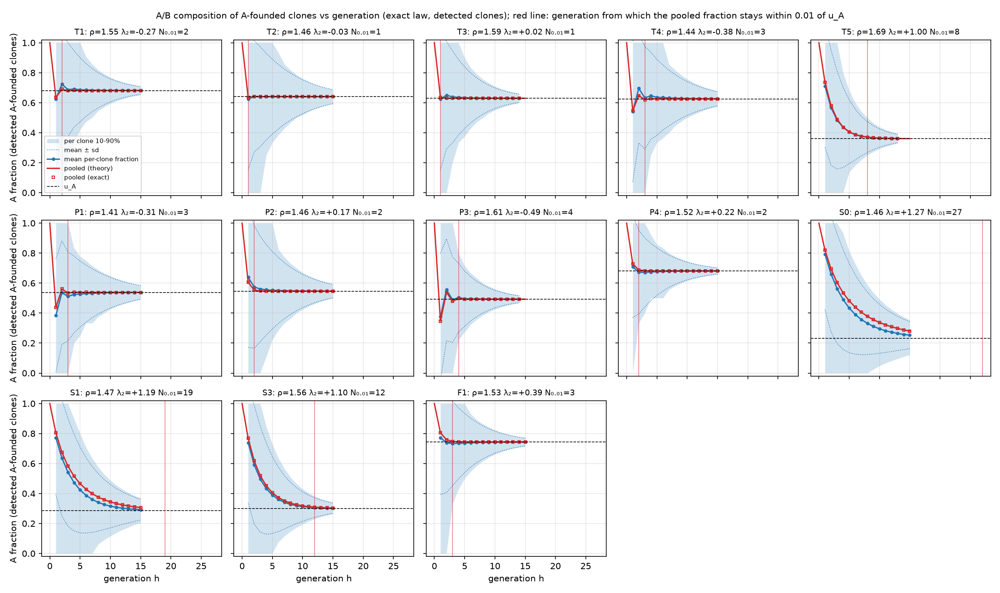
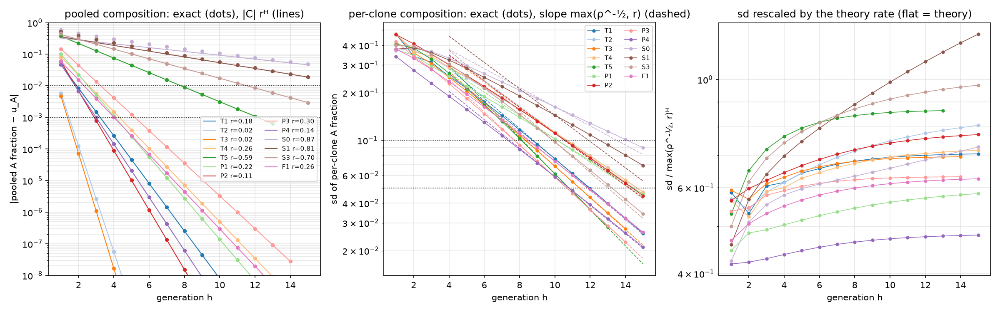
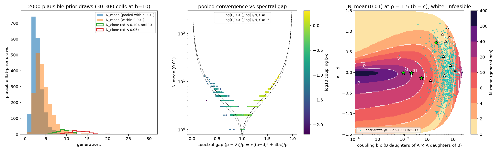
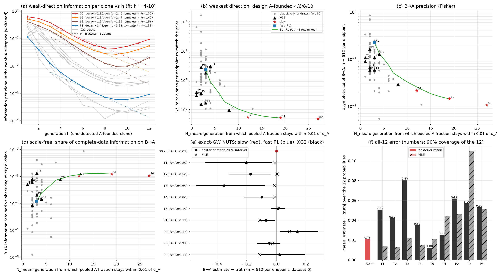

# When does the A/B composition of a clone converge? (exact two-type GW)

Question: in the exact two-type Galton–Watson model of the organoid clones (A = LGR5⁺,
B = KRT20⁺), after how many generations does the A/B composition of A-founded clones reach
its stable value? How fast do single clones scatter around it? What does a slowly converging
composition mean for inference of the interconversion rates?

## Short answer

* **The pooled composition converges geometrically, and the theory is exact.** The pooled A
  fraction of detected A-founded clones is f_h = E[A_h]/E[N_h]. It obeys
  f_h − u_A = C σ^h r^h / (1 + D σ^h r^h) exactly, with r = |λ₂|/ρ and σ = sign λ₂. This matches
  the iterated mean matrix to 10⁻¹⁶. For the 9 XG2 truths the pooled fraction stays within 0.01
  of u_A from generation **1–4** (T5: **8**) and within 0.001 from 2–6 (T5: 13). The leading-term
  formula N_ε ≈ log(|C|/ε)/log(1/r) is within one generation of the exact value.
* **Single clones converge more slowly, at the Kesten–Stigum rate.** In every XG2 truth and in
  every plausible prior draw λ₂² < ρ. The sd of the per-clone A fraction therefore shrinks by √ρ
  per generation: the exact law gives ×1.18–1.30 per generation against √ρ = 1.19–1.30 (within
  1.5%). That sd falls below **0.10 at generation 8–11** and below **0.05 at 11–15**. Example:
  T1 has sd 0.34, 0.25, 0.18, 0.12, 0.076 at h = 2, 4, 6, 8, 10, which reproduces the
  simulation. Within the XG2 window (generations 4–10) the pooled composition has converged for
  every XG2 truth except T5, but single clones have not (sd 0.06–0.11 at generation 10).
* **Slow pooled mixing is rare among plausible parameters.** Take 2000 flat-prior draws with
  30–300 expected cells at generation 10. The median of r is 0.17 and the median of N_mean(0.01)
  is 3 generations. The share with N_mean(0.01) above 4 / 10 / 20 generations is **12% / 0.5% /
  0%**; for N_mean(0.001) it is 39% / 2.4% / 0.15%. N_mean is set by r alone (Spearman 0.93).
  The single-clone convergence time N_clone is set by ρ (Spearman −0.90).
* **What makes mixing slow.** r → 1 in exactly two ways, because
  ρ − λ₂ = √((a − d)² + 4bc):
  1. **Small coupling b·c together with a ≈ d.** The two lineages are nearly independent and
     self-renew at the same rate. In practice this means rare dedifferentiation (c small, B→A ≲
     0.05) while KRT20⁺ cells self-renew about as fast as LGR5⁺ cells.
  2. **λ₂ → −ρ.** Neither type self-renews (a, d → 0) and the types alternate (b·c → ρ²). The
     composition oscillates.

  Among the 15 prior draws with N_mean ≥ 10, 10 are of the second (oscillating) kind. In the
  no-dedifferentiation limit c = 0 the matrix is reducible. Mixing is geometric with
  r = min(a, d)/max(a, d), and only polynomial (~1/h) when a = d: for a = 1.4, b = 0.3 the
  pooled fraction needs 462 generations to come within 0.01. With c = 0 forced, the prior
  draws have median N_mean 8; 35% exceed 10 and 15% exceed 20.
* **Slow mixing makes the interconversion easier to infer.** Along a path from a slow set (S1,
  B→A = 0.02, N_mean = 19) to a fast set with the same A row and the same growth (F1,
  B→A = 0.3, N_mean = 3):
  * The weakest direction of the XG2 design needs **51 instead of 2317 clones per endpoint**
    to match the prior.
  * The share of the complete-data information that the clone counts keep is **15× larger**
    along the worst direction and **10× larger** for B→A.
  * The dedifferentiation output c = B→A + 2·B→AA + B→AB (A daughters per B cell) is
    estimated with a relative sd of **10% instead of 29%** at n = 512.

  Across the plausible prior draws, slower mixing goes with fewer clones needed for the weakest
  direction (Spearman −0.42) and with a smaller relative sd of c (Spearman −0.65).
  **B→A itself is not easier in relative terms** (relative sd 0.43–1.06 for the slow sets
  against 0.74 for F1; Spearman −0.09): how c splits between switching (B→A) and dividing
  into A (B→AA, B→AB) remains a parent-swap-type weak direction. Exact-GW NUTS at n = 512
  (§3b) confirms this.
* **Practical readout.** Three signs show that the composition has not converged by generation
  10:
  1. The pooled A fraction still drifts between endpoints. At n = 512 per endpoint its SE is
     0.002–0.006. For the slow sets the drift from generation 8 to 10 is 3–4 SE and from 4 to
     10 is 10–13 SE (T5: 1.3 and 6.4 SE). For every other XG2 truth it is < 0.5 SE.
  2. All-B clones persist. P(all B) among detected A-founded clones is 0.03–0.12 at
     generations 8–10 for the slow sets, against ≤ 0.011 for every other set.
  3. The per-clone sd shrinks more slowly than √(clone-size growth): 0.92–0.94 of it for the
     slow sets against 0.98–0.99. This sign is weak.

  A composition that has not converged means two things together: KRT20⁺ → LGR5⁺ conversion is
  rare, and KRT20⁺ cells self-renew about as fast as LGR5⁺ cells. A converged composition does
  **not** prove interconversion. It is equally produced by fast interconversion or by very
  different growth rates (with c = 0 and d ≪ a, r = d/a is small).

## Theory (precise and compact)

Mean matrix M = [[a, b], [c, d]]. Here a and b are the expected A and B daughters of an A cell
per generation, and c and d those of a B cell
(`report_exact_gw/make_swap_theory.py`, `scripts/convergence/common.py`). Further notation:
Δ = √((a − d)² + 4bc), ρ = (a + d + Δ)/2 (Perron root), λ₂ = (a + d − Δ)/2,
r = |λ₂|/ρ = |1 − Δ/ρ|, and u the stable composition (left Perron vector,
u_A = c/(c + ρ − a)).

1. **Pooled composition.** Extinct clones add 0 to both A and N, so conditioning on
   detection cancels and f_h = (e_A M^h)_A / (e_A M^h)·1. Write e_A = α u + β w (left
   eigenvectors, u summing to 1). Then f_h − u_A = C σ^h r^h / (1 + D σ^h r^h) with
   C = β(w_A − u_A(w_A + w_B))/α and D = β(w_A + w_B)/α (`gap_amplitude`). Consequently
   N_ε ≈ log(|C|/ε)/log(1/r). The gap oscillates in sign when λ₂ < 0. The process must be
   primitive (bc > 0 and a + d > 0). The limit cases are:
   * a = d = 0: periodic, the composition never converges.
   * c = 0: reducible. ρ = max(a, d) and r = min(a, d)/max(a, d). If d > a, then u_A = 0 and
     the composition drifts to all B. If a > d, then u_A = (a − d)/(a − d + b).
   * c = 0 and a = d: a Jordan block, with f_h = a/(a + h b). Convergence is polynomial and
     N_ε ≈ a/(ε b).
2. **Per-clone composition (Kesten–Stigum).** On survival Z_h/ρ^h → W u, so X_h = A_h/N_h → u_A.
   The deviation of Z_h along the second eigenvector grows like ρ^{h/2} (a CLT) when
   λ₂² < ρ, and like |λ₂|^h when λ₂² > ρ. Hence X_h − u_A = O(ρ^{−h/2}) or O(r^h), with a
   log factor at λ₂² = ρ. The sd shrinks per generation by min(√ρ, 1/r).
3. **Link to inference.** Report §6.3 shows that the per-clone information on the parent-swap
   weak directions is proportional to the composition variance. It therefore falls like
   max(ρ^{−1}, r²) per generation, which is ρ^{−h} in the CLT regime. A slowly mixing
   composition keeps the "which parent" transient alive for longer and at a larger amplitude.

**Checks** (`tables/truths.md`, `figures/gap_sd_theory.png`):
* The exact pooled gap equals the closed form to 2·10⁻¹⁶ for all 13 sets.
* In the CLT regime the fitted sd shrink factor (h ≥ 6) is 0.6–1.6% below √ρ for all 9 XG2
  truths and F1.
* S0 lies in the λ₂² > ρ regime (λ₂²/ρ = 1.10). Its sd shrinks ×1.127 per generation, against
  1/r = 1.149. The rescaled sd in the right panel is still rising slowly, because ρ^{−1/2}
  (0.83) is close to r (0.87).
* S1 is near-critical (λ₂²/ρ = 0.97). Its sd shrinks ×1.158 against √ρ = 1.21, as expected
  from the log correction.
* The weak-4 Fisher information per clone (generations 4–10) decays ×1.46–1.71 per generation
  for the XG2 truths (ρ = 1.41–1.69), but ×1.30 for S0, where 1/max(ρ⁻¹, r²) = 1.32.

## 1. Exact per-clone composition of the XG2 truths

Method: exact law of one A-founded clone conditioned on detection (pgf/FFT, the
`gw_exact` law with no damping), h = 1…15. The grid holds P(N ≥ L | detected) ≤ 10⁻¹⁰ and is
capped at 5000²; T3 and P3 stop at h = 14 and T5 at 13. Captured mass equals 1 to 10⁻¹³.
Full per-generation table: `tables/by_generation.csv`.

| set | ρ | λ₂ | r | λ₂²/ρ | u_A | b·c | a−d | N_mean 0.01 | N_mean 0.001 | N_clone sd<0.10 | N_clone sd<0.05 | sd shrink/gen (exact) | √ρ or 1/r | sd h=4 | sd h=10 | cells h=10 |
|---|---|---|---|---|---|---|---|---|---|---|---|---|---|---|---|---|
| T1 | 1.554 | −0.274 | 0.176 | 0.05 | 0.681 | 0.544 | 1.08 | 2 | 4 | 9 | 12 | 1.243 | 1.247 | 0.255 | 0.076 | 101 |
| T2 | 1.461 | −0.031 | 0.021 | 0.00 | 0.640 | 0.340 | 0.93 | 1 | 2 | 11 | 15 | 1.191 | 1.209 | 0.288 | 0.113 | 63 |
| T3 | 1.586 | 0.024 | 0.015 | 0.00 | 0.630 | 0.469 | 0.75 | 1 | 2 | 9 | 12 | 1.256 | 1.259 | 0.251 | 0.069 | 124 |
| T4 | 1.438 | −0.378 | 0.263 | 0.10 | 0.626 | 0.640 | 0.86 | 3 | 5 | 11 | 15 | 1.191 | 1.199 | 0.290 | 0.113 | 49 |
| T5 | 1.694 | 0.996 | 0.588 | 0.59 | 0.360 | 0.112 | −0.19 | 8 | 13 | 9 | 11 | 1.295 | 1.301 | 0.267 | 0.061 | 211 |
| P1 | 1.405 | −0.314 | 0.223 | 0.07 | 0.538 | 0.731 | 0.17 | 3 | 5 | 11 | 15 | 1.176 | 1.185 | 0.255 | 0.102 | 40 |
| P2 | 1.462 | 0.167 | 0.114 | 0.02 | 0.547 | 0.418 | −0.08 | 2 | 3 | 11 | 15 | 1.200 | 1.209 | 0.301 | 0.111 | 64 |
| P3 | 1.608 | −0.489 | 0.304 | 0.15 | 0.493 | 1.099 | 0.05 | 4 | 6 | 8 | 11 | 1.266 | 1.268 | 0.229 | 0.058 | 128 |
| P4 | 1.517 | 0.219 | 0.144 | 0.03 | 0.681 | 0.383 | 0.39 | 2 | 3 | 8 | 11 | 1.227 | 1.231 | 0.190 | 0.059 | 86 |
| S0 | 1.460 | 1.270 | 0.870 | 1.10 | 0.231 | 0.009 | −0.01 | 27 | 43 | 15 | 20* | 1.127 | 1.150 | 0.332 | 0.163 | 92 |
| S1 | 1.469 | 1.191 | 0.811 | 0.97 | 0.287 | 0.019 | −0.02 | 19 | 30 | 13 | 18* | 1.158 | 1.212 | 0.323 | 0.144 | 85 |
| S3 | 1.563 | 1.097 | 0.702 | 0.77 | 0.300 | 0.049 | −0.14 | 12 | 19 | 10 | 14 | 1.234 | 1.250 | 0.304 | 0.098 | 116 |
| F1 | 1.527 | 0.393 | 0.257 | 0.10 | 0.743 | 0.192 | 0.72 | 3 | 5 | 9 | 12 | 1.230 | 1.236 | 0.236 | 0.074 | 89 |

\* extrapolated beyond h = 15 with the fitted shrink factor. N_mean is the generation from
which the pooled fraction stays within ε of u_A at every later h. N_clone(δ) is the first
generation from which the per-clone sd stays below δ. The "sd shrink/gen" column is the fit of
log sd over the last 6 generations with h ≥ 6.

Further observations (`figures/truths_composition.png`):
* The mean of the per-clone fractions is within 0.01–0.02 of the pooled fraction by h = 4 and
  within 0.01 by h = 6 for the XG2 truths and F1. For the slow sets it lies 0.03–0.05 below
  the pooled fraction at h = 4–10 (S0, S1), because persistent all-B clones pull it down.
* P(all A) falls below 0.01 at generation 6–11.
* P(all B) falls below 0.01 at generation 5–9 for the XG2 truths, F1 and S3. For S0 and S1 it
  does so only at generations 15 and 13 (0.07 and 0.03 at generation 10).




## 2. Map over plausible parameters

Setup: 2000 flat-prior draws, with the same stream and filter as the XG2 / optimal-design
prior draws (`PRIOR_SEED = 20261122`, 30–300 expected cells at generation 10, 2000 accepted
of 5515). N_mean comes from the closed form for all 2000 draws. N_clone comes from the exact law
for EXACT_N draws: every 10th draw, plus every draw with N_mean ≥ 9, with the grid capped at
2500² (h up to 12–15; beyond that, extrapolated with the fitted rate). Tables:
`tables/prior_draws.csv` and `tables/prior_summary.md`.

PRIOR_TABLE

**Drivers.**
* N_mean is a function of r alone (Spearman 0.93; the scatter in the middle panel is the
  amplitude C).
* r is not monotone in the coupling, because a large coupling with little self-renewal gives
  λ₂ < 0 (oscillation). Within the prior, b·c and |a − d| are therefore nearly uncorrelated
  with N_mean (Spearman 0.005 and −0.14).
* The map at fixed ρ = 1.5 (with b = c) shows both slow regions:
  * the small-coupling, a ≈ d corner (left);
  * the strong-alternation edge (right).

  The plausible prior draws (cyan) sit mostly in between. S0/S1/S3 were built in the left
  corner.
* N_clone is set by ρ (Spearman −0.90): every plausible draw is in the CLT regime, so the
  per-clone sd shrinks by √ρ.



## 3. Does slow mixing make inference easier?

**Sets** (`scripts/convergence/sets.py`; all entries interior, growth and clone sizes as in
XG2). In every set the A row puts ~0.55 on A→AA, 0.10–0.12 on A→AB and 0.10 on A→B.

| set | B row (death, to_A, persist, AA, AB, BB) | ρ | N_mean(0.01) | cells h=10 | meaning |
|---|---|---|---|---|---|
| S0 | 0.20, 0.01, 0.19, 0.005, 0.01, 0.585 | 1.46 | 27 | 79 | rare dedifferentiation, a ≈ d (λ₂² > ρ) |
| S1 | 0.20, 0.02, 0.18, 0.01, 0.02, 0.57 | 1.47 | 19 | 72 | as S0, twice the B→A |
| S3 | 0.15, 0.05, 0.12, 0.02, 0.04, 0.62 | 1.56 | 12 | 101 | B→A 0.05, B self-renews a little more |
| F1 | 0.20, 0.30, 0.10, 0.10, 0.10, 0.20 | 1.53 | 3 | 76 | S1's A row, frequent return to A (fast) |
| S1→F1 path | (1 − t) S1_B + t F1_B, t = 0…1 | 1.47–1.53 | 19 → 3 | 72–76 | matched growth and A row |

### 3a. Fisher information (prior-whitened, A-founded design 4/6/8/10)

Method: the same quantities as the weak-direction and optimal-design studies. The whitened
information is K = U^T I U / 42. 1/λ_k is the number of clones per endpoint at which the data
match the flat prior along the k-th weakest direction. The asymptotic sd is computed at
n = 512 per endpoint. "Retained" is the information of the clone counts relative to observing
every division outcome (complete data, the multinomial information per expected parent). It
is scale-free: it removes the 1/p growth of the Fisher information near the boundary, which
otherwise favours small-B→A truths. XG2 truths T1/T2/T4 use the ε = 0.01 variant, as in the
earlier studies. Full table: `tables/info.md`; per-generation values:
`tables/info_by_generation.csv`.

INFO_TABLE

What this shows:
* The weakest direction needs 48–55 clones per endpoint for the slow sets, against 2317 for F1
  and 96–2996 for the XG2 truths (T5, the slowest-mixing XG2 truth, has the lowest value at 96).
* Along the S1→F1 path, 1/λ_min rises monotonically as mixing speeds up: 51 → 2317. The
  retained fraction along the worst direction falls 15× (0.058% → 0.0038%).
* The late endpoints carry more of the weak-direction information in the slow sets: the share
  from generations 8 and 10 is 21–24%, against 6–15% for the XG2 truths and F1.
* The gain is in the coupling c (relative sd 10–13% for S0/S1, 29% for F1), not in B→A
  separately (relative sd 1.06 / 0.72 / 0.43 for S0/S1/S3, 0.74 for F1).

### 3b. Exact-GW NUTS + MLE at n = 512

Setup:
* NUTS: `bio-sbi -m +experiment=exact_gw_data_size +truths.<set>=... gt=<set>
  design.clones=512 seed=<s> inference.method.kernel=adjoint
  inference.method.stop.enabled=true` (`scripts/convergence/run_nuts.sh`, truths in
  `truths.sh`), datasets 0–2 for each set.
* MLE: `scripts/exact_gw_mle.py`. Standard errors: `scripts/exact_gw_mle_se.py`.
* Comparison: the XG2 n = 512 runs (report §7; these used the older fixed-length sampler).

NUTS_TABLE



## 4. Practical readout

All numbers use the exact law at n = 512 clones per endpoint (`tables/readout.md`):

READOUT_TABLE

How to tell from data whether the composition has converged within the observation window:

1. **Pooled A fraction against generation.** Plot ΣA/ΣN per endpoint with its ratio-estimator
   SE, sqrt(Var(A − f N)/n)/E[N]; at n = 512 this is 0.002–0.006.
   * A drift between the last two endpoints of more than ~2–3 SE means the composition has not
     converged (S0/S1/S3: 2.7–4.1 SE between generations 8 and 10).
   * With 4 endpoints, the ratio of successive differences estimates r² (for λ₂ > 0). Fitting
     f_h = u + C r^h then extrapolates u_A.
   * A sign change between endpoints means λ₂ < 0 (alternating types).
2. **Spread against generation.** On a log scale, the per-clone sd of the A fraction should
   fall by √ρ per generation, where ρ² is the growth of the mean clone size over two
   generations.
   * A clearly slower fall means λ₂² > ρ, i.e. a slowly mixing composition.
   * This sign is weak: 0.92–0.94 of √growth for the slow sets against 0.98–0.99, and the
     sampling noise in the sd ratio is of similar size at n = 512.
3. **All-B clones among A-founded clones.** Without a return to A, a clone that has lost its A
   lineage stays all B. P(all B) at generations 8–10 therefore stays high (0.03–0.12 for the
   slow sets). With frequent return to A it decays to < 0.01 (every other set). This is the
   most direct sign of rare KRT20⁺ → LGR5⁺ conversion.

**What an unconverged composition says about LGR5⁺ ↔ KRT20⁺ interconversion.** A pooled
fraction still drifting at generation 10 with ρ ≈ 1.5 requires a small spectral gap,
Δ/ρ = √((a − d)² + 4bc)/ρ ≲ 0.3 (or ≳ 1.7, the alternating case). In biological terms:
* KRT20⁺ → LGR5⁺ output is small (c ≲ 0.1 A daughters per KRT20⁺ cell when b ≈ 0.3).
* KRT20⁺ cells self-renew almost as fast as LGR5⁺ cells (|a − d| ≲ 0.3). They are not a
  short-lived terminal state.

Such a dataset is good news for inference: the coupling c is then measurable to ~10%
relative precision at n = 512 per endpoint. Whether c comes from switching (B→A) or from
dividing into A (B→AA, B→AB) stays weakly identified.

A composition that has converged by generation 4–6 (every XG2 truth except T5, 99.5% of the
plausible prior) says only that the spectral gap is large. That can come from frequent
interconversion or from very different growth of the two types. It is not evidence for
dedifferentiation, and then the interconversion has to be read from the weak directions,
which need hundreds to thousands of clones per endpoint (report §6.3, §8).

## Files

Scripts (`scripts/convergence/`):
* `common.py`: spectrum, the exact pooled formula, N_mean, the exact clone law and composition
  statistics.
* `sets.py`, `truths.sh`: the parameter sets.
* `compute_exact.py`: exact per-clone composition (truths, sets, prior draws).
* `compute_info.py`: Fisher information of the sets and the S1→F1 path.
* `analyse_exact.py`: parts 1–2.
* `analyse_slow_fast.py`: part 3.
* `readout.py`: part 4.
* `run_nuts.sh`, `nuts_jobs*.txt`: the NUTS runs.

Results (`/home/matteo/BIO-SBI/results/exact_gw/convergence/`):
* `exact/<set>.json`: per-generation composition.
* `info/<set>.npz`: whitened information, generations 1–12.
* `nuts/<set>/n512_s<seed>/`: NUTS runs with `mle.json`.
* `logs/`.

The XG2 / prior-draw information is reused from `results/exact_gw/optimal_design/info`.

Reproduce (repository root, ≤ 10 threads):

```
python scripts/convergence/compute_exact.py --workers 2            # truths, sets, 200 prior draws
python scripts/convergence/compute_exact.py --only prior --prior 2000 --workers 2
python scripts/convergence/compute_info.py --workers 2
python scripts/convergence/readout.py
scripts/convergence/run_nuts.sh scripts/convergence/nuts_jobs.txt   # + nuts_jobs_seeds.txt
python scripts/exact_gw_mle.py results/exact_gw/convergence/nuts --workers 8
python scripts/exact_gw_mle_se.py results/exact_gw/convergence/nuts --workers 8
python scripts/convergence/analyse_exact.py
python scripts/convergence/analyse_slow_fast.py
```
