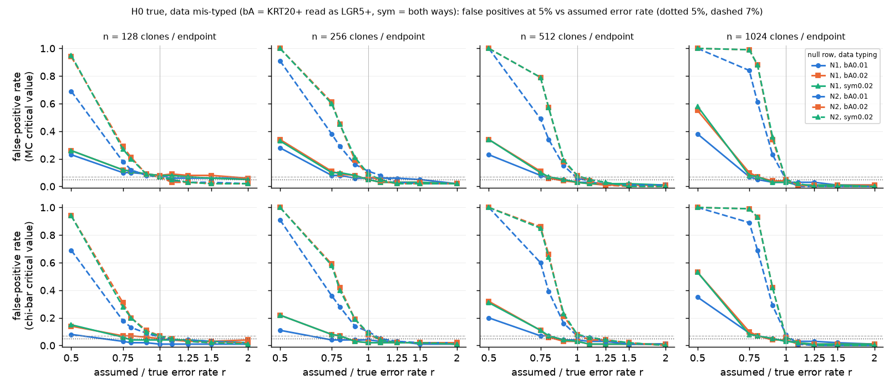
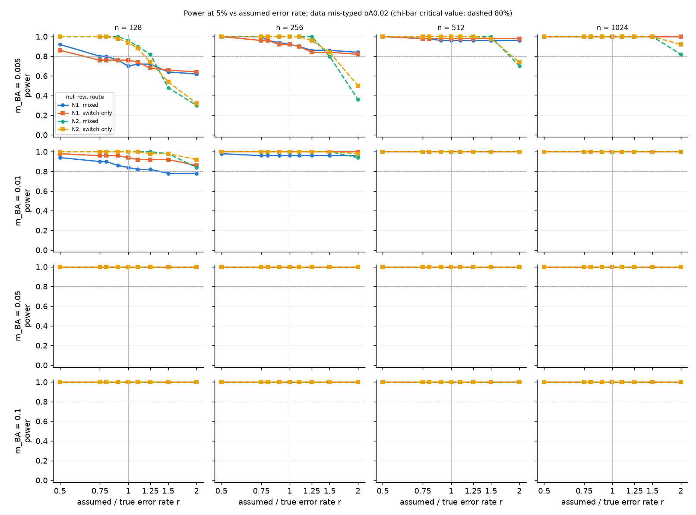
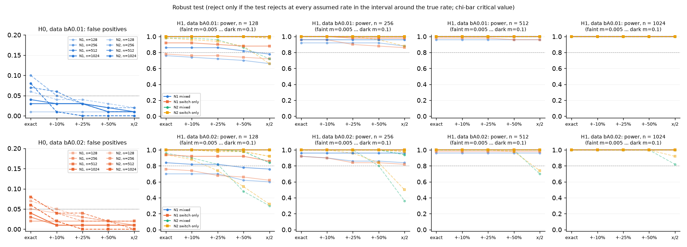

# Testing for dedifferentiation (B gives rise to A) with the exact GW likelihood

**Question for the wet lab.** Can KRT20⁺ cells (B) give rise to LGR5⁺ cells (A) at all, by any route?
Here: a likelihood-ratio test on organoid endpoint counts under the two-type Galton–Watson
model, its calibration, its power, and its sensitivity to cell-typing errors.
Study run 2026-11-18/19 (≈ 4.5 h, 16 workers); results in
`results/exact_gw/dediff_test/` (`summary/tables.md`, `summary/*.csv`); figures in
`figures/`. Code: `src/bio_sbi/inference/dediff_lrt.py`, scripts `scripts/dediff_test/`,
tests `tests/test_dediff_lrt.py` (14 pass). Follow-up "how precisely must the error rate be
known?" (ratio study, 2026-11-19/20, ≈ 10.7 h, 16 workers): [section below](#how-precisely-must-the-mis-typing-rate-be-known),
results in `results/exact_gw/dediff_test/typing_ratio/` (`summary/tables.md`).

## The test
- **H0 (no dedifferentiation):** B→A = B→AA = B→AB = 0 (B may die, persist, or divide into B+B).
- **H1:** at least one > 0. Effect size **m_BA = B→A + 2·B→AA + B→AB** — A cells produced by one
  B cell per generation.
- **Statistic:** Λ = 2[ℓ(full) − ℓ(H0)] ≥ 0, both maximised on the exact likelihood (adjoint
  kernel) with a multistart that includes θ̂₀, small steps along each route, pinned B→A starts and
  warm starts from the next smaller n. The full model's first B-row stick is the total
  dedifferentiation mass q, so H0 is exactly the face q = 0.
- **Calibration:** Monte-Carlo null (known H0 truth), parametric bootstrap from θ̂₀ (what one
  does with real data), and the boundary chi-bar-squared mixture with weights from the observed
  information at θ̂₀ (plus the textbook binomial(3,k)/8 weights and plain χ²₃).
- **Run on a dataset:** `uv run python scripts/dediff_test/run.py data counts.csv --reps 200
  [--confusion 0.02 --typing-kind b_as_a]` (CSV columns `horizon,A,B`, horizons in
  generations; prints Λ, m̂_BA, chi-bar / binomial / χ²₃ / bootstrap p-values).
- **Error rate known only to an interval** (robust test): `... run.py data counts.csv --reps 200
  --confusion-interval 0.015 0.025 [--interval-points 5 --typing-kind b_as_a]` runs the test at
  equally spaced assumed rates over the interval and reports the most conservative result
  (smallest Λ, largest p-value of each kind; `dediff_lrt.robust_test`). It rejects only if the
  test rejects at every rate in the interval, which keeps the level whenever the true rate is
  in the interval. In practice it decides like the test at the upper end of the interval
  (≥ 99.9% of the simulated datasets).

## Design of the study
A row = reference (death .03, persist .03, to_B .05, A→AA .55, A→AB .05, A→BB .29). Null B rows:
N1 death .2 / persist .8; N2 death .1 / persist .5 / B→BB .4; N3 death .5 / persist .5;
N4 death .2 / persist .3 / B→BB .5. Alternatives on N1 and N2 with m_BA ∈ {0.0025, 0.005, 0.01,
0.02, 0.05, 0.1, 0.2, 0.4} by three routes (switch only, B→AB only, mixed). Generations
{4, 6, 8, 10}, n ∈ {128, 256, 512, 1024} clones per endpoint (nested datasets). 200 datasets
per null cell, 50 per alternative cell (10 for m ≥ 0.1), 100 per mis-typing cell.

## Results

### Calibration (false-positive rate at nominal 5%)
| null | 95% critical value, Monte Carlo (n = 128–1024) | chi-bar² (obs. information) | size, chi-bar² | size, binomial weights (5.43) | size, χ²₃ (7.81) | Λ = 0 |
|---|---|---|---|---|---|---|
| N1 | 1.9–3.4 | 3.3–3.5 | 1.0–5.5% | 0–3.5% | 0–2.5% | 65–77% |
| N2 | 3.0–4.1 | 3.7–3.9 | 3.5–6.0% | 1.0–3.0% | 0.5–1.0% | 48–59% |
| N3 | 4.1–4.8 | 3.8–4.2 | 5.0–6.5% | 1.0–3.5% | 0–1.5% | 25–36% |
| N4 | 2.3–3.6 | 3.6–3.9 | 2.5–5.5% | 1.5–2.5% | 0.5–1.5% | 44–52% |

- The **chi-bar² mixture with weights from the observed information** is close to nominal
  (1–6.5%). The textbook binomial weights and χ²₃ are conservative.
- The null distribution **depends on B's other outcomes**: using another null row's Monte-Carlo
  critical value gives up to 16% false positives. Calibrate per dataset (bootstrap or chi-bar²
  from the dataset's own fit), not with one fixed number.
- **Parametric bootstrap** (15 datasets × 100 replicates at n = 128 and 1024): median bootstrap
  critical values 1.5–4.0, close to the Monte-Carlo values except N1 at 1024 (2.3 vs 3.4) and
  N3 at 128 (3.2 vs 4.5); size with bootstrap critical values 5–11% — roughly calibrated, a little
  liberal at small n.
- Optimisation: in 3200 null fits no missed optimum was detected.

### Power
- **The test is extremely sensitive when typing is perfect.** Minimum detectable m_BA at 80%
  power: ≤ 0.0025–0.004 for every route at n = 128 (N1), ≤ 0.0025 for n ≥ 256 and for N2 at all
  n (`summary/tables.md`, `figures/power_mc.png`). At m_BA = 0.05, Λ is ≈ 80 at n = 128 and
  ≈ 670 at 1024.
- **Why:** the evidence comes from rare clones that are almost impossible without
  dedifferentiation (e.g. a clone with a single A cell and no B cell at generation 8 has
  log p ≈ −15 under H0); their score contributions are extremely heavy-tailed.

### Mis-typing (H0 true, LGR5/KRT20 classification errors in the data)
| analysis | false-positive rate at 5% (0.5–5% errors, n = 128–1024) |
|---|---|
| errors ignored | **75–100%** (already 75–100% at 0.5% "B read as A") |
| model assumes half the true error rate | **21–100%** |
| true confusion matrix in the model | 1–13% (3–11% from n = 256; nominal 5%) |

The same rare clones that give the test its power are created by a single mis-typed cell
(one B read as A turns a common clone into an "impossible" one). **The detectable effects
(m_BA ≈ 0.003) are far below any realistic typing error rate, so the test is only as good as the
model of typing errors.**

### How precisely must the mis-typing rate be known?
**Design (ratio study).** Data mis-typed with true rate e (KRT20⁺ read as LGR5⁺, `b_as_a`,
e = 1% and 2%; under H0 also symmetric 2%), analysed with the confusion matrix at the
*assumed* rate r·e, r ∈ {0.5, 0.75, 0.8, 0.9, 1, 1.1, 1.25, 1.5, 2} (r = 0, errors ignored,
reused from `typing/`). H0: null rows N1, N2, 100 datasets per cell. H1: N1/N2 × route (mixed,
switch only) × m_BA ∈ {0.005, 0.01, 0.05, 0.1} × e, 50 datasets per cell. Generations 4/6/8/10,
n = 128–1024 (nested); the clones are those of the null / alternative datasets with the same
seed (mis-typing from its own random stream). 81,600 LRTs, 7.4 s each, 10.7 h on 16 workers,
no failures; no reduction of the planned grid. Critical values: MC = 95% quantile of the
perfectly typed null of the same row and n (as above); chi-bar = per-dataset, from that
analysis's own H0 fit. Code: `run.py ratio`, `analyse_ratio.py`, `queue_ratio.sh`; figures
`figures/ratio_*.png`.

**False positives (H0) against the assumed rate** — range over e ∈ {1%, 2% bA, 2% sym} and
n = 128–1024 (chi-bar; the MC critical value gives the same picture, `summary/tables.md`,
but is more liberal for N1 at n = 128: 5–9% at every r ≥ 0.9, 23–26% at r = 0.5):

| r = assumed / true | 0 (ignored) | 0.5 | 0.75 | 0.8 | 0.9 | **1** | 1.1 | 1.25 | 1.5 | 2 |
|---|---|---|---|---|---|---|---|---|---|---|
| N1 (B persists) | 92–100% | 8–53% | 3–11% | 2–7% | 2–6% | **1–5%** | 1–4% | 1–4% | 1–3% | 1–4% |
| N2 (B self-renews) | 100% | 69–100% | 18–99% | 13–93% | 9–42% | **6–10%** | 1–6% | 0–4% | 0–3% | 0–2% |

- **Under-estimating the rate is dangerous, over-estimating is safe.** With self-renewing B
  (N2: more B cells, so more mis-scored ones) assuming 10% less than the true rate already gives
  9–42% false positives (14–42% for n ≥ 256), 20–25% less gives 13–99%; the damage grows with
  n (more clones = more mis-typed cells to explain). Assuming more than the true rate never
  gives more than 6% (chi-bar).
- Even the exact rate is slightly liberal for N2 (6–10%); r = 1.1 brings it to nominal (1–6%).

**Power (H1, data mis-typed the same way)** — smallest power over N1/N2 and both routes
(chi-bar, %; perfect typing on the same clones: m_BA = 0.005: 92/98/98/100, ≥ 96 for larger m):

| e | m_BA | n | r = 0.5 | 0.75 | 0.9 | **1** | 1.1 | 1.25 | 1.5 | 2 |
|---|---|---|---|---|---|---|---|---|---|---|
| 1% | 0.005 | 128 / 256 / 512 / 1024 | 86/98/100/100 | 80/92/98/100 | 80/92/98/100 | **76/92/96/100** | 74/92/96/100 | 74/90/96/100 | 72/90/96/100 | 66/88/96/100 |
| 1% | 0.01 | 128 / 256 / ≥ 512 | 92/98/100 | 88/98/100 | 86/96/100 | **86/96/100** | 86/96/100 | 86/96/100 | 82/96/100 | 78/96/100 |
| 2% | 0.005 | 128 / 256 / 512 / 1024 | 86/100/100/100 | 76/96/98/100 | 76/92/96/100 | **70/92/96/100** | 72/90/96/100 | 68/84/96/100 | 48/80/96/100 | 30/36/70/82 |
| 2% | 0.01 | 128 / 256 / ≥ 512 | 94/98/100 | 90/96/100 | 86/96/100 | **84/96/100** | 82/96/100 | 82/96/100 | 78/96/100 | 78/94/100 |
| 1–2% | ≥ 0.05 | all | 100 | 100 | 100 | **100** | 100 | 100 | 100 | 100 |

- Real dedifferentiation is *not* easily explained away as mis-typing: Λ falls only slowly with
  the assumed rate (the clones dedifferentiation creates — LGR5⁺ cells that keep dividing
  inside B-derived clones — presumably do not look like isolated mis-scored cells). Only the smallest
  effect (0.005, i.e. 5 A cells per 1000 B cells per generation) at the higher error rate (2%)
  loses power once the rate is over-estimated by 50% or more at n ≤ 512.
- Modelling the true error costs little power relative to perfect typing (m_BA = 0.005: 76–100%
  vs 92–100%; ≥ 0.01: ≥ 84% vs ≥ 96%).

(`ratio_power_bA0.01*.png`: 1% errors; `*_chibar` / without suffix: chi-bar / MC critical value.)

**Tolerance window** [r_min, r_max]: false positives ≤ 7% for every r ≥ r_min and power ≥ 80%
for r_min ≤ r ≤ r_max (2 = edge of the grid). Most restrictive over N1/N2 and both routes,
chi-bar (`summary/tolerance_worst.csv`; MC critical value in parentheses where it differs):

| m_BA | e | n = 128 | 256 | 512 | 1024 |
|---|---|---|---|---|---|
| 0.005 | 1% | none (power 76% at r = 1) [MC: 1.1–1.5] | 1.1–≥2 (MC 1.25–≥2) | 1–≥2 | 1.1–≥2 (MC 1–≥2) |
| 0.005 | 2% | none (power 70% at r = 1) | 1.1–1.5 | 1.1–1.5 | 1–≥2 (MC 1–1.5) |
| 0.01 | 1% | 1–1.5 (MC 1.1–≥2) | 1.1–≥2 (MC 1.25–≥2) | 1–≥2 | 1.1–≥2 (MC 1–≥2) |
| 0.01 | 2% | 1–1.25 (MC 2–2) | 1.1–≥2 | 1.1–≥2 | 1–≥2 |
| ≥ 0.05 | 1–2% | 1–≥2 (MC 1.1–≥2 / 2 at e = 1 / 2%) | 1.1–≥2 (MC 1.25 at e=1%) | 1–1.1 to ≥2 | 1–1.1 to ≥2 |

The lower edge is always **r ≈ 1–1.1** (1.25 with the MC critical value at n = 256, e = 1%; at
n = 128, e = 2% the MC critical value of N1 is a little liberal at every r, 6–9%, hence its
2.0); the upper edge is ≥ 2 except for m_BA ≤ 0.01 at small n. The window is strongly
asymmetric: **at most ~0–10% too low, up to +50–100% too high.**

**Robust test** (interval of assumed rates around the true rate; reject only if every grid
rate in the interval rejects) — false-positive rate, worst null row / error rate (chi-bar; MC in
parentheses), and smallest power over rows and routes for the weakest effects (chi-bar):

| interval of r | FPR, n = 128 / 256 / 512 / 1024 | power m_BA = 0.005, e = 1% | e = 2% | power m_BA = 0.01, e = 2% |
|---|---|---|---|---|
| exact (1) | 7 / 10 / 8 / 8% (8 / 11 / 8 / 5) | 76/92/96/100 | 70/92/96/100 | 84/96/100/100 |
| ±10% (0.9–1.1) | 5 / 5 / 6 / 3% (8 / 8 / 5 / 3) | 74/92/96/100 | 70/90/96/100 | 82/96/100/100 |
| ±25% (0.75–1.25) | 4 / 3 / 4 / 3% (7 / 6 / 3 / 3) | 72/90/96/100 | 68/84/96/100 | 82/96/100/100 |
| ±50% (0.5–1.5) | 3 / 2 / 2 / 2% (7 / 5 / 2 / 1) | 70/88/96/100 | 48/80/96/100 | 78/96/100/100 |
| factor 2 (0.5–2) | 2 / 2 / 1 / 1% (6 / 2 / 1 / 1) | 66/86/96/100 | 30/36/70/82 | 76/94/100/100 |

For m_BA ≥ 0.05 the robust test has 100% power for every interval. Because false positives fall
and power changes little as r grows, the robust test is in effect the test at the upper end of
the interval (same decision in ≥ 99.9% of datasets); its value is that it needs only an *upper*
bound on the error rate to be valid.

**Conclusion for the wet lab.** *The KRT20⁺→LGR5⁺ mis-scoring rate must be measured so that it
is not under-estimated: an upper confidence limit on it is what the test needs.* Concretely:
measure the rate to within about **±25% (relative)** and run the test at the upper end of that
interval (or with `--confusion-interval`). Then false positives stay ≤ 4% (chi-bar; ≤ 7% with
the MC value), and with 256 clones per endpoint the test still detects 5 A cells per 1000 B
cells per generation with ≥ 84% power (≥ 96% at 512) and m_BA ≥ 0.01 with ≥ 96% power. With
only ±50% precision the test stays valid (≤ 3% false positives) but at a 2% error rate the
smallest effect (0.005) is detected with 48% / 80% / 96% power at 128 / 256 / 512 clones per
endpoint. A point estimate used as if exact is acceptable
only if it is not more than ~5–10% below the truth; 20% below already gives up to 93% false
positives when B cells self-renew. As a rule of thumb, ±25% relative precision on a rate e
(95% binomial interval) requires observing ≈ 60 mis-scored cells, i.e. ≈ 3,000 scored KRT20⁺
cells of known identity at e = 2% (≈ 6,000 at 1%); ±50% needs ≈ 15 mis-scored cells (≈ 800 /
1,500).

### Real data (CRC0322, 2D, days 6/10 = generations 6/10, 165 + 101 organoids)
Λ = 45.1, bootstrap p = 0.005 (smallest possible with 200 replicates), m̂_BA = 1.35 with an odd
full-model fit (A mostly makes B+B; B→A 0.51, B→AA 0.42; one start reached it). **Not evidence**:
typing errors are not modelled, and the real organoids showed fate heterogeneity and density
dependence that the homogeneous model lacks.

## Recommendations for the wet lab
1. **Measure the LGR5/KRT20 confusion matrix** — above all the probability that a KRT20⁺ cell is
   scored LGR5⁺ — on the same assay (e.g. sorted pure populations, or double staining), to about
   ±25% (≈ 60 mis-scored cells observed) and **analyse at the upper end of its confidence
   interval** (`--confusion-interval`): under-estimating it by 10–25% gives up to 42–99% false
   positives, over-estimating it by up to 50% costs little power (ratio study above).
2. **Clone numbers are not the bottleneck**: with correct typing, a few hundred clones per
   endpoint detect m_BA ≈ 0.005.
3. **A direct experiment is more robust**: organoids founded by sorted single KRT20⁺ cells (B
   founders), followed at early time points; any LGR5⁺ progeny with a validated marker is direct
   evidence, and the exact GW supports B founders for sizing it.
4. **Before applying the test to real data**, check robustness to organoid-level fate
   heterogeneity (it could create "impossible" clones like mis-typing does) — untested.

## Limitations
Homogeneous Galton–Watson model (discrete generations, no heterogeneity, no density dependence);
alternatives built on two null rows only; bootstrap on 15 datasets per cell. Ratio study: the
true confusion has the assumed *form* (only its rate is wrong); a mis-typing that depends on the
clone (e.g. on its size or density) is untested; tolerance windows rest on 100 (H0) / 50 (H1)
datasets per cell, so single grid points are uncertain by about ±3 (FPR) / ±7–14 (power)
points.
