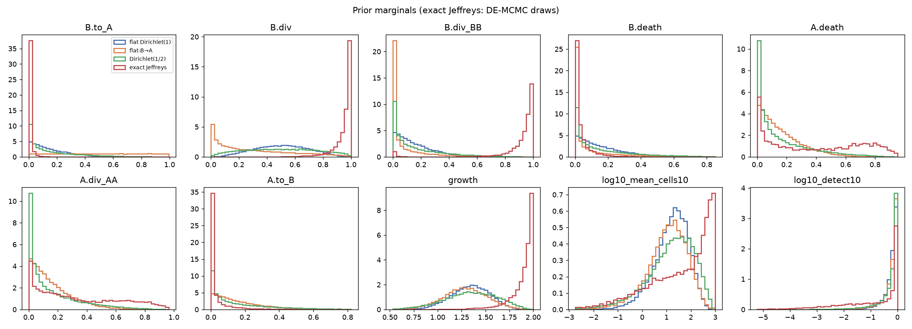
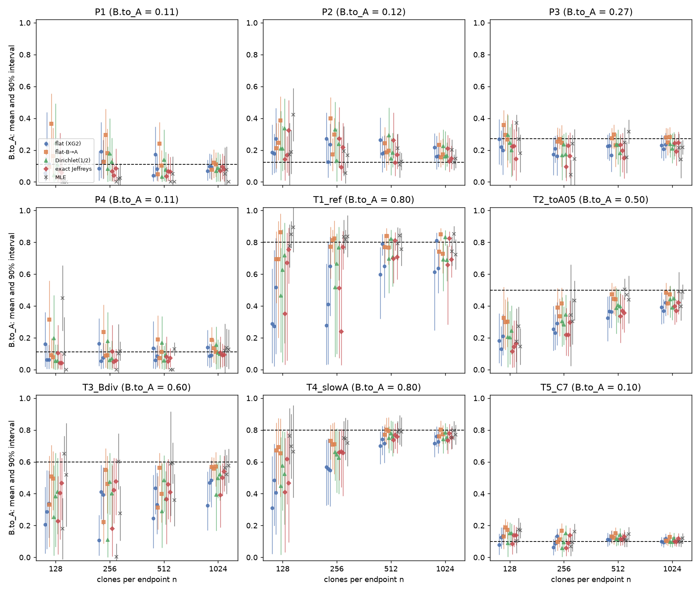
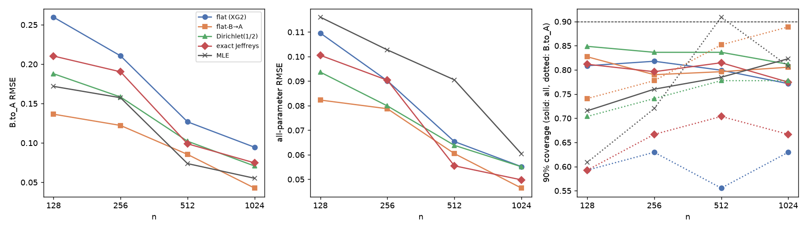

# XG2 under the exact Jeffreys prior (and Dirichlet(1/2))

Question: XG2 (exact GW likelihood, two-type model with all 10 transitions free,
generations 4/6/8/10, n = 128...1024 clones per endpoint, 9 truths x 3 datasets) showed
that B.to_A is pulled toward the prior under the flat Dirichlet. Does an "uninformative"
prior remove that pull, and at which n do the priors stop mattering?

Five arms on the same 108 datasets:

| arm | what | source |
|---|---|---|
| flat (XG2) | Dirichlet(1) on both rows, NUTS, 500 draws/chain | `results/exact_gw/data_size` |
| flat-B→A | A flat; B row Dirichlet(to_A 1, others 0.2), B.to_A ~ U(0,1) | `results/exact_gw/data_size_flat_btoa` |
| Dirichlet(1/2) | symmetric Dirichlet(1/2) on both rows (`prior=jeffreys` in the preset), NUTS with stopping rule | `results/exact_gw/data_size_jeffreys/dir_half` |
| exact Jeffreys | p_J ∝ sqrt(det I(θ)) of *this* model and design; Dirichlet(1/2) draws PSIS-reweighted, reruns where needed | `.../data_size_jeffreys/jeffreys`, `.../jeffreys_rerun` |
| MLE | XG2 `mle.json` (Wald 90% intervals from the observed information where they exist) | `results/exact_gw/data_size` |

Dirichlet(1/2) is the Jeffreys prior of a single, fully observed multinomial row. It is
**not** the Jeffreys prior of this model, where clone counts aggregate many divisions over
several generations. Here it is an arm of its own and the proposal for the exact Jeffreys
posterior.

## 1. The exact Jeffreys prior

**Construction** (`src/bio_sbi/inference/gw_fisher.py`). For one clone observed at
generation h (counts (A, B), conditioned on detection, perfect typing),

    I_h(θ) = Σ_{c ≠ (0,0)} p̃_c s_c s_cᵀ,   p̃_c = p_c / q,   s_c = ∂p_c/p_c − ∂q/q,

where p and ∂p/∂θ come from the exact pgf/FFT law with forward-mode derivatives
(`gw_exact.law_and_jac`), and q = P(detected) and ∂q come from the complement-form
recursion (`detection_and_grad`). The design's information is Σ_h n_h I_h. With equal n
per endpoint, n only multiplies the matrix, so the prior is the same for every n:
p_J(θ) ∝ sqrt(det Σ_{h∈{4,6,8,10}} I_h(θ)).
θ = the stick-breaking coordinates the samplers use (5 sticks per row, 10 in total).
Jeffreys is invariant, so a density in θ is the right object to compare with the
Dirichlet densities in θ (which include the stick Jacobian).

**The sum runs over the whole law, not only observed counts.** The clone total N = A + B
is at most 2^h. Its exact law is a cheap 1-D FFT. The square grid L x L is the smallest
5-smooth size with P(N ≥ L | detected) ≤ 1e-12, capped at the full support, so missed or
aliased mass is ≤ 1e-12. There is no damping, so round-off is about 1e-16 absolute. Cells
with p̃ ≤ 1e-14 or unconditional p ≤ 1e-13 are left out (reported as `omitted_mass`:
≤ 1e-10 at the posterior draws, ≤ 4e-10 on the boundary rays). Where P(detected at any
horizon) < 1e-6 the conditional law is round-off, so the density is set to 0. This is the
likelihood's own `min_detection` floor, and it makes the prior a Jeffreys prior restricted
to clones that are detectable at all (see propriety below). A fused numba.cuda kernel does
the batched GPU evaluation (about 0.05-0.1 s per θ on the RTX A1000, against 0.4-0.85 s on
one CPU thread). It agrees with the CPU code to about 1e-12 in log det.

**Validation** (`tests/test_gw_fisher.py`, fast):
- Known case: one generation from one A cell. With all clones kept, the A block equals the
  multinomial Jᵀ diag(1/p) J and Jeffreys equals Dirichlet(1/2) in sticks, up to a
  constant. With detected clones it equals the 5-outcome multinomial renormalised by
  1 − death. The B block is zero (B is not identified).
- The score dp̃/p̃ matches central finite differences (rel. 1e-5). The information equals
  the p̃-weighted outer product of these scores.
- Monte Carlo: E[s sᵀ] over 40 000 simulated detected clones agrees with I within 5 MC
  standard errors, and E[s] = 0.
- The adaptive grid agrees with the full-support grid (rel. 1e-7). The 1-D law of N sums
  to 1.
- Positive definite at random interior points. The Dirichlet density in θ is checked
  against scipy times |dP/dθ|. The batched torch path equals numba.
- Undetectable parameters give log p_J = −∞.
- At the highest-density points the prior sampler visited, log p_J does not change with a
  2x larger (full-support) grid or with floors 100x lower.

**Behaviour at the boundary and propriety** (`scripts/jeffreys/jeffreys_prior.py profiles`,
`tables/boundary_profiles.json`). The rays run from two interior points (T3 truth and the
uniform row), with one outcome → 0 (face) or one outcome → 1 (vertex), for ε = 1e-1 ... 1e-8.
The density is taken in the free physical probabilities.
- **Faces: p_J is bounded and non-zero.** The local exponent β (p_J ~ ε^β) → 0 on all 24
  faces. This differs from Dirichlet(1/2) (β = −1/2). At generations ≥ 4 no single outcome
  creates otherwise impossible counts, so the information stays finite as an outcome
  probability → 0.
- **Vertices:** a 5-simplex vertex is integrable iff β > −5. The measured β lie between
  −4 and +1 (deterministic B→BB about −1.2 to −1.9 at the smallest ε, A→AB about −2.5 to
  −3.9, A→persist +1). The B-row vertices lose identifiability (p_J → 0).
- **A.death → 1** is the only direction that approaches the limit. Detected clones then
  reveal the founder's first non-death outcome. A scaling argument gives p_J ~ ε^(−4...−4.5)
  in the 5-dim neighbourhood, which is integrable (integrand ε^0 to ε^−0.5). It is
  truncated anyway at P(detected) ≥ 1e-6.
- Numerically, prior MCMC (below) shows no drift. The median of log p_J holds at 34-35 from
  iteration 1000 to 6000. The prior mass decays geometrically with lower detectability:
  19.5% / 8.0% / 2.7% / 0.66% of the mass has P(detected at gen 10) below
  1e-2 / 1e-3 / 1e-4 / 1e-5. The truncation at 1e-6 therefore removes well under 1%.

**Conclusion:** the restricted Jeffreys prior is proper as far as can be checked
numerically. It is bounded on all faces and integrable at all vertices probed. The
truncation at P(detected) ≥ 1e-6 matters only for a negligible tail. An untruncated first
attempt ran into round-off garbage at A.death ≈ 1 (log p_J ~ 1000). That attempt is
archived as `prior/mcmc_untruncated_aborted.*`.

## 2. What the Jeffreys prior implies

Importance sampling from Dirichlet(1/2) fails completely: Pareto k = 1.7 on 4096 draws,
because log p_J spans about 50 nats over the simplex. The prior was therefore sampled with
differential-evolution Metropolis on the exact log p_J (32 chains, 6000 iterations,
192 000 GPU evaluations). Acceptance was 0.14, max R-hat 1.11 and min bulk ESS 211 after
discarding a third as burn-in. This is not converged to the R-hat < 1.01 standard. The
marginal medians below changed by < 0.01 between the 1075-, 3000- and 6000-iteration
summaries.

| quantity (median [5%, 95%]) | flat | flat-B→A | Dirichlet(1/2) | **exact Jeffreys** |
|---|---|---|---|---|
| **B.to_A** | 0.13 [0.01, 0.44] | 0.50 [0.05, 0.95] | 0.10 [0.00, 0.57] | **0.002 [0.000, 0.030]** |
| B.div (B's division mass) | 0.50 [0.19, 0.81] | 0.23 [0.00, 0.82] | 0.50 [0.10, 0.90] | **0.97 [0.80, 1.00]** |
| B.div_BB | 0.13 [0.01, 0.45] | 0.01 [0.00, 0.51] | 0.10 [0.00, 0.57] | 0.96 [0.62, 1.00] |
| A.death | 0.13 [0.01, 0.45] | same as flat | 0.09 [0.00, 0.56] | 0.39 [0.01, 0.87] |
| A.to_B | 0.13 [0.01, 0.45] | same as flat | 0.10 [0.00, 0.57] | 0.005 [0.000, 0.18] |
| growth rate (Perron root) | 1.35 [0.98, 1.66] | 1.29 [0.88, 1.67] | 1.35 [0.84, 1.77] | 1.94 [1.60, 2.00] |
| log10 mean cells at gen 10 | 1.29 [−0.10, 2.19] | 1.11 [−0.53, 2.19] | 1.30 [−0.79, 2.45] | 1.89 [−1.04, 2.93] |

Plain language: Jeffreys gives the most prior weight where the data would be most
informative. In this model that means near-deterministic, explosive growth: B cells almost
always dividing into BB, A rarely making B, huge clones of up to 2^10 cells, or clones
that are rarely detected. As a prior on B.to_A it is extreme: 95% of its mass lies below
0.03. It is anything but uninformative about the biology.

## 3. How the posteriors were obtained

- **Dirichlet(1/2), all 108 cells**: `scripts/run_exact_gw_cells.sh scripts/jobs/xg2_jeffreys.txt
  .../dir_half 16 4 prior=jeffreys inference.method.stop.enabled=true
  inference.method.warm_start_options.check_starts=8` with `WARM_ROOT=results/exact_gw/data_size`.
  The settings are those of the flat-B→A sweep (adjoint kernel, stopping rule with ESS 400 /
  tail 200 / R-hat 1.01 / spread 0.5 / max 1000 draws per chain). One difference: each cell
  was **warm-started from the flat XG2 posterior of the same dataset** (150 warmup
  iterations instead of 500 from L-BFGS, plus 8 L-BFGS checks for unvisited optima). The
  sweep took 3939 cell-minutes on 4 threads, about 17 h wall at ≤ 16 threads.
- **Exact Jeffreys**: every draw of every Dirichlet(1/2) run (2400-4000 per cell) was
  reweighted exactly, with w ∝ p_J/p_Dir(1/2) Pareto-smoothed. All p_J values are exact
  GPU evaluations, about 4 min per cell (`scripts/jeffreys/jeffreys_psis.py`).
  - **Pareto k**: median 0.36 / 0.29 / 0.09 / 0.08 at n = 128 / 256 / 512 / 1024. k > 0.7
    in **4 of 108 cells**, all at n = 128: T1 s0 0.80, T1 s1 0.72, T4 s0 0.72, P1 s1 0.81.
  - **Reruns** (`scripts/jeffreys/jeffreys_rerun.py`, launcher `run_reruns.sh`). NUTS on
    L(θ)·exp(s(θ)), where s is a GP regression of the exact log p_J at the Dirichlet(1/2)
    draws. s is bounded, so the target is proper. The surrogate posterior is then
    corrected exactly by importance weights p_J/exp(s). After correction all 4 cells have
    k ≤ 0.55 (one iteration each).
  - **5 extra validation reruns** were run on cells PSIS handled well (k 0.44-0.53,
    including one at n = 1024). The analysis uses the rerun where one exists.
  - Reruns took 4.8 h of 4-thread runs in total.
- **PSIS vs rerun on the same cell**: in 8 of 9 cells every posterior mean agrees within
  0.3 posterior sd. The exception is **T1_ref n128 s1** (PSIS k 0.72). PSIS gives
  B.to_A 0.50 ± 0.32 with heavy weight on a few Dirichlet(1/2) draws with B.div_BB ≈ 0.4-0.5.
  The rerun gives 0.67 ± 0.23 with B.div_BB ≈ 0.03. A third, surrogate-free sampler was
  tried as arbiter: DE-MCMC on the exact L·p_J, 32 chains, 2000 iterations
  (`jeffreys_exact_demc.py`). It did not converge (R-hat 1.6-1.8), and its means
  (B.to_A 0.64, B.div_BB 0.10) fall between the two. This cell is unresolved. Using the
  PSIS value instead of the rerun raises the n = 128 Jeffreys B.to_A RMSE from 0.212 to
  about 0.218 and changes no conclusion.

## 4. Results

Tables are over the 108 cells (9 truths x 3 datasets x 4 n). All tables are in
`tables/tables.md` and the CSVs in `tables/`. Coverage is that of the 90% central interval.
The MLE interval is Wald and does not exist when the MLE is on the boundary (9-22% of
parameter estimates).

### B.to_A, aggregated over truths

| n | flat | flat-B→A | Dir(1/2) | Jeffreys | MLE |
|---:|---:|---:|---:|---:|---:|
| **RMSE** 128 | 0.260 | **0.137** | 0.188 | 0.212 | 0.172 |
| 256 | 0.211 | **0.122** | 0.158 | 0.193 | 0.157 |
| 512 | 0.127 | 0.085 | 0.102 | 0.099 | **0.074** |
| 1024 | 0.095 | **0.043** | 0.071 | 0.075 | 0.055 |
| **bias** 128 | −0.158 | −0.014 | −0.096 | −0.132 | −0.039 |
| 256 | −0.126 | −0.011 | −0.081 | −0.119 | −0.080 |
| 512 | −0.067 | −0.010 | −0.045 | −0.060 | −0.030 |
| 1024 | −0.053 | −0.003 | −0.035 | −0.044 | −0.026 |
| **coverage** 128 | 0.59 | 0.74 | 0.70 | 0.59 | 0.61 |
| 256 | 0.63 | 0.78 | 0.74 | 0.70 | 0.72 |
| 512 | 0.56 | 0.85 | 0.78 | 0.70 | 0.91 |
| 1024 | 0.63 | 0.89 | 0.78 | 0.67 | 0.81 |
| mean sd 128 | 0.109 | 0.105 | 0.125 | 0.112 | 0.092 |
| 1024 | 0.054 | 0.043 | 0.057 | 0.052 | 0.053 |

### All 12 probabilities

| n | RMSE flat | flat-B→A | Dir(1/2) | Jeffreys | MLE | coverage flat | flat-B→A | Dir(1/2) | Jeffreys | MLE |
|---:|---:|---:|---:|---:|---:|---:|---:|---:|---:|---:|
| 128 | 0.110 | **0.082** | 0.094 | 0.101 | 0.116 | 0.81 | 0.83 | 0.85 | 0.81 | 0.72 |
| 256 | 0.090 | **0.079** | 0.080 | 0.091 | 0.103 | 0.82 | 0.79 | 0.84 | 0.81 | 0.76 |
| 512 | 0.065 | 0.060 | 0.064 | **0.056** | 0.091 | 0.80 | 0.80 | 0.84 | 0.81 | 0.78 |
| 1024 | 0.055 | **0.046** | 0.055 | 0.050 | 0.060 | 0.77 | 0.81 | 0.81 | 0.77 | 0.82 |

Coverage below 0.9 for every arm comes largely from the truths with B divisions exactly 0
(T1, T2, T4). A 90% posterior interval never contains a boundary value.

### Per truth

Mean over the 3 datasets of the B.to_A estimate (full table with RMSE and coverage in
`tables/tables.md`):

| truth (B.to_A) | n | flat | flat-B→A | Dir(1/2) | Jeffreys | MLE |
|---|---:|---:|---:|---:|---:|---:|
| T1_ref (0.80) | 128 | 0.36 | 0.75 | 0.60 | 0.59 | 0.84 |
| | 256 | 0.45 | 0.80 | 0.65 | 0.51 | 0.83 |
| | 1024 | 0.69 | 0.77 | 0.74 | 0.72 | 0.77 |
| T2_toA05 (0.50) | 128 | 0.17 | 0.31 | 0.22 | 0.14 | 0.20 |
| | 1024 | 0.39 | 0.46 | 0.43 | 0.40 | 0.46 |
| T3_Bdiv (0.60) | 128 | 0.28 | 0.44 | 0.35 | 0.35 | 0.45 |
| | 1024 | 0.43 | 0.57 | 0.47 | 0.48 | 0.55 |
| T4_slowA (0.80) | 128 | 0.40 | 0.67 | 0.52 | 0.50 | 0.71 |
| | 1024 | 0.73 | 0.78 | 0.76 | 0.75 | 0.77 |
| P1 (0.11) | 128 | 0.13 | 0.21 | 0.13 | 0.05 | 0.00 |
| P4 (0.11) | 128 | 0.09 | 0.16 | 0.10 | 0.06 | 0.18 |
| T5_C7 (0.10) | 128 | 0.11 | 0.16 | 0.13 | 0.12 | 0.15 |

For the high-B.to_A truths (T1-T4, B.to_A 0.5-0.8) every symmetric prior pulls B.to_A
down: flat most, then Jeffreys, then Dirichlet(1/2). For the truths near the prior mean
(P1-P4, T5, B.to_A 0.10-0.27) flat-B→A pushes up, by +0.05 to +0.10 at n = 128. Jeffreys
pushes *down* (P1 0.05, P4 0.06 against truth 0.11). For these truths its RMSE is mixed:
lowest of the Bayesian arms for P2 (n ≥ 256) and for P4 at n = 256 and 1024, highest for P3.

### When do the priors agree?

Median |difference of the B.to_A posterior means| in units of posterior sd (fraction of
cells with < 0.25 sd in brackets):

| n | flat vs Dir(1/2) | flat vs Jeffreys | Dir(1/2) vs Jeffreys | flat vs flat-B→A | flat-B→A vs Jeffreys |
|---:|---:|---:|---:|---:|---:|
| 128 | 0.40 (30%) | 0.48 (22%) | 0.33 (26%) | 1.20 (0%) | 1.07 (7%) |
| 256 | 0.25 (48%) | 0.42 (37%) | 0.41 (44%) | 1.19 (0%) | 1.03 (4%) |
| 512 | 0.34 (37%) | 0.29 (44%) | 0.32 (48%) | 0.99 (11%) | 0.86 (7%) |
| 1024 | 0.29 (48%) | 0.32 (44%) | 0.18 (59%) | 1.08 (11%) | 0.67 (4%) |

- The three symmetric priors (flat, Dir(1/2), Jeffreys) differ by about 0.2-0.5 sd at
  every n.
- flat-B→A still differs from them by about 1 sd at n = 1024 (0.67 sd from Jeffreys).
- Counting all 12 parameters, at most 11% of cells have every posterior mean within
  0.25 sd between any two priors, even at n = 1024.
- So none of the pairs agrees on B.to_A within 128-1024 clones per endpoint. The pull
  shrinks roughly like the posterior sd but does not vanish relative to it.

### Dirichlet(1/2) sampler diagnostics

| | stop rule met | max rank R-hat > 1.01 | > 1.05 | > 1.10 | median min bulk ESS | median min tail ESS | median divergences |
|---|---:|---:|---:|---:|---:|---:|---:|
| Dirichlet(1/2) | 16 / 108 | 83 | 13 | 5 | 217-405 | 107-294 | 37 |
| flat-B→A | 7 / 108 | 97 | 50 | 28 | 63-123 | 56-75 | 142 |
| flat (no stop rule, 500 draws) | – | 89 | 9 | 5 | 214-365 | – | 8.5 |

- Like the 0.2 concentrations of flat-B→A, Dirichlet(1/2) has an unbounded density at 0.
  It mixes much better than flat-B→A (R-hat > 1.05 in 13 against 50 cells) but has more
  divergences than flat.
- The stopping rule failed mostly on R-hat + bulk ESS + tail ESS together (40 cells) or on
  R-hat alone (12).
- Parameters that fail most often under Dirichlet(1/2) (rank R-hat > 1.01 / bulk ESS < 400):
  - A.persist 48% / 45%;
  - A.death 44% / 50%;
  - B.death 43% / 42%;
  - B.div_AA 39%;
  - B.to_A 39% / 34%;
  - least often A.div_BB and B.div_BB (22-23%).

  Under flat-B→A it is B.death, B.div_AA and B.persist (72-73%), the outcomes with 0.2
  concentration.
- Worst cells: T1_ref n256 s1 and n128 s2 (bulk ESS 11 and 19), P2 n1024 s1/s2,
  T3_Bdiv n1024 s0, P3 n1024 s0 (bulk ESS 20-34).

## 5. Conclusions (plain language)

1. **An "uninformative" prior does not remove the B.to_A pull.**
   - The exact Jeffreys prior of this model is proper but strongly informative: a priori
     B.to_A < 0.03 with 95% probability, and B nearly always self-renews.
   - Its posteriors still underestimate high B.to_A. At n = 128 the B.to_A bias is −0.13
     (flat −0.16, Dirichlet(1/2) −0.10), and at n = 1024 it is −0.044 (flat −0.053).
   - Its B.to_A coverage (0.59-0.70) is no better than flat's (0.56-0.63) and worse than
     Dirichlet(1/2)'s (0.70-0.78).
   - Jeffreys is the reference prior for *information*, not for *neutrality about B.to_A*.
     Here the two are very different.
2. **Dirichlet(1/2) is the best of the symmetric priors for B.to_A.** For every truth it
   sits between flat and flat-B→A. Its B.to_A RMSE is 0.19 → 0.07 from n = 128 to 1024
   (flat 0.26 → 0.10). The reason is that it favours sparse rows, which suits the truths
   with B divisions = 0.
3. **flat-B→A remains the most accurate prior for B.to_A** (RMSE 0.14 → 0.04, bias about
   0, coverage 0.74-0.89). It is also best or tied for all 12 parameters at n = 128, 256 and
   1024. Its cost is worse mixing and an upward pull for truths with small B.to_A (P1-P4,
   T5). The MLE is competitive for B.to_A at n ≥ 512 (RMSE 0.074 / 0.055). For all 12
   parameters it is the worst at n ≤ 512, because of boundary estimates.
4. **The priors do not agree within the XG2 range.**
   - The three symmetric priors stay 0.2-0.5 posterior sd apart on B.to_A at every n.
   - flat-B→A stays 0.7-1.2 sd away even at n = 1024.
   - The differences shrink in absolute terms, about like n^−1/2 (B.to_A RMSE roughly
     halves from 256 to 1024 for every arm). They do not shrink relative to the posterior
     width.
   - Agreement to within a quarter of a posterior sd would need well beyond 1024 clones per
     endpoint.
   - This matches the XG2 report: the B row is practically, not structurally, weakly
     identified.

## Reproduce

    # Dirichlet(1/2) sweep (restart-safe)
    WARM_ROOT=results/exact_gw/data_size setsid nohup scripts/run_exact_gw_cells.sh \
      scripts/jobs/xg2_jeffreys.txt results/exact_gw/data_size_jeffreys/dir_half 16 4 \
      prior=jeffreys inference.method.stop.enabled=true \
      inference.method.warm_start_options.check_starts=8 &
    uv run python scripts/jeffreys/jeffreys_psis.py --watch        # PSIS to exact Jeffreys (GPU)
    setsid nohup scripts/jeffreys/run_reruns.sh 16 2 108 &          # reruns where k > 0.7
    uv run python scripts/jeffreys/jeffreys_prior.py profiles       # boundary exponents
    uv run python scripts/jeffreys/jeffreys_prior_mcmc.py --iters 6000
    uv run python scripts/jeffreys/jeffreys_prior.py report         # prior marginals
    uv run python scripts/jeffreys/analyse_jeffreys.py              # five-arm tables, figures

Results: `results/exact_gw/data_size_jeffreys/{dir_half, jeffreys, jeffreys_rerun,
jeffreys_exact, prior, analysis}`. Compute: Dirichlet(1/2) sweep 3939 cell-minutes
(4 threads each), reruns 285 min (4 threads), GPU about 22 h in total (prior MCMC about 15 h,
PSIS about 7 h). Wall time about 18 h at ≤ 16 CPU threads plus the GPU.
