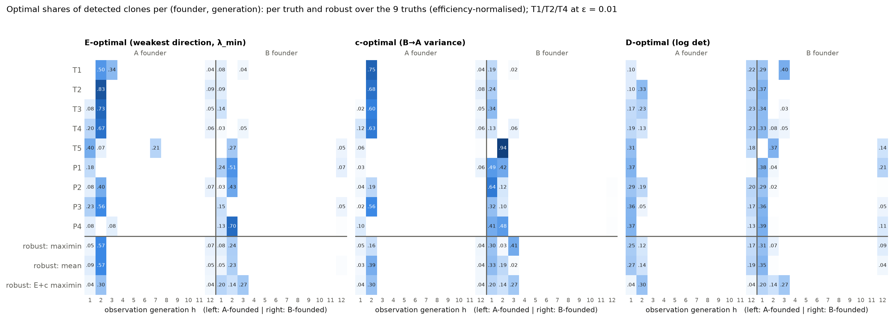
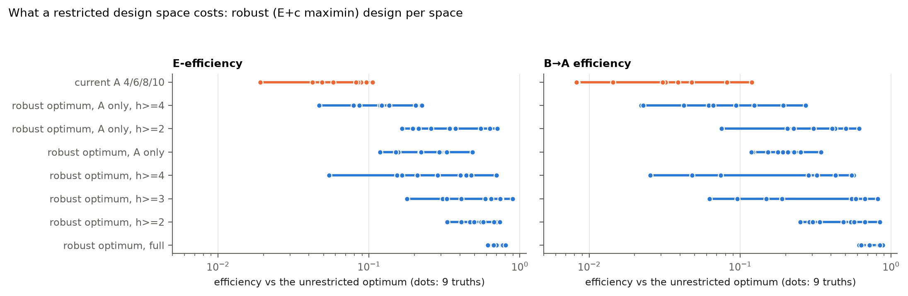
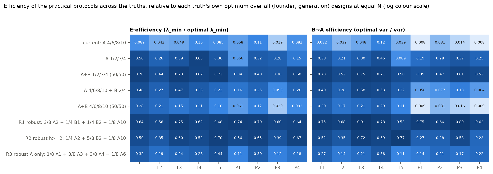
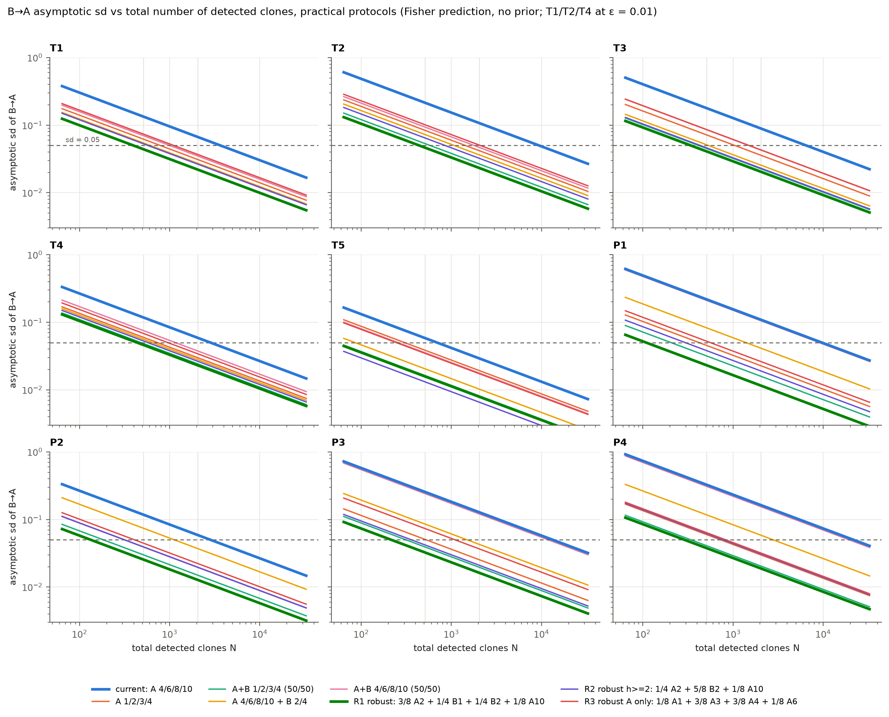

# Optimal experimental design for the exact two-type GW organoid model

Question: which observation generations and founder types should the wet lab use, at a fixed
experimental budget, so that the weakly identified directions, B→A (dedifferentiation)
first of all, are informed as well as possible? The study builds on the exact expected
Fisher information of `docs/weak_directions/`. It optimises designs exactly (convex
programmes), per truth and robustly over the 9 XG2 truths and over 60 prior draws. It then
compares a short list of implementable protocols and checks the predictions against XG2
posteriors and simulated MLEs.

## Short answer

* **The current design (A-founded clones at generations 4/6/8/10) is 1–12% efficient.**
  Relative to the best design at the same number of clones, its weakest-direction
  information (λ_min) is 2–11% of the optimum and its B→A variance is 12–120× too large
  (B→A efficiency 0.8–12%). On 60 plausible prior draws the medians are 3.7% (λ_min) and
  1.2% (B→A).
* **Optimal designs observe very early, and use B founders.** For every truth the E- and
  c-optima put 88–99% of the clones at generations 1–3, mostly 1–2. The exception is T5's
  E-optimum: 73%, plus 21% at A7. The early clones are split between A-founded and
  B-founded (KRT20⁺). The rest, about 5%, goes to A-founded clones at the latest generation
  for the stiff "growth" directions (`figures/optimal_weights.png`). At
  generations 1–2 a clone has 1–4 cells, so the parent type of every event is still known.
  That is exactly what the weak "parent swap" directions need. The c-optimal (B→A) designs
  lean more on B-founded clones at generations 1–2: 13–34% for T1–T4, 42–94% for T5 and the
  P truths. A B founder seen one or two divisions later shows B's own outcome row
  directly.
* **Recommended protocol R1: 3/8 A-founded at generation 2, 1/4 B-founded at generation 1,
  1/4 B-founded at generation 2, 1/8 A-founded at generation 10.** It is the best design
  with at most 4 design points and shares in eighths for the joint worst-case criterion
  (A10 instead of A12 costs 0.5%). Against the current design at the same number of clones,
  it gains:
  * λ_min: ×6.4–31 (median ×8.1). 1/λ_min falls from 384–12 000 to 48–1 440 clones;
  * B→A variance: ÷6.5–89 (median ÷21);
  * clones for B→A sd ≤ 0.05: 51–440 instead of 700–21 700. Founders to seed: 55–540;
  * worst-case efficiency over the 9 truths: 0.56 (λ_min) and 0.53 (B→A). The fully
    optimised robust design reaches 0.61/0.61, so the rounding costs little;
  * on the 60 prior draws, which were not used to build it: median efficiency 0.65 / 0.69,
    10% quantile 0.46 / 0.37, median gain over the current design ×19 (λ_min) and ÷59
    (B→A variance).
* **If generation 1 is not feasible** (R2: 1/4 A2 + 5/8 B2 + 1/8 A10), the gains are
  still ×5.4–21 (λ_min) and ÷5–37 (B→A variance), with 35–850 clones for sd ≤ 0.05.
  **If B founders are not available** (R3: 1/8 A1 + 3/8 A3 + 3/8 A4 + 1/8 A6), the gains
  are ×2–6 and ÷3–26, with 250–2 100 clones. **Generation 4 as the earliest time point
  caps the gain at about ×2–10.** The robust optimum restricted to h ≥ 4 has a worst-case
  efficiency of 0.05 (λ_min) and 0.03 (B→A).
* **The predictions hold where they should.** For the current design, the XG2 posterior
  variance of B→A is 0.89× the Gaussian prediction (median; IQR 0.62–1.65), as in the
  weak-directions study. Simulated datasets for R1 and for A+B 1/2/3/4 (T3, 1 024 clones,
  50 datasets) give an MLE sd of B→A of **0.95× and 0.96× the prediction**. The current
  design at 4 096 clones is still pre-asymptotic: its MLE sd is 1.43× the prediction and
  27 of 50 MLEs sit on a face.

## 1. Method

**Design space.** A design point is (founder f ∈ {A, B}, observation generation
h ∈ 1..12): a clone started from one A (LGR5⁺) or one B (KRT20⁺) cell and counted (A and B
cells) after h synchronous generations. A design is a vector of shares w_{f,h} ≥ 0,
Σ w = 1. With N detected clones the information is N · K(w), K(w) = Σ w_{f,h} K_{f,h}.
K_{f,h} is the expected Fisher information of ONE DETECTED clone
(`src/bio_sbi/inference/gw_fisher.py::horizon_information`). It uses the exact pgf/FFT law,
conditioned on detection as the likelihood is, with a founder row of (1, 0) or (0, 1)
(`dataclasses.replace(model, founder=...)`; the code supports any founder distribution).

**Coordinates.** The coordinates are those of the weak-directions study: the 10-dim
tangent space of the 12 outcome probabilities, prior-whitened. The flat Dirichlet row has
covariance P₀/42, so K = Uᵀ I U / 42 and eigenvalues λ of K(w) are "per clone, in units of
the prior". **1/λ_min is the total number of clones at which the weakest direction is as
well informed as by the flat prior.** For the 4-endpoint current design that is 4× the
"clones per endpoint" of the weak-directions tables.

**B→A.** p_{B→A} = cᵀx with c = Uᵀe_{B→A}. Asymptotic variance = cᵀK(w)⁺c / (42 N), and with
the flat prior (Gaussian approximation) cᵀ(I + N K)⁻¹c / 42. The c-criterion is
invariant to the whitening.

**Criteria** (all convex in w, solved exactly as SDPs with cvxpy + Clarabel; cvxpy is a
script-only dependency, `uv run --with cvxpy`):
* E: maximise λ_min(K(w)) (all directions; in practice the weak parent-swap block);
* c: minimise cᵀK(w)⁺c (B→A); matrix-fractional form, valid for singular K(w) with c in
  its range;
* D: maximise log det K(w) (reference).

Optimality is certified by the general equivalence theorem: the directional-derivative
gap over the unrestricted space is ≤ 7e-4 at unit cost and ≤ 6e-3 under the cost models
(`eq_gap` in `tables/optimal_designs.csv`). For restricted spaces the column is computed
over all 24 points, so there it measures what the excluded points would add. For the
truths checked (T1–T3, P1), the Bayesian c-criterion cᵀ(I + N K)⁻¹c gives the same designs
at N = 512 and 2048: shares within 0.03, except P1 at 512 (B1 0.67 instead of 0.49).

**Robust designs.** The truths differ by 2 decades in λ_min, so the designs are
efficiency-normalised: E-eff = λ_min(w)/λ_min*, c-eff = v*/v(w), D-eff = (det/det*)^(1/10),
each relative to that truth's own optimum. Variants:
(a) maximin efficiency over the 9 truths;
(b) mean (E: mean log efficiency; c: mean relative variance; D: mean log det);
(c) **joint E + c maximin**, which maximises the worst case over truths of
min(E-eff, c-eff) by bisection on convex feasibility problems;
(d) the same over 60 flat-prior draws that pass the XG2 plausibility filter (30–300
expected cells per A-founded clone at generation 10, as for P1–P4; 60 accepted of 166
drawn; generations 1–10 only, because the generation-12 grids of the largest draws need
> 4 GB).

**Rounded designs.** All designs with ≤ 4 points among A1–A4, A6, A8, A10, A12, B1–B4 and
shares in eighths (≈ 22 000 designs) were scored by the joint maximin efficiency over the
9 truths (`tables/rounded.csv`).

**Budget models.** (i) *clone*: N = number of detected clones analysed (main). (ii)
*founder*: cost of a detected clone = 1/q_{f,h} founders seeded, with q = P(detected) =
P(clone not extinct). (iii) *founder + time*: (1/q)(1 + h/4)/2: half fixed per founder,
half proportional to culture time, normalised so that a founder observed at generation 4
costs 1. The optimal designs barely move under (ii) and (iii)
(`tables/optimal_designs.csv`, `tables/robust_designs.csv`). Detection is high, 0.6–0.97
per point, and the optimal designs are already early, which (iii) favours. Under (iii) the
joint robust design becomes 0.42 A2 + 0.32 B2 + 0.20 B1 + 0.06 A12, i.e. R1.

**Boundary truths.** T1, T2 and T4 have B divisions exactly 0. There B-founded information
is non-regular: a B clone larger than 2^(h−1) is impossible unless B divides, so the
expected information along B's divisions is infinite. All design numbers for them use the
**ε = 0.01 variant** (each zero set to 0.01, the rest of B's row rescaled), as in the
weak-directions study. Check: for A-founded designs, ε = 0.01 vs the exact boundary
changes 1/λ_min by 6–15% and the B→A sd by 3–7% (`tables/boundary_eps_check.csv`). As a
second view, the exact boundary truths were evaluated on the **active face** ("B never
divides" known, 7 dims), where B-founded clones are regular (`tables/face.csv`). On the
face R1 gives B→A sd 0.044–0.046 at N = 512, the same as at ε = 0.01, against 0.069–0.087
for the current design. The face optimum is almost pure A2 (0.77–0.96).

## 2. Optimal designs per truth



Unit cost, all 24 design points (`tables/optimal_designs.csv`; budget shares; 1/λ_min in
total clones; asymptotic B→A sd at N = 512):

| truth | E-optimal | 1/λ_min | c-optimal (B→A) | sd(B→A) at 512 | current: 1/λ_min, sd |
|---|---|---|---|---|---|
| T1 | A2 .50, A3 .34, B1 .08, A12/B3 .04 | 54 | A2 .75, B1 .19, A12 .04 | 0.038 | 611, 0.134 |
| T2 | A2 .83, B1 .09, A12 .09 | 65 | A2 .68, B1 .24, A12 .08 | 0.038 | 1 540, 0.214 |
| T3 | A2 .73, B1 .14, A1 .08, A12 .05 | 59 | A2 .60, B1 .34, A12 .05 | 0.039 | 1 210, 0.178 |
| T4 | A2 .67, A1 .20, A12 .06, B3 .05 | 65 | A2 .63, A1/B1 .12–.13, A12/B3 .06 | 0.041 | 675, 0.118 |
| T5 | A1 .40, B2 .27, A7 .21, A2 .07 | 33 | B2 .94, A1 .06 | 0.011 | 384, 0.058 |
| P1 | B2 .51, B1 .24, A1 .18, B12 .07 | 417 | B1 .49, B2 .42, A12 .06 | 0.020 | 7 170, 0.218 |
| P2 | B2 .43, A2 .40, A1 .08, A12 .07 | 155 | B1 .64, A2 .19, B2 .12 | 0.021 | 1 460, 0.118 |
| P3 | A2 .56, A1 .23, B1 .15, B12 .05 | 228 | A2 .56, B1 .32, B2 .10 | 0.031 | 12 000, 0.255 |
| P4 | B2 .70, B1 .13, A1/A3 .08 | 920 | B2 .48, B1 .41, A1 .10 | 0.030 | 11 200, 0.326 |

* **Every optimum is supported on generations 1–3 plus at most one late point.** The late
  point is the latest available generation (A12 or B12, 1–9%), or A7 for T5's E-optimum. It
  carries the stiff directions (growth rate, stable composition), which gain most from a
  long run. Any late endpoint works: with A10 or A8 instead of A12 the rounded design loses
  0.5% or 1.5%.
* **The T truths** (B mostly switches back) want A-founded clones at generation 2 plus B
  founders at generation 1. **The P truths** (near-even composition) want more B founders:
  for P1/P4 the B-founded clones at generations 1–2 dominate both criteria.
* **D-optimal designs** spread more evenly (A1, B1 ~0.3 each, 13–23% at generation 12).
  The per-truth D-optima are 33–90% E-efficient (robust D designs 26–77%): log det rewards
  the stiff directions, which are not the problem.

## 3. Robust designs

`tables/robust_designs.csv` (efficiencies per truth in `tables/robust_efficiencies.csv`),
unit cost, efficiencies relative to each truth's unrestricted optimum:

| design space | E+c maximin design | min E-eff | min c-eff |
|---|---|---|---|
| all (h 1–12, A + B) | A2 .30, B3 .27, B1 .20, B2 .14, A1/A12 .04 | 0.61 | 0.61 |
| h ≥ 2 | B2 .71, A2 .26, A12 .03 | 0.33 | 0.25 |
| h ≥ 3 | B3 .59, A3 .37, A12 .03 | 0.18 | 0.06 |
| h ≥ 4 | B4 .51, A4 .46, A12 .03 | 0.05 | 0.03 |
| A founders only | A4 .66, A3 .18, A1 .14 | 0.12 | 0.12 |
| A only, h ≥ 2 | A3 .50, A2 .48 | 0.17 | 0.08 |
| A only, h ≥ 4 | A4 .99 | 0.05 | 0.02 |
| *current A 4/6/8/10* | | *0.019* | *0.008* |



* The E-maximin design (A2 .57, B2 .24, B1 .08, A12 .07, A1 .05) is 77% E-efficient for
  every truth but only 40% B→A-efficient for T5. The c-maximin design (B3 .41, B1 .30,
  A2 .16) is 68% B→A-efficient but 48% E-efficient. The joint design balances them at
  61/61.
* **Each generation of delay costs about a factor 2–4 in the worst case.** The earliest
  feasible observation time is the most important design decision. Adding B founders is
  the second: worth ×2–5 when the earliest generation is 1 or 2, almost nothing at
  h ≥ 4.
* **Prior draws** (`tables/prior_robust.csv`, generations ≤ 10). The robust designs over 60
  prior draws look like the 9-truth ones: generation 1–2, A + B, with a few % late. The
  prior-mean c-design puts more on B1 (0.56). Designs carry over between the two sets. The
  9-truth joint design is 67% / 64% efficient on the median prior draw. The prior-built
  joint design is 40% / 55% efficient in the worst of the 9 truths. The tail is real: for
  the 10% least favourable prior draws the 9-truth design is ≤ 31% B→A-efficient, and those
  draws favour even more B1.

## 4. Practical protocols

Equal N detected clones, shares as listed (equal shares within a protocol unless stated).
Full per-truth tables: `tables/protocols*.csv|md`. On the prior draws:
`tables/protocols_prior.*`.



| protocol | E-eff (min–median) | B→A eff (min–median) | gain λ_min vs current (median, range) | gain B→A var (median, range) | detected fraction |
|---|---|---|---|---|---|
| current: A 4/6/8/10 | 0.019–0.082 | 0.008–0.032 | 1 | 1 | 0.60–0.95 |
| A 1/2/3/4 | 0.066–0.32 | 0.089–0.28 | 5.7 (1.1–15) | 6.6 (2.3–30) | 0.65–0.96 |
| A+B 1/2/3/4 (50/50) | 0.34–0.60 | 0.40–0.52 | 7.9 (3.7–20) | 16 (5.9–64) | 0.75–0.94 |
| A 4/6/8/10 + B 2/4 | 0.093–0.26 | 0.058–0.28 | 3.5 (2.3–9.6) | 7.8 (2.5–12) | 0.67–0.93 |
| A+B 4/6/8/10 (50/50) | 0.020–0.12 | 0.009–0.11 | 1.2 (1.1–5.0) | 2.5 (1.0–5.3) | 0.70–0.93 |
| **R1: 3/8 A2 + 1/4 B1 + 1/4 B2 + 1/8 A10** | **0.56–0.64** | **0.53–0.75** | **8.1 (6.4–31)** | **21 (6.5–89)** | **0.76–0.93** |
| R2 (h ≥ 2): 1/4 A2 + 5/8 B2 + 1/8 A10 | 0.35–0.56 | 0.23–0.52 | 8.2 (5.4–21) | 15 (5.0–37) | 0.76–0.92 |
| R3 (A only): 1/8 A1 + 3/8 A3 + 3/8 A4 + 1/8 A6 | 0.11–0.24 | 0.11–0.21 | 3.6 (2.0–6.1) | 4.5 (2.8–26) | 0.63–0.95 |

1/λ_min in total clones (the weakest direction matches the prior at this N):

| protocol | T1 | T2 | T3 | T4 | T5 | P1 | P2 | P3 | P4 |
|---|---|---|---|---|---|---|---|---|---|
| current | 611 | 1 540 | 1 210 | 675 | 384 | 7 170 | 1 460 | 12 000 | 11 200 |
| A 1/2/3/4 | 108 | 245 | 153 | 100 | 91 | 6 310 | 485 | 806 | 6 200 |
| A+B 1/2/3/4 | 78 | 147 | 80 | 105 | 44 | 1 230 | 393 | 600 | 1 520 |
| A 4/6/8/10 + B 2/4 | 113 | 237 | 125 | 196 | 146 | 2 540 | 631 | 2 440 | 3 560 |
| **R1** | **85** | **116** | **78** | **106** | **48** | **560** | **220** | **381** | **1 440** |
| R2 | 108 | 187 | 98 | 125 | 46 | 746 | 240 | 577 | 1 370 |
| R3 | 168 | 344 | 246 | 231 | 73 | 3 670 | 509 | 1 960 | 5 150 |

Asymptotic sd of B→A at N = 512 / N = 2048 total detected clones:

| protocol | T1 | T2 | T3 | T4 | T5 | P1 | P2 | P3 | P4 |
|---|---|---|---|---|---|---|---|---|---|
| current | .134/.067 | .214/.107 | .178/.089 | .118/.059 | .058/.029 | .218/.109 | .118/.059 | .255/.128 | .326/.163 |
| A 1/2/3/4 | .062/.031 | .084/.042 | .072/.036 | .060/.030 | .039/.019 | .045/.023 | .039/.020 | .051/.025 | .060/.030 |
| A+B 1/2/3/4 | .045/.022 | .053/.027 | .045/.022 | .049/.024 | .016/.008 | .032/.016 | .030/.015 | .039/.020 | .041/.020 |
| A 4/6/8/10 + B 2/4 | .055/.027 | .073/.036 | .051/.026 | .056/.028 | .021/.010 | .083/.041 | .074/.037 | .085/.043 | .117/.058 |
| **R1** | **.044/.022** | **.046/.023** | **.041/.020** | **.046/.023** | **.016/.008** | **.023/.012** | **.026/.013** | **.032/.016** | **.038/.019** |
| R2 | .053/.027 | .065/.032 | .046/.023 | .053/.027 | .013/.007 | .038/.019 | .039/.020 | .042/.021 | .062/.031 |
| R3 | .074/.037 | .101/.051 | .086/.043 | .068/.034 | .035/.017 | .052/.026 | .045/.022 | .073/.037 | .064/.032 |

**Clones needed for B→A sd ≤ 0.05** (asymptotic; detected clones / founders to seed):

| protocol | T1 | T2 | T3 | T4 | T5 | P1 | P2 | P3 | P4 |
|---|---|---|---|---|---|---|---|---|---|
| current | 3 660 / 3 830 | 9 390 / 10 400 | 6 490 / 6 800 | 2 840 / 3 130 | 697 / 751 | 9 730 / 12 700 | 2 830 / 4 700 | 13 300 / 14 200 | 21 700 / 30 100 |
| A 1/2/3/4 | 786 / 819 | 1 430 / 1 530 | 1 050 / 1 090 | 734 / 795 | 304 / 325 | 422 / 511 | 316 / 490 | 525 / 553 | 727 / 975 |
| A+B 1/2/3/4 | 407 / 446 | 581 / 740 | 414 / 453 | 482 / 545 | 54 / 59 | 206 / 261 | 183 / 245 | 313 / 339 | 341 / 420 |
| A 4/6/8/10 + B 2/4 | 609 / 661 | 1 080 / 1 340 | 533 / 577 | 646 / 733 | 86 / 93 | 1 400 / 1 840 | 1 130 / 1 680 | 1 490 / 1 610 | 2 790 / 3 640 |
| **R1** | **396 / 429** | **440 / 543** | **340 / 369** | **437 / 487** | **51 / 55** | **109 / 137** | **133 / 176** | **215 / 232** | **289 / 353** |
| R2 | 574 / 637 | 852 / 1 120 | 433 / 480 | 574 / 658 | 35 / 39 | 296 / 380 | 314 / 405 | 360 / 392 | 781 / 943 |
| R3 | 1 110 / 1 160 | 2 100 / 2 280 | 1 510 / 1 570 | 957 / 1 040 | 246 / 264 | 562 / 703 | 406 / 651 | 1 100 / 1 160 | 829 / 1 130 |

With the flat prior (Gaussian approximation, `N for sd<=0.05 (prior)` in
`tables/protocols.csv`), R1 needs 41–343 clones and the current design 485–17 100.



**Detection (the lab's real cost).** In this model a seeded founder fails to give a
detected clone only if its lineage dies out. q = P(detected) is 0.71–0.97 at generation 1
and 0.60–0.95 at generation 10 (`tables/detection.csv`). B founders: 0.76–0.97 at
generation 1, 0.61–0.90 at generation 10. Detection falls only slightly with h, because
extinction happens early. The fraction of seeded founders that yields a detected clone is
0.76–0.93 for R1 (≤ 33% extra seeding), against 0.60–0.95 for the current design (up to
66% extra for P2; `founders for sd<=0.05`). Clones are small at the
recommended points: on average 2.4–3.1 cells at A2, 1.0–1.8 at B1, 1.7–3.2 at B2
(`tables/clone_size.csv`). R1 averages 7–29 cells per detected clone, against 19–80 for
the current design, so imaging and typing per clone are cheaper too. Plating efficiency
and post-sort survival are not in the model: the real founders-per-clone ratio is the
model's 1/q times 1/(plating efficiency). That factor is common to all protocols as long
as plating efficiency does not depend on the time of observation.

**Prior draws** (`tables/protocols_prior.csv`; efficiencies vs each draw's optimum over
generations ≤ 10):

| protocol | median E-eff (10%) | median B→A eff (10%) | median gain λ_min / B→A var | median / 90% clones for sd ≤ 0.05 |
|---|---|---|---|---|
| current | 0.037 (0.013) | 0.012 (0.002) | 1 / 1 | 5 060 / 52 900 |
| A 1/2/3/4 | 0.27 (0.11) | 0.23 (0.024) | 7.5 / 15 | 282 / 2 330 |
| A+B 1/2/3/4 | 0.53 (0.36) | 0.45 (0.21) | 13 / 41 | 135 / 742 |
| **R1** | **0.65 (0.46)** | **0.69 (0.37)** | **19 / 59** | **92 / 459** |
| R2 | 0.56 (0.34) | 0.38 (0.09) | 15 / 29 | 157 / 1 270 |
| R3 | 0.21 (0.09) | 0.15 (0.016) | 5.4 / 9.3 | 423 / 3 050 |

## 5. Checks

**(a) XG2 posteriors, current design** (`tables/validation_posterior.*`; 105 NUTS runs,
n = 256–4 096 per endpoint; posterior sds from the weak-directions table). The posterior
variance of B→A is 0.89× the Gaussian prediction (median, IQR 0.62–1.65; 0.87 at n ≥ 1024
per endpoint). The departures have known causes, as in `docs/weak_directions` §7:
* T1 at n ≤ 1024 (ratio 3–6.6: the "B divides" branch);
* T3 (1.3–2.5: two-branch ridge);
* T2 (0.5–0.7; part of it is ε = 0.01, which gives a 3–6% wider prediction than the exact
  boundary);
* P4 (0.22–0.35: B→A = 0.11 close to the face, truncated).

At n ≥ 2048 per endpoint, T1/T4 have variance ratios of 0.7–0.9. My predictions equal the
weak-directions study's to machine precision for the interior truths.

**(b) MLE simulation** (`scripts/optimal_design/validate.py mle`,
`tables/validation_mle.*`). Clones were simulated from the GW model (own numpy simulator,
checked against the exact mean clone sizes to 0.3%), A- and B-founded, conditioned on
detection. The exact-likelihood MLE combines two `ExactLikelihood` objects, the B one with
founder row (0, 1) (the pipeline's `law.founder` is one mixture per dataset, so typed B
founders need this two-likelihood construction; the likelihood code supports it
unchanged). The fit is L-BFGS-B in stick coordinates, started at the truth: a local check
of the asymptotics. 50 datasets per case:

| truth | design | N | sd(B→A) MLE / predicted | ratio | sd along w1, ratio | MLEs on a face |
|---|---|---|---|---|---|---|
| T3 | R1 | 1 024 | 0.0273 / 0.0288 | 0.95 | 0.96 | 3 |
| T3 | A+B 1/2/3/4 | 1 024 | 0.0305 / 0.0318 | 0.96 | 0.92 | 4 |
| T3 | current | 4 096 | 0.0902 / 0.0629 | 1.43 | 1.29 | 27 |
| P2 | R1 | 1 024 | 0.0177 / 0.0180 | 0.98 | 0.65 | 35 |

The early designs are in the asymptotic regime at about 1 000 clones. The current design is
not, even at 4 096 (27/50 MLEs on a face, bias −0.02). Its real precision is worse than its
Fisher prediction, so the gains in §4 are, if anything, underestimates at moderate N. P2's
weakest direction loads on its near-zero outcomes (B→AB = 0.004, A→B = 0.008): 35/50 MLEs
sit on a face and the sd along w1 is truncated (0.65), but B→A itself matches (0.98). Some
L-BFGS-B runs end with a line-search warning at bound-constrained optima (45/50, 50/50,
41/50, 29/50 flagged converged); they were kept.

## 6. Recommendations for the lab

1. **Observe early.** Most of the information on who-does-what comes from clones of 1–4
   cells, one or two divisions after seeding (a "paired-daughter" / doublet assay):
   * a clone at generation 1 is the fate of the founder itself;
   * a clone at generation 2 adds the fates of both daughters;
   * at generation 4 or later the clone is a mixture and only population averages remain.
2. **Seed both types.** Sort single KRT20⁺ (B) cells as well as LGR5⁺ (A) cells. A
   B-founded clone observed after 1–2 divisions shows B's own outcome row, including
   switching back to A. This is the most direct handle on B→A.
3. **Keep a few late clones.** About 1/8 of the clones at a late endpoint (generation 8–12;
   10 is fine) pin down the growth rate and the stable composition.
4. **Concretely (R1):** for every 8 detected clones, 3 A-founded clones counted after 2
   divisions, 2 B-founded after 1 division, 2 B-founded after 2 divisions, and 1
   A-founded at generation 10. About 400–450 detected clones (430–540 founders) bring B→A
   to sd 0.05 for the T truths, and 110–290 for the P truths. The current design needs
   2 800–21 700 clones for the same.
5. **If the first division cannot be scored:** R2 (2 A-founded at generation 2, 5
   B-founded at generation 2, 1 A-founded at generation 10, per 8 clones). It needs about
   1.3–2.7× more clones than R1 for the same B→A precision (0.7× for T5). **If B cells
   cannot be sorted:** R3 (A-founded at generations 1/3/4/6 in proportions 1:3:3:1). It
   needs 2–5× more clones than R1.

## 7. Caveats

* **Synchronous generations.** The GW model counts clones after exactly h generations. In
  culture, cells divide asynchronously, and the first division after sorting has a
  variable lag. An early time point is therefore a mixture of clones at generation 0, 1
  and 2. The early-generation information assumes the generation is known. In practice
  the time point should be matched to the cell cycle (or the division count read from
  imaging / dye dilution). Otherwise the model needs a time-to-generation layer
  (`galton_watson_hours`), which would reduce the early-time advantage.
* **Typing errors are not included** (perfect observation, as in XG2). Early clones are
  more exposed: one misclassified cell in a 2-cell clone is a different outcome. KRT20/LGR5
  misclassification and impure B sorts (an A cell sorted as B) would bias B→A directly.
  The confusion-matrix observation model exists in the likelihood. A design study with
  typing errors is the natural next step before committing to generation 1.
* **Detection = survival only.** Founders whose lineage dies are not counted (the
  likelihood conditions on detection), so death is informed only indirectly. Plating
  efficiency is not modelled. Recording seeded founders and empty wells would add
  information on death (selection = all), but only if plating loss can be separated from
  biological death.
* **Model assumptions.** These are the time-homogeneous two-type GW model and the truths of
  XG2. Recently sorted cells may behave differently (sorting stress, niche-free first
  divisions), which would affect early observations more than late ones.
* **Boundary truths** (T1/T2/T4) are evaluated at ε = 0.01 inside the boundary. At the
  exact boundary a single B-founded clone larger than 2^(h−1) proves that B divides: a
  non-regular, faster-than-√n test. The face analysis gives the same B→A sd for R1 (§1).
* **Asymptotics.** All numbers are Fisher (Gaussian) predictions. They are validated for
  the early designs at ~1 000 clones (§5b), and are optimistic for the current design
  below a few thousand clones (§5a, b). Near the simplex faces the posterior is truncated
  (narrower but biased).
* **Generation 12** is the edge of the design space. The late point always sits there, but
  generations 8–12 are within 1.5% of each other. The prior-draw analysis uses generations
  ≤ 10 (memory).

## Reproduce

```
uv run python scripts/optimal_design/compute_info.py 60            # information, ~2 min (4 threads)
uv run --with cvxpy python scripts/optimal_design/optimise.py      # designs + tables, ~20 min (1 core)
uv run --with cvxpy python scripts/optimal_design/protocols_prior.py   # protocols on prior draws, ~1 min
uv run --with cvxpy python scripts/optimal_design/validate.py posterior
uv run --with cvxpy python scripts/optimal_design/validate.py mle 50   # ~6 min, 3 workers
uv run python scripts/optimal_design/figures.py
```

`cvxpy` is not a project dependency (`uv run --with cvxpy` installs it ephemerally;
nothing in `src/` needs it). Caches are in `results/exact_gw/optimal_design/`:
`info/<label>.npz` (K per design point, detection, mean clone size), `prior_draws.npz`,
`designs.npz` (all designs and curves, JSON payload), `validation_mle.npz`,
`protocols_prior_long.csv`.

## Files

* `scripts/optimal_design/od_common.py`: truths, ε variant, information per (founder,
  generation), whitening, B→A functional.
* `scripts/optimal_design/design_lib.py`: criteria, cvxpy SDPs (E, c, D; robust maximin /
  mean), equivalence-theorem gap.
* `scripts/optimal_design/optimise.py`: sections 2–4 and the tables.
* `tables/optimal_designs.*`: per truth × criterion × design space × cost model.
* `tables/robust_designs.*`, `tables/robust_efficiencies.*`: robust designs.
* `tables/prior_robust.*`, `tables/prior_efficiencies.*`, `tables/prior_optimal_weights.csv`:
  prior draws.
* `tables/rounded.*`: best simple designs.
* `tables/protocols.*` (long), `tables/protocols_summary.*`,
  `tables/protocols_<metric>.*` (pivoted per truth), `tables/protocols_prior.*`.
* `tables/face.*`, `tables/boundary_eps_check.*`: boundary truths.
* `tables/detection.*`, `tables/clone_size.*`: P(detected) and mean detected clone size per
  design point.
* `tables/validation_posterior.*`, `tables/validation_mle.*`: checks.
* `figures/optimal_weights.png`, `figures/btoa_sd_vs_N.png`,
  `figures/efficiency_across_truths.png`, `figures/design_space_restrictions.png`.
