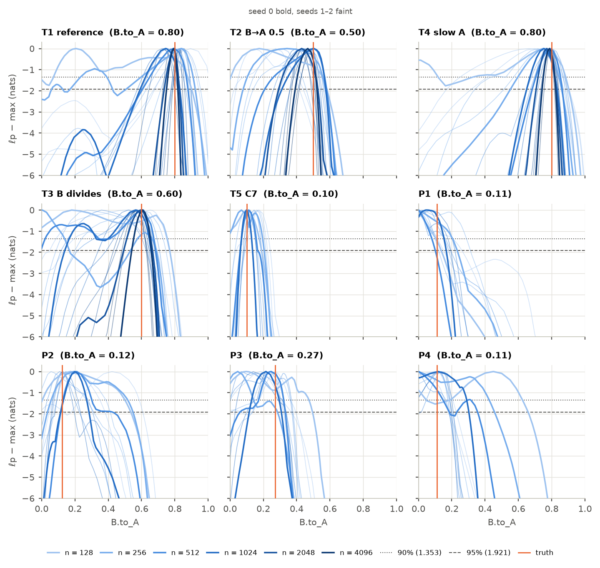
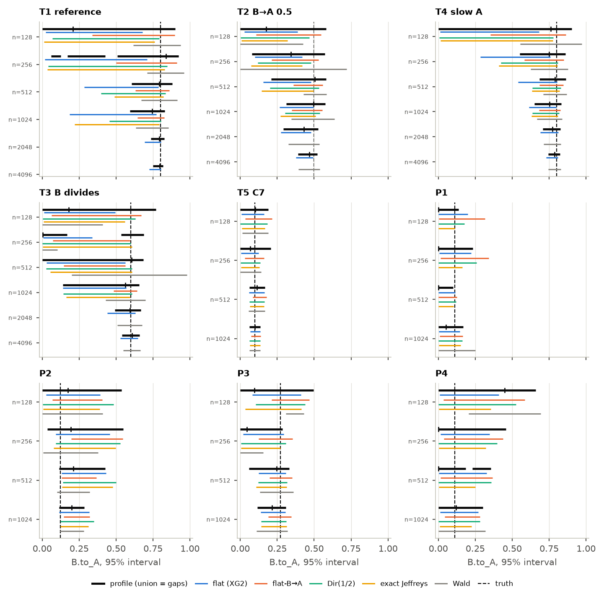
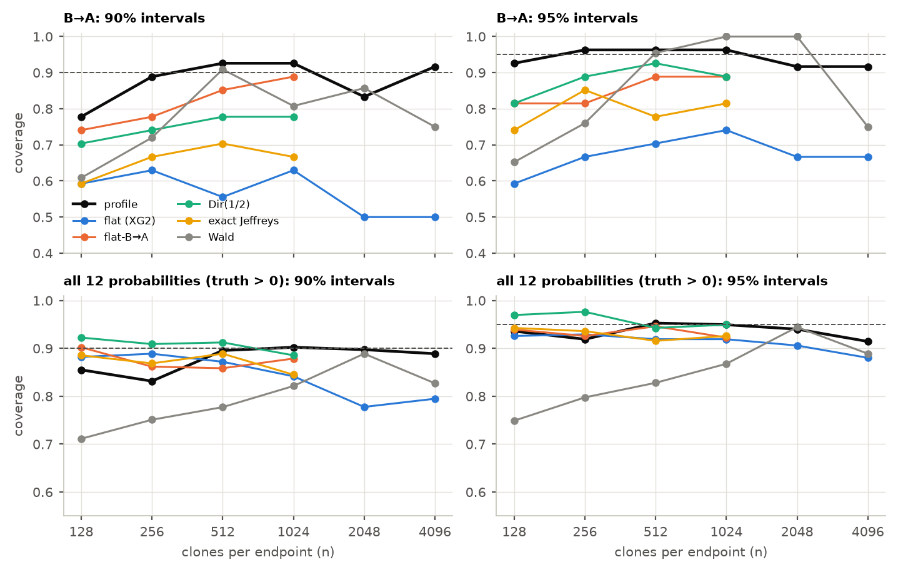
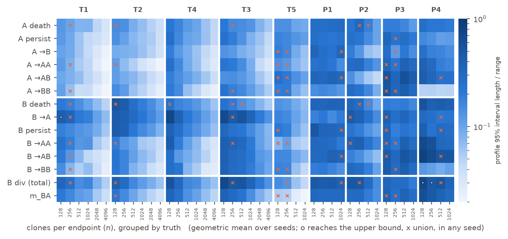
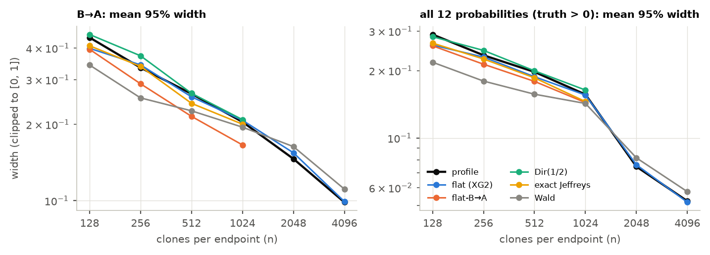
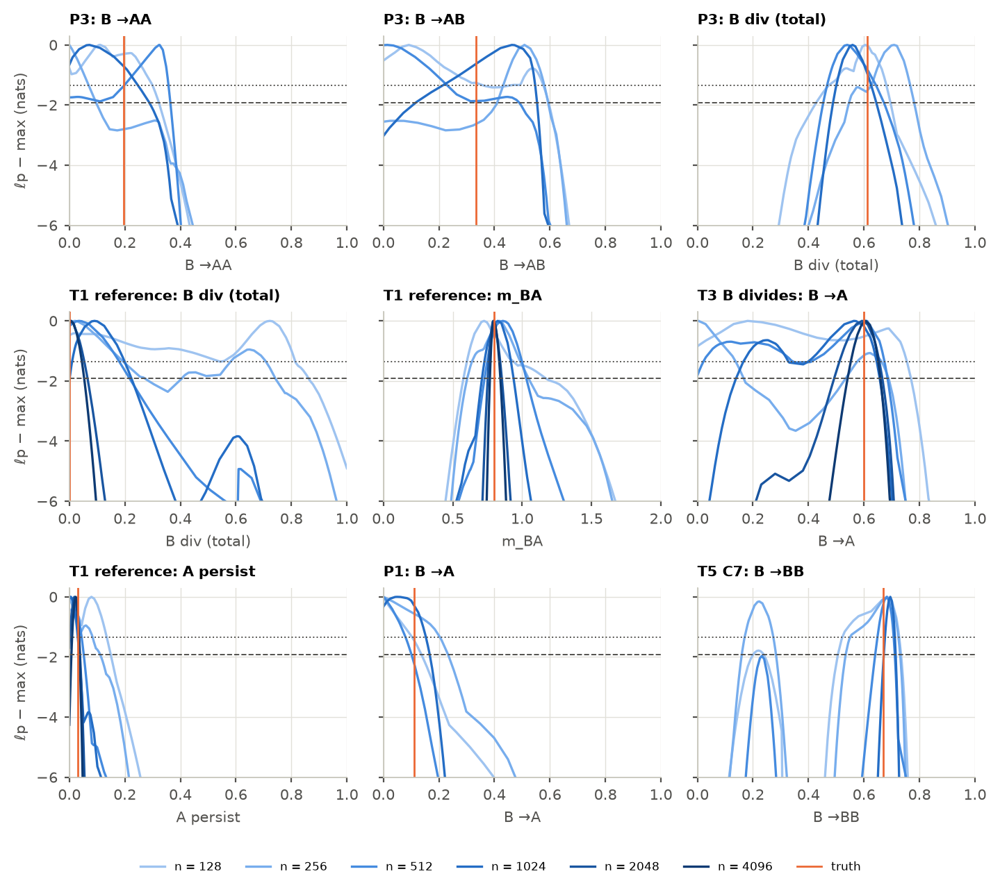

# Profile-likelihood intervals for the XG2 exact-GW runs

Data: the 132 XG2 runs of `results/exact_gw/data_size/runs_index.csv` (9 truths, n = 128 ... 1024
for all, plus n = 2048 / 4096 for T1-T4, 3 seeds; two-type law, generations 4/6/8/10, 12
probabilities, 10 free stick coordinates). **No posterior inference was rerun**: every profile
point is a constrained maximum-likelihood fit on the run's stored dataset (`reference.npz`,
regenerated from the run's config and checked bit for bit). Scripts:
`scripts/profile_intervals/`. Results (curves, intervals, logs):
`/home/matteo/BIO-SBI/results/exact_gw/profile_intervals/`. Tables: `tables/`, figures:
`figures/` (PNG + PDF).

## Summary

* **Yes, profile intervals can be computed without rerunning inference.** All 132 runs ×
  14 functionals are done: the 12 probabilities, B's total division mass `B.div` and
  `m_BA`. Total cost: about 170 CPU-hours (55 M exact-likelihood evaluations, 92,500
  profile points, about 5.5 CPU-minutes per profile including all repair passes), about
  12 h wall time on 12–19 workers.
* **B→A.** The 95% profile interval covers the truth in **95%** of the 132 cells (90%:
  88%). The posteriors are lower: flat 67%, flat-B→A 85%, Dir(1/2) 88%, exact Jeffreys
  80% (n ≤ 1024 for the last three), and Wald 85% where it exists. On the high-B→A truths
  (T1, T3, T4) the profile covers in 94–100% of cells and the flat posterior in 44–61%.
* **All 12 probabilities (truth > 0).** Profile 94% at 95% (87% at 90%), on a par with
  the posteriors (92–96%), against 83% for Wald. Wald also has no interval in 6–38% of
  cells. The profile stays at 91–95% for n = 2048/4096, where the flat posterior drops to
  88–91%.
* **Widths.** Profile intervals are about as wide as the posterior CrIs (mean 95% width
  over all probabilities: 0.29 vs 0.26–0.28 at n = 128, 0.052 vs 0.052 at n = 4096). They
  are not inflated.
* **Shape.** 46% of the 95% intervals are open-ended, almost all at 0: 65% at n = 128,
  23% at n = 4096. Only 0.2% reach the upper end. 4.5% are unions of segments (8–10% at
  n ≤ 256, none at n ≥ 2048), from two-branch ridges.
* **The stored MLE is not the global maximum in 19 of 132 runs** (by > 0.01 nats; 8 by
  > 0.1). In 13 runs it was under-converged in the same basin (+0.01 to +0.54 nats). In
  5 runs it sat in a different basin:
  * P3 n256 s2: +1.50 nats, B→A 0.14 → 0.24;
  * P3 n512 s2: +0.32;
  * T1 n128 s0: +0.41, at B→A = 0.21 as in the earlier note;
  * P3 n128 s0: +0.27;
  * P3 n512 s1: +0.06.

  The last three were found only by profiling.
* **T2 (B→A = 0.5) is the profile's weak spot.** It covers B→A in 72% of cells (5 misses,
  all with the interval just below 0.5). Every posterior is worse there (flat 6%,
  Jeffreys 17%).

## Method

**What is profiled.** For each run, 14 functionals ψ of the law: each of the 12
probabilities, B's total division mass `B.div = B.div_AA + B.div_AB + B.div_BB` and
`m_BA = B.to_A + 2 B.div_AA + B.div_AB` (mean number of A cells a B cell makes per
generation, range [0, 2]). The profile is ℓp(c) = max ℓ(θ) subject to ψ(θ) = c.

**Constrained parametrisation** (`plib.ConstrainedModel`). ψ is a weighted sum of one row's
entries with weights in {0, 1, 2}. Entries are grouped by weight. With two groups (single
probability, `B.div`) the group masses are fixed (c and 1 − c); with three groups (`m_BA`)
one coordinate u ∈ [0, 1] sets the weight-2 mass t ∈ [max(0, c − 1), c/2] and the others
follow (c − 2t, 1 − c + t). Inside a group the entries share its mass by stick-breaking;
the other row keeps its 5 sticks. Every constrained model has 9 coordinates in [0, 1].
The gradient is exact: the analytic derivative of P along our own `dP` goes into the
exact likelihood's **adjoint kernel** (`gw_exact.log_likelihood(kernel="adjoint")`).
Checked against finite differences for all three cases.

**Optimiser.** L-BFGS-B with ftol 1e-15, gtol 1e-9. The scipy defaults stop up to 0.2
nats short at n = 4096 (ill-conditioned valleys), which made the curves jagged by ±0.1
nats; with the tight settings repeated restarts agree to 1e-4 nats.

**Grid and passes** (`plib.run_profile`).
1. Start at the (refitted) MLE, ĉ = ψ(θ̂), and step outward both ways. The step adapts so
   that each step drops about 0.5 nats (initial step: half the Wald se, or 0.01 · range),
   clipped to [0.002, 0.05] · range. Stop when the drop exceeds 3.5 nats or at the
   boundary. Starts at each point: the neighbouring point's optimum projected onto ψ = c,
   plus the 2 highest-likelihood posterior draws within one step of c, projected onto ψ = c
   (draws pooled from the flat, flat-B→A and Dir(1/2) arms of the same dataset, 2000–6000
   per run).
2. Coarse continuation from the 3.5-nat point to the boundary, step 0.05 · range (warm
   start + 1 nearby draw, default tolerances). This catches second modes, so every curve
   spans the whole range [0, 1] (or [0, 2] for `m_BA`).
3. Warm-start sweeps outward from the best point (up to 3 passes, until nothing improves
   by more than 1e-3 nats). Points more than 8 nats down whose neighbour is also more than
   8 nats down are skipped.
4. Fill: midpoints where the drop jumps by more than 0.75 nats between neighbours, inside
   the relevant region.
5. Crossings: every crossing of the 0.821, 1.353 and 1.921-nat thresholds is located by
   secant/bisection with refits until |drop − threshold| < 0.01 nats, alternated with
   the smoothing step described under *polish* below until no point changes.

**Global maximum** (`run_profiles.py`, phase `global`). The MLE is refitted from the stored
MLE and the 3 best draws. If any profile point of the run beats it by more than 0.01 nats,
the full model is polished from that point. That gives the new global MLE, and all 14
profiles of the run are redone from it (merged with the earlier points).

**Cross-check** (phase `cross`). Every point θ of the other 13 profiles of a run is a
feasible point of {ψ = ψ(θ)}, so ℓp(ψ(θ)) ≥ ℓ(θ). Wherever a point within 5 nats of the
maximum beats this profile's (interpolated) curve by more than 0.02 nats, the profile is
refitted from θ at c = ψ(θ), then swept, filled and its crossings recomputed. Rounds are
repeated until no profile changes. Every curve passes through
a final **polish** pass (phase `polish`): sweeps and fill on the stored points, then crossing
refinement alternated with a two-sided smoothing step. Each point (drop < 6 nats) is refitted
from any neighbour that is more than 0.02 nats higher, until nothing improves. This catches a
specific failure: a crossing refinement lands on a better branch next to a point fitted
earlier on the worse one (example: T1 n256 s0 B.div at c = 0.405, 0.63 nats too low, right
at the 95% threshold). The polish improved 162 of 1848 profiles by > 0.01 nats, mostly
far from the thresholds. It moved no 90% endpoint by more than 0.003 and one 95% endpoint
by 0.017, and flipped one coverage (P3 n128 s0 B.div_AB at 90%).
The cross-check found violations in 744 profiles in the first round (up to 18 nats,
mainly T5, whose likelihood has a second mode: see below), 133 in the second, 20 in the
third, 1 in the fourth, and 2 after the polish; then none.

**Intervals.** {c : ℓp(c) ≥ max ℓp − t} with linear interpolation between points, which are
exact at the refined crossings. t = 1.353 (90%) and 1.921 (95%) nats is the χ²₁ rule
(primary). The set may be a union of segments; an interval is *open-ended* when it reaches
0 or the upper end of the range. The maximum used is the run's global maximum (largest of
the refit and all profile points).

**Boundary rule** (secondary). When the true value is 0, the likelihood-ratio statistic is
asymptotically a 50:50 mixture of 0 and χ²₁, so χ²₁ intervals are conservative there.
The mixture thresholds are 0.821 nats (90%) and 1.353 nats (95%), i.e. 2.71/2. Two
variants are reported:
* *data-driven* (`profile_bc`): the mixture thresholds are used whenever the profile's
  maximiser is at the boundary (ĉ = 0 or ĉ = upper end), otherwise χ²₁. This is the rule an
  analyst can apply without knowing the truth.
* *oracle*: for the truth-0 cells, coverage of 0 by the mixture-threshold interval.

**Coverage.** Coverage is computed only for truth > 0 cells, for every method. An
equal-tailed credible interval from posterior draws never contains exactly 0, so truth-0
cells (T1–T4: B.div_*, B.div) are reported separately, for the profile only.
Posterior intervals are equal-tailed quantiles of the stored draws: flat (XG2, all n),
flat-B→A, Dirichlet(1/2), and exact Jeffreys. The last three exist only for n ≤ 1024.
Exact Jeffreys uses PSIS-reweighted Dir(1/2) draws, or the rerun's corrected draws where
one exists (weighted quantiles; `scripts/jeffreys/analyse_jeffreys.py::jeffreys_draws`).
Wald is MLE ± z·se from `mle.json`. It does not exist when the MLE is at 0 or the
information has no curvature in that direction (se = null). Its coverage is over the cells
where it exists, and the share of such cells is reported. Widths are lengths clipped to
the parameter range; a union's width is its total length.

## Results

All tables: `tables/tables.md` (and CSVs). Coverage is over truth > 0 cells; "–" means the
arm does not exist (flat-B→A, Dir(1/2) and Jeffreys only for n ≤ 1024). Cells per n:
27 for n ≤ 1024 (B→A) and 12 at n = 2048/4096 (T1–T4 only). So the n ≥ 2048 rows are
the easier T truths only, and coverage values move in steps of 1/12.

### Coverage of B→A

| n | profile 90 / 95 | flat 90 / 95 | flat-B→A | Dir(1/2) | Jeffreys | Wald |
|---|---|---|---|---|---|---|
| 128 | 0.78 / 0.93 | 0.59 / 0.59 | 0.74 / 0.81 | 0.70 / 0.81 | 0.59 / 0.74 | 0.61 / 0.65 |
| 256 | 0.89 / 0.96 | 0.63 / 0.67 | 0.78 / 0.81 | 0.74 / 0.89 | 0.67 / 0.85 | 0.72 / 0.76 |
| 512 | 0.93 / 0.96 | 0.56 / 0.70 | 0.85 / 0.89 | 0.78 / 0.93 | 0.70 / 0.78 | 0.91 / 0.95 |
| 1024 | 0.93 / 0.96 | 0.63 / 0.74 | 0.89 / 0.89 | 0.78 / 0.89 | 0.67 / 0.81 | 0.81 / 1.00 |
| 2048 | 0.83 / 0.92 | 0.50 / 0.67 | – | – | – | 0.86 / 1.00 |
| 4096 | 0.92 / 0.92 | 0.50 / 0.67 | – | – | – | 0.75 / 0.75 |
| **all** | **0.88 / 0.95** | 0.58 / 0.67 | 0.81 / 0.85 | 0.75 / 0.88 | 0.66 / 0.80 | 0.77 / 0.85 |

By truth, 95% (profile / flat / flat-B→A / Dir(1/2) / Jeffreys / Wald):

| truth | profile | flat | flat-B→A | Dir(1/2) | Jeffreys | Wald |
|---|---|---|---|---|---|---|
| T1 | 0.94 | 0.56 | 0.92 | 0.83 | 0.75 | 0.93 |
| T2 | 0.72 | 0.06 | 0.67 | 0.42 | 0.17 | 0.67 |
| T3 | 1.00 | 0.44 | 0.83 | 0.92 | 0.83 | 0.78 |
| T4 | 1.00 | 0.61 | 1.00 | 0.92 | 0.92 | 1.00 |
| T5 | 1.00 | 1.00 | 0.67 | 1.00 | 1.00 | 0.83 |
| P1 | 0.92 | 1.00 | 1.00 | 1.00 | 0.83 | 0.80 |
| P2 | 1.00 | 0.92 | 0.58 | 0.83 | 0.83 | 0.92 |
| P3 | 1.00 | 1.00 | 1.00 | 1.00 | 0.83 | 0.83 |
| P4 | 1.00 | 1.00 | 1.00 | 1.00 | 1.00 | 0.88 |

### Coverage of all 12 probabilities (truth > 0)

| n | profile 90 / 95 | flat 90 / 95 | flat-B→A | Dir(1/2) | Jeffreys | Wald | Wald defined |
|---|---|---|---|---|---|---|---|
| 128 | 0.86 / 0.94 | 0.88 / 0.93 | 0.90 / 0.94 | 0.92 / 0.97 | 0.89 / 0.94 | 0.71 / 0.75 | 80% |
| 256 | 0.83 / 0.92 | 0.89 / 0.93 | 0.86 / 0.93 | 0.91 / 0.98 | 0.87 / 0.94 | 0.75 / 0.80 | 87% |
| 512 | 0.90 / 0.95 | 0.87 / 0.92 | 0.86 / 0.95 | 0.91 / 0.94 | 0.89 / 0.92 | 0.78 / 0.83 | 86% |
| 1024 | 0.90 / 0.95 | 0.84 / 0.92 | 0.88 / 0.92 | 0.89 / 0.95 | 0.85 / 0.93 | 0.82 / 0.87 | 94% |
| 2048 | 0.90 / 0.94 | 0.78 / 0.91 | – | – | – | 0.89 / 0.94 | 62% |
| 4096 | 0.89 / 0.91 | 0.79 / 0.88 | – | – | – | 0.83 / 0.89 | 69% |
| **all** | **0.87 / 0.94** | 0.86 / 0.92 | 0.88 / 0.93 | 0.91 / 0.96 | 0.87 / 0.93 | 0.78 / 0.83 | |

"Wald defined" is the share of truth > 0 cells with a standard error (none when the MLE
is 0 or the information has no curvature in that direction).

Derived functionals, all n (90 / 95):

| | profile | flat | flat-B→A | Dir(1/2) | Jeffreys |
|---|---|---|---|---|---|
| B.div (truth > 0: T3, T5, P1–P4) | 0.87 / 0.96 | 0.83 / 0.87 | 0.83 / 0.94 | 0.89 / 0.96 | 0.83 / 0.94 |
| m_BA | 0.86 / 0.92 | 0.91 / 0.97 | 0.87 / 0.92 | 0.92 / 0.98 | 0.87 / 0.92 |

Per parameter (`tables/coverage_by_param.csv`). Profile 95% coverage ranges from 0.91
(A.death, B.div_AA, B.div_AB) to 0.97 (B.div_BB). The profile is below every posterior
on B.div_AB (0.91 vs 0.92–0.99) and A.div_AB (0.95 vs 0.98–0.99): these are weakly
identified division outcomes. By truth, the profile is lowest on P1 (0.88) and P3 (0.93); there many
MLEs are at 0, and the Dirichlet posteriors, centred near the prior mean, do well.

**Boundary-corrected thresholds.** The data-driven rule (mixture thresholds when the MLE
is on the boundary) lowers truth > 0 coverage, to 0.85 / 0.92 for all 12. For B→A it is
0.84 / 0.94. The intervals are 2–4% narrower. This is expected: the rule is designed for
truth-0 cells. **Truth-0 cells** (T1–T4: B.div_AA/AB/BB, 36 cells per n):

| n | χ²₁ 90% | χ²₁ 95% | mixture 90% (0.821) | mixture 95% (1.353) | MLE at 0 |
|---|---|---|---|---|---|
| 128 | 0.86 | 0.89 | 0.81 | 0.86 | 39% |
| 256 | 0.92 | 0.97 | 0.83 | 0.92 | 42% |
| 512 | 0.97 | 1.00 | 0.97 | 0.97 | 56% |
| 1024 | 0.89 | 0.92 | 0.81 | 0.89 | 39% |
| 2048 | 0.89 | 0.89 | 0.86 | 0.89 | 36% |
| 4096 | 0.92 | 0.94 | 0.89 | 0.92 | 42% |

Asymptotically the χ²₁ columns should be 0.95 / 0.975 and the mixture columns 0.90 / 0.95.
The observed values are a little lower. The truth-0 B divisions are not independent
boundary parameters (three of them, on one simplex face), so the 50:50 mixture is only
approximate. With 36 correlated cells per n the standard error is about ±0.05.

### Widths

Mean 95% width (clipped to the parameter range; unions: total length):

| n | profile | flat | flat-B→A | Dir(1/2) | Jeffreys | Wald | | B→A profile | B→A flat | B→A Jeffreys |
|---|---|---|---|---|---|---|---|---|---|---|
| 128 | 0.290 | 0.260 | 0.258 | 0.283 | 0.265 | 0.218 | | 0.440 | 0.399 | 0.408 |
| 256 | 0.234 | 0.230 | 0.214 | 0.246 | 0.225 | 0.180 | | 0.335 | 0.343 | 0.339 |
| 512 | 0.197 | 0.188 | 0.179 | 0.200 | 0.186 | 0.157 | | 0.264 | 0.257 | 0.242 |
| 1024 | 0.156 | 0.156 | 0.144 | 0.164 | 0.145 | 0.143 | | 0.205 | 0.208 | 0.200 |
| 2048 | 0.075 | 0.076 | – | – | – | 0.082 | | 0.146 | 0.154 | – |
| 4096 | 0.052 | 0.052 | – | – | – | 0.058 | | 0.099 | 0.099 | – |

The step from 1024 to 2048 is partly a change of truths: n ≥ 2048 covers T1–T4 only. The
profile is as wide as the posteriors, about 10% wider at n = 128 and equal from n = 1024.
At small n Wald is narrower than everything else and has poor coverage.

### Open-ended intervals and unions

| n | open (90 / 95) | open, excluding MLE at 0 (95) | union (90 / 95) |
|---|---|---|---|
| 128 | 0.57 / 0.65 | 0.46 | 0.05 / 0.08 |
| 256 | 0.50 / 0.55 | 0.40 | 0.09 / 0.10 |
| 512 | 0.40 / 0.46 | 0.32 | 0.05 / 0.02 |
| 1024 | 0.32 / 0.37 | 0.28 | 0.02 / 0.01 |
| 2048 | 0.23 / 0.26 | 0.18 | 0 / 0 |
| 4096 | 0.22 / 0.23 | 0.14 | 0 / 0 |

Overall at 95%: 46% open-ended, 0.2% reaching the upper end (4 profiles, e.g. B→A on T1
n128 s2), 4.5% unions. By parameter, open-ended is most common for B's divisions (B.div_AB
85%, B.div_AA 77%) and never happens for m_BA. A profile has a second local maximum
within 4 nats in 15–28% of cases depending on the parameter. These are two-branch ridges.

### Where profile and posterior intervals disagree (95%, truth > 0)

Cells where only one of the two covers the truth (`tables/disagreements.csv` lists them
all):

| vs | profile covers, arm misses | arm covers, profile misses | of which B→A (profile only / arm only) |
|---|---|---|---|
| flat | 88 | 61 | 37 / 1 |
| flat-B→A | 57 | 49 | 12 / 1 |
| Dir(1/2) | 21 | 52 | 9 / 1 |
| Jeffreys | 42 | 30 | 17 / 0 |
| Wald | 145 | 8 | 13 / 2 |

On B→A the profile wins almost every disagreement. The flat cases are T2 12, T3 10,
T1 7, T4 7; the only reverse case is P1 n512 s0. There the MLE is 0, the profile interval
is [0, 0.10] and the truth is 0.11. Against Dir(1/2) the profile loses more often than it
wins (52 vs 21). Those losses are spread over weakly identified parameters at small n
(A.to_B 9, m_BA 7, B.persist 6, B.div_AB 6): the Dir(1/2) intervals are wider there and
centred near the prior mean, which is close to these truths.

### Per-truth observations

* **T1 (B→A = 0.8).** n = 128: the profile is flat from 0 to 0.9 (drop < 1.9 nats); the
  interval is [0, 0.90] for s0, where the global maximum is the low branch at 0.21.
  Seeds 1–2 give [0.68, 0.94] and [0.68, 1.0]. n = 256 s0 is a three-segment union
  (0.06–0.13, 0.17–0.43, 0.51–0.92). From n = 512 the interval is a single segment,
  width 0.27 down to 0.07 at n = 4096, and contains 0.8 in 17 of 18 cells. The miss is
  n2048 s2, [0.64, 0.80]. The flat posterior covers in 56% of cells.
* **T2 (B→A = 0.5).** Profile coverage 0.72. The misses (n128 s1/s2, n256 s1, n1024 s1,
  n4096 s1) all lie below 0.5, e.g. [0.37, 0.49] at n = 4096. Every arm misses on the same
  side (flat 0.06, Jeffreys 0.17). This looks like the data on this truth pointing
  below 0.5, not a profile artefact. The profile maximum is below 0.5 in 17 of the 18 T2 cells.
* **T3 (B→A = 0.6, B divides).** Profile 1.00, flat 0.44. Wide at small n (median width
  0.41); n = 256 s0 is a union.
* **T4.** Profile 1.00, all arms good except flat (0.61).
* **T5 (C7, large clones).** The likelihood has a real second mode about 1 nat down: A
  divides into BB (A.div_BB ≈ 0.9), B divides into AA (≈ 0.38). The FFT grids are
  accurate there (tail mass ≈ 1e-6). It produces unions for B.div, B.div_BB, A.div_BB
  and m_BA at n ≤ 256 (`curves_other.png`, T5 B→BB), and it is where the cross-check
  repaired the most. B→A itself is unimodal and covered in 12/12 cells.
* **P1–P4 (prior draws, B→A ≈ 0.11–0.27).** The B→A MLE is often exactly 0 (P1 58%,
  P4 33%), so the intervals are [0, u]: all 12 of P1's B→A intervals are open at 0, 11
  of P4's. Coverage is high for every arm. The P3 runs needed the most global-maximum
  repairs (4 of the 5 different-basin cases).

### Figures

* `figures/gallery_btoa.png`: (a) relative profile of B→A, one panel per truth, all n
  (seed 0 bold, seeds 1–2 faint), 90/95% thresholds, truth.
* `figures/forest_btoa.png`: (b) B→A 95% intervals per truth × n (seed 0): profile
  (black; gaps = union; tick = MLE), flat, flat-B→A, Dir(1/2), Jeffreys, Wald;
  `forest_btoa_allseeds.png` has all seeds; `forest_bdiv.png` the same for B.div.
* `figures/coverage_vs_n.png`: (c) coverage vs n per method, B→A and all 12, 90% and 95%.
* `figures/width_heatmap.png`: (d) profile 95% interval length / range, parameter ×
  (truth, n), geometric mean over seeds; o = reaches the upper bound, x = union (any
  seed). Same layout as the MLE-SE heatmap (report 5.2 Fig. 2).
* `figures/width_vs_n.png`: mean 95% width vs n per method.
* `figures/curves_other.png`: profiles of other parameters. P3 B→AA / B→AB show the flat
  division pair. T1 B.div and m_BA. T3 B→A shows the two branches. T5 B→BB shows the
  second mode.
* `figures/gallery_bdiv.png`: as (a) for B's total division mass.








### Cost

About 170 CPU-hours in total, plus about 10 for pilots:

| phase | CPU time |
|---|---|
| base (draws' log likelihood, MLE refit) | 0.9 h |
| profiles, global redo and cross rounds | ≈ 105 h |
| polish | ≈ 62 h |

That is 55.2 M likelihood evaluations (gradient included, adjoint kernel, 3–20 ms each)
and 546 k L-BFGS-B fits. Mean CPU per profile, including repairs: 1.2 min (P1, T4) to
8.8 min (T5, larger FFT grids), roughly independent of n. Wall time was about 12 h on
12–19 single-thread workers on a shared 20-core machine. Per-profile `seconds`, `evals`
and `fits` are in `profile_intervals.csv`.


## Files

* `scripts/profile_intervals/plib.py`: constrained model, profiler, intervals,
  cross-check.
* `scripts/profile_intervals/run_profiles.py`: phases `base` / `profile` / `global` /
  `cross`, process pool, one thread per worker, skips work already on disk.
* `scripts/profile_intervals/analyse.py` (+ `figures.py`): all tables and figures below.
  Rerunnable.
* Results under `/home/matteo/BIO-SBI/results/exact_gw/profile_intervals/`:
  `runs/<gt>/n<n>_s<seed>/{base.npz, <functional>.npz, global.json}` (curve: `c`, `ll`,
  argmax `phys` (k × 15) at each point, `fits`, `evals`, `seconds`, `redone`, `cross`;
  base: draws' log likelihood, refit MLE); `profile_intervals.csv` (one row per run ×
  functional: MLE, drop at truth, 90/95% intervals as segment lists, flags, cost);
  `profile_curves.csv.gz` (every point with its argmax θ); `intervals.csv` (run ×
  functional × method × level); `runs.csv` (global-maximum bookkeeping); `run_log*.txt`.
* `tables/`: CSV copies of everything above plus `tables.md`.

**Rerun.**
```
uv run python scripts/profile_intervals/run_profiles.py --workers 16     # all phases
uv run python scripts/profile_intervals/analyse.py
```
**Extra runs** (e.g. the P1–P4 / T5 n = 2048 / 4096 runs that arrived during this study):
they are not in `runs_index.csv` and are **not** included here. Once their `mle.json`
exists, `PROFILE_ALL_RUNS=1` makes both scripts also pick up every finished run folder
`<gt>/n<n>_s<seed>/` (metrics.json + mle.json). The profile run then computes only the
new runs, because finished work is skipped. Then rerun the cross phase and the analysis
with the same variable. Note that `--phase all` reruns `global` / `cross` for all runs,
but these are cheap where nothing changes.
