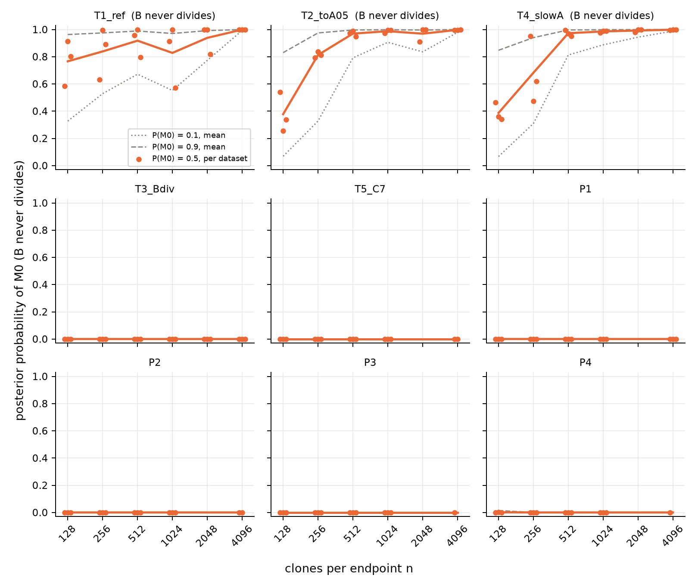
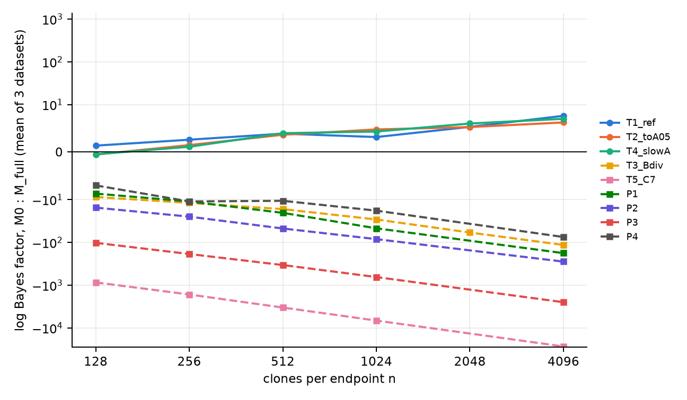
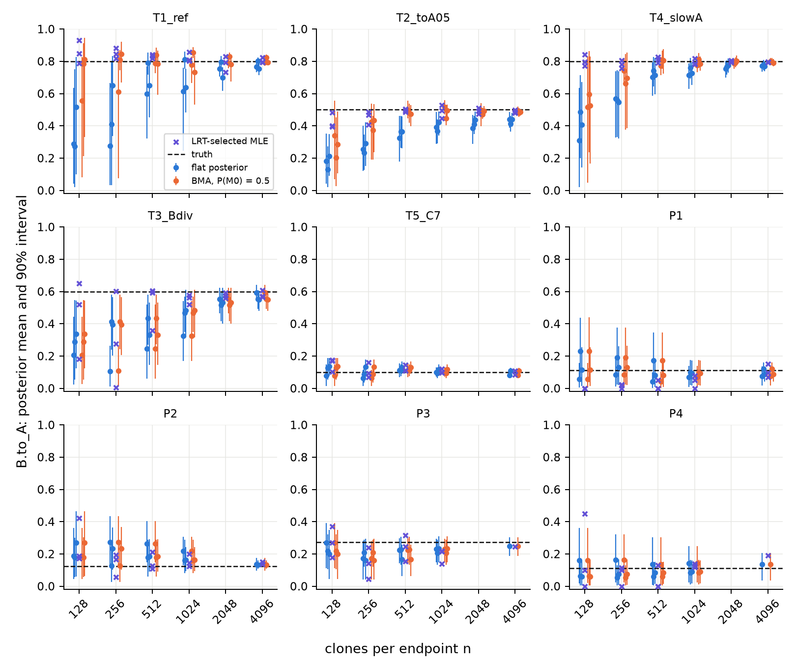
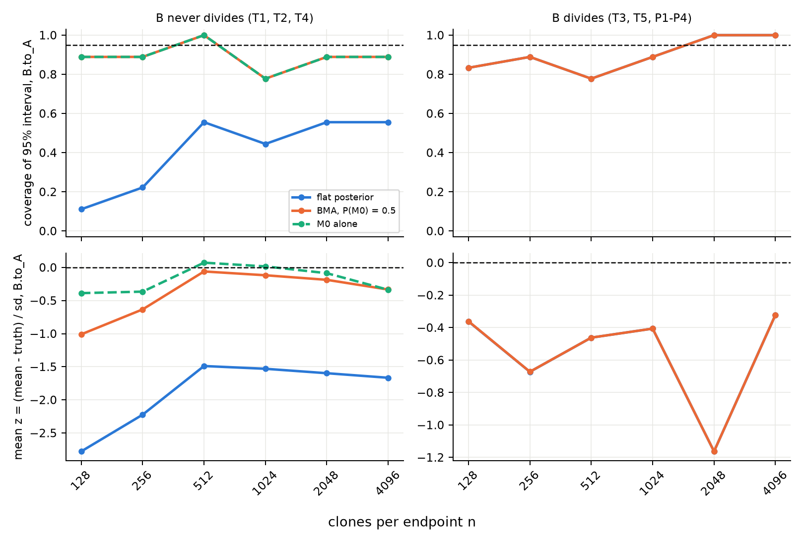

# Spike-and-slab on B's divisions (XG2, exact two-type GW)

Question: under the flat Dirichlet prior, truths where B never divides (T1_ref, T2_toA05,
T4_slowA) get a posterior for B.to_A that is biased low by a constant 1.2-2.4 posterior
sd at every n up to 4096 (`report_exact_gw` §6-7). The posterior there is a normal
truncated at a face of the simplex, so the bias does not shrink in sd units. Does a prior
with point mass on the face "B never divides" (B.div_AA = B.div_AB = B.div_BB = 0)
remove it, and what does it cost for truths that do divide?

Data: the 141 XG2 runs of `results/exact_gw/data_size` that have an `mle.json`
(9 truths x n 128-1024 x 3 datasets, n 2048/4096 for T1-T4, and the P1-P4 / T5 large-n
runs that had arrived by 15:10 on 22 Nov: P1 n4096 x3, P2 n4096 x2, P3/P4/T5 n4096 x1).
Code: `scripts/spike_slab/`. Per-run results: `results/exact_gw/spike_slab/runs/`.
Tables: `tables/`. Figures: `figures/`.

## Short answer

* **Yes for the truths without B divisions.** With prior weight 1/2 on M0, P(M0 | y)
  averages 0.77-0.94 for T1 at n 128-2048 and 0.999 at 4096, and goes from 0.38 (n 128)
  to 0.97-0.999 (n >= 512) for T2 and T4. The model-averaged (BMA) posterior of B.to_A
  then has mean z -0.06 to -0.33 for n >= 512 (flat posterior: -1.5 to -1.7), and its
  95% interval covers the truth in 89% of the 54 runs (flat: 41%). RMSE of the mean for
  B.to_A drops from 0.218 to 0.099 overall, and from 0.11-0.13 to 0.02-0.04 at
  n 512-1024.
* **It costs nothing measurable for truths that divide.** P(M0 | y) is at most 0.004 in
  all 87 runs of T3, T5 and P1-P4 (largest log Bayes factor -5.5, P4 n 128 seed 1; below
  -7 in every other run, down to -27 000). The BMA mean differs from the flat posterior
  mean by at most 0.0014 for any probability with P(M0) = 1/2 (0.012 with P(M0) = 0.9),
  and B.to_A's RMSE and coverage are unchanged (0.118, 95% coverage 0.874, both methods).
* **The remaining cost is at n = 128-256**, where the data barely separate the models:
  P(M0 | y) is 0.26-0.54 for T2/T4 at n = 128. The BMA posterior is then a two-bump
  mixture (flat posterior with B.to_A near 0.2, M0 posterior near the truth), its mean
  sits in between (mean z -1.0 at n 128, -0.6 at 256), and its result depends on the
  prior weight: RMSE 0.33 / 0.22 / 0.09 at n 128 for P(M0) = 0.1 / 0.5 / 0.9. From
  n = 512 on the prior weight matters much less (RMSE within 0.035).
* **The LRT-selected MLE is as good as the BMA mean for point estimation** (RMSE 0.040
  against 0.046 for BMA with P(M0) = 0.9 and 0.099 with 0.5, on the no-division truths),
  but it gives no interval. The two decisions agree in 134/141 runs; the 7 disagreements
  are T2/T4 at n 128-256, where the LRT keeps M0 by default (p 0.06-0.66) and BMA is
  undecided (P(M0) 0.26-0.48), plus T1 n 2048 seed 2 (LRT rejects at p = 0.016, BMA gives
  P(M0) = 0.82).
* **It does not help T3_Bdiv**, whose truth is interior: its bias (mean z -3.1 to -1.0)
  comes from the ridge plus volume effect, not the boundary, and BMA leaves it unchanged.
* **No-dedifferentiation face**: P(B never dedifferentiates | y) < 3e-4 in all 141 runs
  (log BF of "B.to_A = B.div_AA = B.div_AB = 0" against M_full at most -8.0, T2 n 128).
  The Bayesian counterpart of the dedifferentiation LRT detects dedifferentiation in every
  run.



## Models and priors

* **M_full**: flat Dirichlet(1) on A's 6 outcomes and on B's 6 outcomes (10 free
  dimensions). Its posterior is the existing NUTS run.
* **M0** ("B never divides"): B.div_AA = B.div_AB = B.div_BB = 0; A row Dir(1) on 6
  outcomes, B row Dir(1) on (death, to_A, persist); 7 free dimensions. This is the
  conditional of M_full's prior on the face (a flat Dirichlet restricted to a face is
  flat), so the comparison is a proper spike-and-slab and Savage-Dickey consistent.
* **Main prior over models**: P(M0) = 1/2, P(M_full) = 1/2; sensitivity with P(M0) = 0.1
  and 0.9.
* **Eight division faces** (each subset of B.div_* set to 0, uniform 1/8 each): run for
  seed 0, n 128-1024, all 9 truths (36 runs), see "Eight faces" below.
* **No dedifferentiation**: B.to_A = B.div_AA = B.div_AB = 0 (B can only die, persist or
  make B B), against M_full with prior 1/2.

P(M0 | y) = pi0 Z0 / (pi0 Z0 + (1 - pi0) Z_full). BMA posterior = (1 - P(M0 | y)) x
[M_full NUTS draws] + P(M0 | y) x [M0 draws], with B.div_* exactly 0 in the M0 part.
Summaries: weighted mean, sd, 2.5/5/95/97.5% quantiles (equal-tailed intervals).
z = (mean - truth) / sd.

## Evidence estimation

All face models are written in additive log-ratio coordinates (per row, log p_i / p_ref
with the row's largest posterior-mean entry as reference). The flat Dirichlet becomes the
normalised density (m-1)! prod_i p_i in these coordinates, so the integral of
likelihood x prior density is the evidence (checked by Monte Carlo to 1%).

1. **Laplace (unconstrained)**: mode of log L + log prior density in ALR coordinates
   (L-BFGS from the stored MLE, the posterior mean, the best projected NUTS draws and two
   prior draws), Hessian from central differences of the exact (adjoint-kernel) gradient.
   With a flat Dirichlet, ALR and logit-stick coordinates give the same Laplace value.
2. **Laplace in physical coordinates at the MLE** (validation only): plain; "truncated"
   = Gaussian at the MLE times its mass inside the simplex (Monte Carlo, 4e5 draws); and
   the boundary-aware version with the gradient term at a boundary MLE
   (exp(g'H^-1 g / 2) x P(N(MLE + H^-1 g, H^-1) in simplex)).
3. **Posterior draws**: M_full uses the existing NUTS draws (2000). M0 and the other
   faces use waste-free tempered SMC (`bio_sbi.inference.smc`, 100 chains x 8 steps,
   reference = Laplace t (df 5, covariance x 1.44) mixed 70/30 with a t fitted to the
   NUTS draws projected onto the face, 20 000 likelihood evaluations).
4. **Bridge sampling (main estimate)**: Meng-Wong optimal bridge between the posterior
   draws and 2000 fresh draws from a proposal fitted to them (Gaussian mixture by EM, used
   as t's with covariance x 1.21), effective size of the posterior draws from the
   autocorrelation of their log density. Two proposals (1 and 4 components); the main
   estimate is their mean, the spread is reported. Plain IS from the same fresh draws and
   SMC's own evidence are kept for comparison.

If the bridge estimate fails (once: T5 n 1024, M0, a model 3300 nats worse), the SMC
evidence is used. For the no-dedifferentiation face, SMC + bridge is only run if its
Laplace log BF against M_full is above -25 (otherwise the Laplace value is used; it is
-25 to -2800 nats there, far beyond any approximation error).

Cost: about 50-120 s per run for M_full + M0 + no-dediff on one thread (adjoint kernel),
140 runs in 65 min on 4 workers; the 6 extra faces at half budget about 4 min per run.

### Approximation checks

Ten runs, each estimator minus the bridge estimate (nats;
`tables/validation_evidence.md`). "NUTS bridge" uses 2 NUTS chains (400 warmup + 500
draws) on M0 instead of SMC draws (`nuts_m0.py`; 5 runs).

| run | model | Laplace (ALR) | Laplace phys. | trunc. Laplace | trunc. + gradient | IS | NUTS bridge |
|---|---|---|---|---|---|---|---|
| T1_ref n128 s0 | full | -1.02 | +9.23 | -2.98 | +2.6e+04 (p 0) | -0.22 (k 1.19) |  |
| T1_ref n128 s0 | M0 | -0.11 | +2.34 | +0.41 | +0.20 (p 0.091) | +0.17 (k 0.51) | +0.27 |
| T1_ref n1024 s0 | full | -2.26 | +1.88 | +0.43 | -0.76 (p 0.0072) | -0.10 (k 0.77) |  |
| T1_ref n1024 s0 | M0 | -0.07 | +0.19 | +0.08 | +0.09 (p 0.9) | +0.04 (k 0.38) | +0.10 |
| T1_ref n4096 s0 | full | -0.38 | +2.15 | -0.01 | -0.17 (p 0.088) | -0.11 (k 0.16) |  |
| T1_ref n4096 s0 | M0 | +0.04 | +0.10 | +0.10 | +0.10 (p 1) | +0.15 (k 0.59) |  |
| T2_toA05 n128 s1 | full | -0.93 | +1.97 | -2.70 | -3.23 (p 0.00066) | +0.15 (k 0.61) |  |
| T2_toA05 n128 s1 | M0 | -0.27 | +1.55 | -0.66 | -0.79 (p 0.09) | +0.14 (k 0.54) |  |
| T2_toA05 n512 s0 | full | -0.81 | +2.58 | -0.50 | -1.25 (p 0.018) | -0.16 (k 0.60) |  |
| T2_toA05 n512 s0 | M0 | +0.04 | +0.52 | +0.28 | +0.28 (p 0.79) | +0.28 (k 0.88) | +0.30 |
| T4_slowA n256 s0 | full | -0.56 | +9.88 | +0.89 | +5.7e+06 (p 0) | -0.14 (k 0.67) |  |
| T4_slowA n256 s0 | M0 | -0.03 | +0.53 | +0.30 | +0.30 (p 0.8) | +0.12 (k 0.49) |  |
| T3_Bdiv n512 s0 | full | -0.63 | -0.80 | -2.85 | -3.08 (p 0.096) | +0.88 (k 4.53) |  |
| T3_Bdiv n512 s0 | M0 | -0.04 | +3.18 | +1.54 | +0.27 (p 0.00021) | +0.29 (k 0.72) | +0.29 |
| P1 n128 s0 | full | -0.66 | +11.78 | +0.49 | +9.3e+06 (p 0) | +0.08 (k 1.41) |  |
| P1 n128 s0 | M0 | +0.11 | +3.44 | +1.24 | +0.51 (p 0.00038) | +0.15 (k 0.68) |  |
| P3 n512 s0 | full | -0.61 | +3.83 | +0.76 | -0.77 (p 2.5e-06) | -0.94 (k 6.49) |  |
| P3 n512 s0 | M0 | -0.25 | +19.98 | +7.08 | +3.0e+06 (p 0) | +0.04 (k 0.41) | +0.04 |
| T5_C7 n512 s0 | full | -0.40 | +0.78 | -0.10 | -0.10 (p 0.41) | +0.18 (k 0.66) |  |
| T5_C7 n512 s0 | M0 | +26.51 | +25.10 | +17.13 | +1.5e+03 (p 0) | +11.95 (k 1.69) |  |

What this shows:

* **Bridge with good draws is stable to about 0.1-0.3 nats.** The two proposals differ by
  0.16 (median) and at most 0.58 nats for M_full on the no-division truths, 0.04 (median)
  and at most 0.14 for M0. Against NUTS draws on M0, the SMC-based bridge is lower by
  0.04-0.30 nats (5 runs), so P(M0 | y) may be slightly understated (by at most ~0.07
  where it is near 1/2).
* **Laplace in ALR coordinates is good for M0** (within 0.3 nats where M0 holds) **but
  underestimates M_full** by 0.4-2.3 nats: the full posterior is skewed against the
  boundary and, at small n, two-branched. Used alone it would overstate the evidence for
  M0 by up to ~2 nats.
* **Laplace at a boundary MLE** without truncation overestimates by 2-12 nats (much of
  the Gaussian lies outside the simplex). Truncation to the simplex (Gaussian at the MLE
  times its mass inside) brings it to -3 ... +1.5 nats (7 and 17 for M0 of P3 and T5,
  models hundreds of nats worse than M_full). The version with the gradient term is within
  -3.1 ... +0.3 nats when its truncation probability is above 1%, and useless when the
  shifted centre is far outside (probability below 1/4e5; then off by thousands to
  millions).
* **Plain importance sampling** from the same proposals has Pareto k above 0.7 in 8 of 20
  cases and errors of -0.9 ... +0.9 nats (12 for M0 of T5).
* **M0 posterior summaries** (SMC draws against NUTS, `tables/validation_m0_posterior.md`):
  means agree within 0.007 for B.to_A and 0.014 for every probability; the SMC sd's are
  smaller than NUTS's by 7% on average (median 6%, range -10% ... +29%; B.to_A 2-11%),
  so M0-part intervals are slightly narrow.

## Results

### P(M0 | y) by truth and n (P(M0) = 1/2, mean of 3 datasets)

| gt       |   128 |   256 |   512 |   1024 |   2048 |   4096 |
|:---------|------:|------:|------:|-------:|-------:|-------:|
| T1_ref   | 0.766 | 0.839 | 0.918 |  0.828 |  0.939 |  0.999 |
| T2_toA05 | 0.378 | 0.813 | 0.97  |  0.988 |  0.969 |  0.998 |
| T4_slowA | 0.387 | 0.682 | 0.973 |  0.986 |  0.993 |  0.999 |
| T3_Bdiv  | 0     | 0     | 0     |  0     |  0     |  0     |
| T5_C7    | 0     | 0     | 0     |  0     |        |  0     |
| P1       | 0     | 0     | 0     |  0     |        |  0     |
| P2       | 0     | 0     | 0     |  0     |        |  0     |
| P3       | 0     | 0     | 0     |  0     |        |  0     |
| P4       | 0.002 | 0     | 0     |  0     |        |  0     |

Log Bayes factor M0 : M_full grows roughly like 1.5 log n for the no-division truths
(T1: 1.4, 2.6, 3.9, 3.2, 5.3, 7.6 at n = 128 ... 4096; dataset-to-dataset range about
+-3) and falls linearly in n for the others (-9 to -115 for T3, -7 to -75 for P4, the
closest dividing truth).



### B.to_A against the flat posterior, the MLE and the LRT-selected MLE



B.to_A over all n (`tables/btoa_by_class_method.md`; per truth and n: `tables/btoa_by_truth_n_method.md`):

| cls                        | method    |   runs |   rmse |   bias |   cov90 |   cov95 |   mean_z |
|:---------------------------|:----------|-------:|-------:|-------:|--------:|--------:|---------:|
| B divides (others)         | BMA_pi0.1 |     87 |  0.118 | -0.038 |   0.816 |   0.874 |   -0.478 |
| B divides (others)         | BMA_pi0.5 |     87 |  0.118 | -0.038 |   0.816 |   0.874 |   -0.478 |
| B divides (others)         | BMA_pi0.9 |     87 |  0.118 | -0.038 |   0.816 |   0.874 |   -0.475 |
| B divides (others)         | LRT       |     87 |  0.121 | -0.032 |         |         |          |
| B divides (others)         | M0        |     87 |  0.211 |  0.115 |   0.103 |   0.149 |    1.155 |
| B divides (others)         | MLE       |     87 |  0.121 | -0.032 |         |         |          |
| B divides (others)         | flat      |     87 |  0.118 | -0.038 |   0.816 |   0.874 |   -0.478 |
| B never divides (T1,T2,T4) | BMA_pi0.1 |     54 |  0.165 | -0.097 |   0.759 |   0.833 |   -0.757 |
| B never divides (T1,T2,T4) | BMA_pi0.5 |     54 |  0.099 | -0.049 |   0.87  |   0.889 |   -0.391 |
| B never divides (T1,T2,T4) | BMA_pi0.9 |     54 |  0.046 | -0.017 |   0.87  |   0.889 |   -0.214 |
| B never divides (T1,T2,T4) | LRT       |     54 |  0.04  | -0.001 |         |         |          |
| B never divides (T1,T2,T4) | M0        |     54 |  0.034 | -0.008 |   0.852 |   0.889 |   -0.182 |
| B never divides (T1,T2,T4) | MLE       |     54 |  0.092 | -0.043 |         |         |          |
| B never divides (T1,T2,T4) | flat      |     54 |  0.218 | -0.163 |   0.278 |   0.407 |   -1.881 |

Mean z of B.to_A by n (sd units; flat posterior against BMA with P(M0) = 1/2 and M0
alone):

| gt       | method    |   128 |   256 |   512 |   1024 |   2048 |   4096 |
|:---------|:----------|------:|------:|------:|-------:|-------:|-------:|
| T1_ref   | BMA_pi0.5 | -0.33 | -0.02 |  0.35 |   0.61 |   0.35 |   0.33 |
| T1_ref   | M0        |  0.52 |  0.77 |  0.64 |   0.93 |   0.48 |   0.33 |
| T1_ref   | flat      | -2.07 | -1.66 | -1.05 |  -0.95 |  -1.35 |  -1.19 |
| T2_toA05 | BMA_pi0.5 | -1.58 | -1.03 | -0.4  |  -0.59 |  -0.63 |  -0.99 |
| T2_toA05 | M0        | -1.19 | -1.24 | -0.36 |  -0.5  |  -0.46 |  -1    |
| T2_toA05 | flat      | -3.94 | -3.12 | -2.17 |  -2.14 |  -2.2  |  -2.4  |
| T4_slowA | BMA_pi0.5 | -1.12 | -0.86 | -0.13 |  -0.37 |  -0.29 |  -0.34 |
| T4_slowA | M0        | -0.5  | -0.63 | -0.06 |  -0.38 |  -0.28 |  -0.34 |
| T4_slowA | flat      | -2.32 | -1.89 | -1.25 |  -1.5  |  -1.24 |  -1.41 |
| T3_Bdiv  | BMA_pi0.5 | -2.4  | -3.09 | -2.25 |  -1.89 |  -1.16 |  -0.97 |
| T3_Bdiv  | M0        |  1.85 |  2.3  |  3.55 |   4.95 |   8.16 |  12.36 |
| T3_Bdiv  | flat      | -2.4  | -3.1  | -2.25 |  -1.89 |  -1.16 |  -0.97 |

* T1 and T4: the BMA z is -0.02 ... +0.62 for T1 from n = 256 on and -0.13 ... -0.37 for
  T4 from n = 512 on, against -0.95 ... -2.3 for the flat posterior: the constant sd-unit
  bias is gone.
* T2: BMA z -0.4 ... -1.0 at n >= 512, which is what M0 alone gives (-0.36 ... -1.0, 3
  datasets per cell, se about 0.6); the flat posterior is at -2.1 ... -2.4.



### All 12 probabilities

| class | method | RMSE | cov 90 | cov 95 | mean z |
|---|---|---|---|---|---|
| B divides (others) | BMA_pi0.5 | 0.069 | 0.893 | 0.948 | -0.013 |
| B divides (others) | LRT | 0.100 |  |  |  |
| B divides (others) | M0 | 0.234 | 0.091 | 0.111 |  |
| B divides (others) | MLE | 0.100 |  |  |  |
| B divides (others) | flat | 0.069 | 0.893 | 0.948 | -0.013 |
| B never divides (T1,T2,T4) | BMA_pi0.5 | 0.037 | 0.943 | 0.968 | +0.012 |
| B never divides (T1,T2,T4) | LRT | 0.030 |  |  |  |
| B never divides (T1,T2,T4) | M0 | 0.022 | 0.924 | 0.960 | -0.034 |
| B never divides (T1,T2,T4) | MLE | 0.046 |  |  |  |
| B never divides (T1,T2,T4) | flat | 0.080 | 0.594 | 0.648 | +0.079 |

Under the flat posterior the three B.div_* of the no-division truths are never covered by
an equal-tailed interval (the truth 0 is outside every central interval of a continuous
posterior); the BMA puts an atom at 0 and covers them in 100% of runs. The A row also
improves (RMSE of A.death 0.048 to 0.024, coverage 0.76 to 0.98), because the M0 fit no
longer trades A's deaths against B's divisions.

### Prior-weight sensitivity (B.to_A, no-division truths)

|    n |   cov95 BMA_pi0.1 |   cov95 BMA_pi0.5 |   cov95 BMA_pi0.9 |   cov95 flat |   mean_z BMA_pi0.1 |   mean_z BMA_pi0.5 |   mean_z BMA_pi0.9 |   mean_z flat |   rmse BMA_pi0.1 |   rmse BMA_pi0.5 |   rmse BMA_pi0.9 |   rmse flat |
|-----:|------------------:|------------------:|------------------:|-------------:|-------------------:|-------------------:|-------------------:|--------------:|-----------------:|-----------------:|-----------------:|------------:|
|  128 |             0.556 |             0.889 |             0.889 |        0.111 |             -2.023 |             -1.01  |             -0.411 |        -2.778 |            0.333 |            0.215 |            0.092 |       0.399 |
|  256 |             0.889 |             0.889 |             0.889 |        0.222 |             -1.214 |             -0.634 |             -0.429 |        -2.224 |            0.211 |            0.104 |            0.052 |       0.298 |
|  512 |             1     |             1     |             1     |        0.556 |             -0.318 |             -0.061 |              0.034 |        -1.489 |            0.049 |            0.021 |            0.02  |       0.13  |
| 1024 |             0.778 |             0.778 |             0.778 |        0.444 |             -0.325 |             -0.118 |             -0.027 |        -1.531 |            0.063 |            0.037 |            0.029 |       0.111 |
| 2048 |             0.889 |             0.889 |             0.889 |        0.556 |             -0.345 |             -0.187 |             -0.113 |        -1.598 |            0.032 |            0.016 |            0.015 |       0.068 |
| 4096 |             0.889 |             0.889 |             0.889 |        0.556 |             -0.318 |             -0.334 |             -0.337 |        -1.666 |            0.013 |            0.013 |            0.013 |       0.047 |

For the dividing truths the three prior weights give the same results to three decimals
in the tables (largest P(M0 | y) with P(M0) = 0.9: 0.034, P4 n 128 seed 1).

### Eight faces

Uniform prior 1/8 on each subset of {B.div_AA, B.div_AB, B.div_BB} pinned at 0 (M_full
and M0 included), seed 0 only, n 128-1024, all 9 truths (36 runs). The six intermediate
faces were run at half the budget (SMC 10 000 evaluations, 1000 fresh draws), so their
evidences are less precise (about 0.3-0.5 nats). `tables/faces8_per_run.md`.

| gt       |    n |   P(M_full) |   P(div_AA=0) |   P(div_AB=0) |   P(div_BB=0) |   P(M0), 8 faces |   P(M0), 2 models |   B.to_A BMA8 mean |   B.to_A z |
|:---------|-----:|------------:|--------------:|--------------:|--------------:|-----------------:|------------------:|-------------------:|-----------:|
| T1_ref   |  128 |       0.212 |         0.579 |         0.512 |         0.593 |            0.297 |             0.584 |              0.531 |     -1.101 |
| T1_ref   |  256 |       0.22  |         0.581 |         0.639 |         0.625 |            0.377 |             0.632 |              0.541 |     -0.855 |
| T1_ref   |  512 |       0.023 |         0.678 |         0.855 |         0.86  |            0.531 |             0.958 |              0.758 |     -0.591 |
| T1_ref   | 1024 |       0.034 |         0.702 |         0.914 |         0.491 |            0.356 |             0.912 |              0.754 |     -0.753 |
| T2_toA05 |  128 |       0.145 |         0.306 |         0.691 |         0.588 |            0.17  |             0.54  |              0.279 |     -1.632 |
| T2_toA05 |  256 |       0.087 |         0.553 |         0.753 |         0.644 |            0.33  |             0.792 |              0.374 |     -1.226 |
| T2_toA05 |  512 |       0.016 |         0.779 |         0.851 |         0.884 |            0.606 |             0.974 |              0.469 |     -0.452 |
| T2_toA05 | 1024 |       0.015 |         0.852 |         0.751 |         0.836 |            0.548 |             0.973 |              0.491 |     -0.183 |
| T4_slowA |  128 |       0.289 |         0.517 |         0.466 |         0.532 |            0.249 |             0.463 |              0.483 |     -1.196 |
| T4_slowA |  256 |       0.027 |         0.867 |         0.792 |         0.732 |            0.534 |             0.951 |              0.723 |     -1.18  |
| T4_slowA |  512 |       0.003 |         0.932 |         0.867 |         0.887 |            0.722 |             0.996 |              0.767 |     -0.868 |
| T4_slowA | 1024 |       0.01  |         0.945 |         0.636 |         0.726 |            0.421 |             0.977 |              0.758 |     -1.2   |
| T3_Bdiv  |  128 |       0.581 |         0.062 |         0.303 |         0.201 |            0     |             0     |              0.214 |     -2.966 |
| T3_Bdiv  |  256 |       0.656 |         0.115 |         0.224 |         0.123 |            0     |             0     |              0.157 |     -2.65  |
| T3_Bdiv  |  512 |       0.678 |         0.132 |         0.283 |         0.006 |            0     |             0     |              0.284 |     -1.965 |
| T3_Bdiv  | 1024 |       0.438 |         0.493 |         0.405 |         0     |            0     |             0     |              0.451 |     -1.063 |
| T5_C7    |  128 |       0.671 |         0.151 |         0.196 |         0     |            0     |             0     |              0.088 |     -0.279 |
| T5_C7    |  256 |       0.746 |         0.033 |         0.22  |         0     |            0     |             0     |              0.068 |     -1.008 |
| T5_C7    |  512 |       0.476 |         0.018 |         0.506 |         0     |            0     |             0     |              0.12  |      0.85  |
| T5_C7    | 1024 |       0.815 |         0     |         0.185 |         0     |            0     |             0     |              0.101 |      0.05  |
| P1       |  128 |       0.53  |         0.078 |         0.048 |         0.442 |            0     |             0     |              0.059 |     -0.976 |
| P1       |  256 |       0.744 |         0.122 |         0.035 |         0.196 |            0     |             0     |              0.089 |     -0.347 |
| P1       |  512 |       0.644 |         0.011 |         0.023 |         0.346 |            0     |             0     |              0.042 |     -2.244 |
| P1       | 1024 |       0.744 |         0     |         0.092 |         0.197 |            0     |             0     |              0.066 |     -1.21  |
| P2       |  128 |       0.541 |         0.063 |         0.423 |         0.012 |            0     |             0     |              0.193 |      0.749 |
| P2       |  256 |       0.663 |         0.209 |         0.192 |         0     |            0     |             0     |              0.302 |      1.618 |
| P2       |  512 |       0.561 |         0.038 |         0.42  |         0     |            0     |             0     |              0.258 |      1.625 |
| P2       | 1024 |       0.722 |         0     |         0.278 |         0     |            0     |             0     |              0.213 |      1.885 |
| P3       |  128 |       0.844 |         0.07  |         0.041 |         0.092 |            0     |             0     |              0.271 |     -0.009 |
| P3       |  256 |       0.775 |         0.15  |         0.035 |         0.076 |            0     |             0     |              0.17  |     -1.467 |
| P3       |  512 |       0.874 |         0.014 |         0.094 |         0.02  |            0     |             0     |              0.223 |     -1.046 |
| P3       | 1024 |       0.862 |         0.029 |         0.006 |         0.106 |            0     |             0     |              0.229 |     -1.014 |
| P4       |  128 |       0.412 |         0.173 |         0.168 |         0.539 |            0     |             0     |              0.173 |      0.615 |
| P4       |  256 |       0.383 |         0.155 |         0.196 |         0.562 |            0     |             0     |              0.163 |      0.621 |
| P4       |  512 |       0.339 |         0.239 |         0.163 |         0.619 |            0     |             0     |              0.128 |      0.185 |
| P4       | 1024 |       0.356 |         0.279 |         0.119 |         0.608 |            0     |             0     |              0.133 |      0.382 |

True B divisions of the dividing truths:

| gt      |   B.div_AA_truth |   B.div_AB_truth |   B.div_BB_truth |
|:--------|-----------------:|-----------------:|-----------------:|
| T3_Bdiv |            0.02  |            0.05  |            0.15  |
| T5_C7   |            0.05  |            0.05  |            0.67  |
| P1      |            0.262 |            0.266 |            0.024 |
| P2      |            0.35  |            0.004 |            0.358 |
| P3      |            0.195 |            0.334 |            0.083 |
| P4      |            0.175 |            0.506 |            0.018 |

* **For the no-division truths the eight-face prior dilutes the gain.** M_full itself is
  rejected (P below 0.035 from n = 512, as with two models), but M0's 1/8 prior share
  competes with the six intermediate faces, which still allow one or two B divisions near
  0 and are therefore still truncated at a boundary. P(M0 | y) is 0.17-0.72 (two-model:
  0.46-0.996), and B.to_A's z is -0.2 ... -1.2 at n 512-1024, against -1.0 ... +0.5 for
  the two-model BMA and -1.3 ... -2.0 for the flat posterior on the same six runs. The
  marginal probability that each single division is zero is 0.5-0.95.
* **For the dividing truths it finds small rates**, which two models cannot express:
  P(B.div_AB = 0) = 0.19-0.42 for P2 (true 0.004), P(B.div_BB = 0) = 0.20-0.62 for P1 and
  P4 (true 0.018-0.024), P(B.div_AA = 0) = 0.49 for T3 at n 1024 (true 0.02). These are
  near-zero rates that the data cannot tell from zero. B.to_A barely changes: P2's z is
  +0.7 ... +1.9 with eight faces and +0.7 ... +1.85 under the flat posterior.
* So the prior over models matters: put the point mass on the structural hypothesis of
  interest ("B never divides", 1/2), not spread uniformly over all faces.

### No dedifferentiation

`tables/log_bf_nodediff_max.md`: largest log BF of "B never dedifferentiates" against
M_full per truth and n. Every value is below -8 (T2 and P4 at n 128) and falls to -190
... -2800 at n 4096. P(dedifferentiation | y) > 0.9997 in every run.

## Caveats

* **Three datasets per cell.** Coverages are fractions of 3-9 runs; one miss moves a
  cell by 0.11-0.33.
* **M_full draws are the existing NUTS runs.** Where they are mis-mixed (e.g. T1 n 256
  seed 1, R-hat 3.75) the M_full bridge estimate and the flat part of the BMA inherit the
  error.
* **Evidence errors of 0.1-0.3 nats** (bridge proposals; SMC against NUTS draws) move
  P(M0 | y) by at most about 0.07 where it is near 1/2 and not at all elsewhere.
* **M0 draws are SMC draws** with sd's about 7% too small (validated on 5 runs), which
  makes the M0 component's intervals slightly narrow; the BMA's 95% coverage for B.to_A
  (89%) may be about 2-4 points low for this reason.
* **The prior on models is a choice.** P(M0) = 1/2 is the natural default for a binary
  structural question; the result for n >= 512 does not depend on it, but at n 128-256
  it does (above).
* **T5 n 2048 and the P1-P4/T5 runs still being computed** are not included. Rerun
  `evidence_runs.py` (it skips finished runs and picks up any run with an `mle.json`),
  then `analysis.py`.

## Reproduce

```
uv run python scripts/spike_slab/evidence_runs.py --workers 4                # M_full, M0, no-dediff
uv run python scripts/spike_slab/evidence_runs.py --models z_AA,z_AB,z_BB,z_AA_AB,z_AA_BB,z_AB_BB \
    --scale 0.5 --workers 2 --only T1_ref:128:0 ...                             # eight faces (subset)
uv run python scripts/spike_slab/nuts_m0.py T1_ref:128:0 T1_ref:1024:0 T2_toA05:512:0 \
    T3_Bdiv:512:0 P3:512:0 --workers 2 --chains 2 --warmup 400 --draws 500     # NUTS check of M0
uv run python scripts/spike_slab/validate.py --workers 3                       # approximation table
uv run python scripts/spike_slab/analysis.py                                   # tables and figures
```

Files: `core.py` (faces, ALR coordinates, Laplace, SMC draws, bridge sampling, physical
Laplace), `evidence_runs.py`, `nuts_m0.py`, `validate.py`, `analysis.py`.
