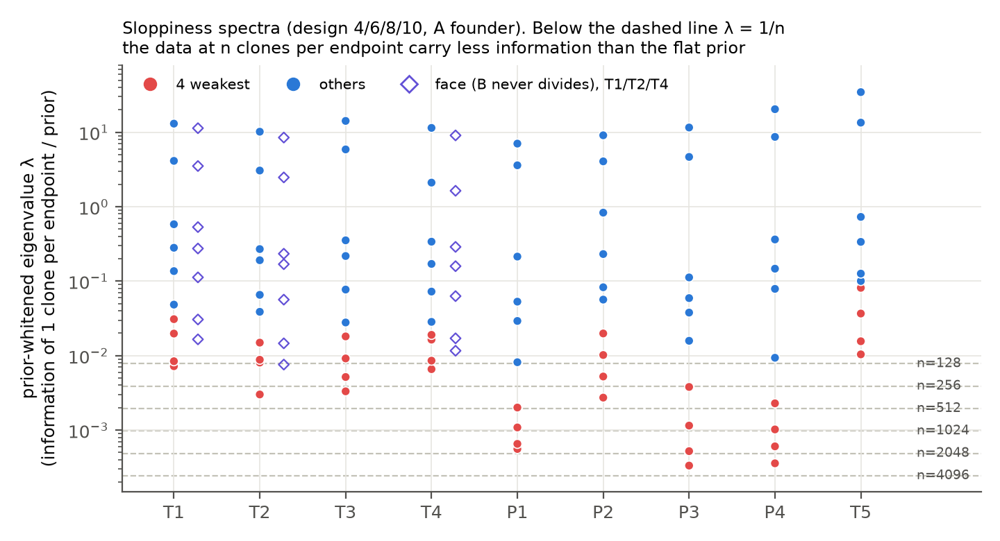
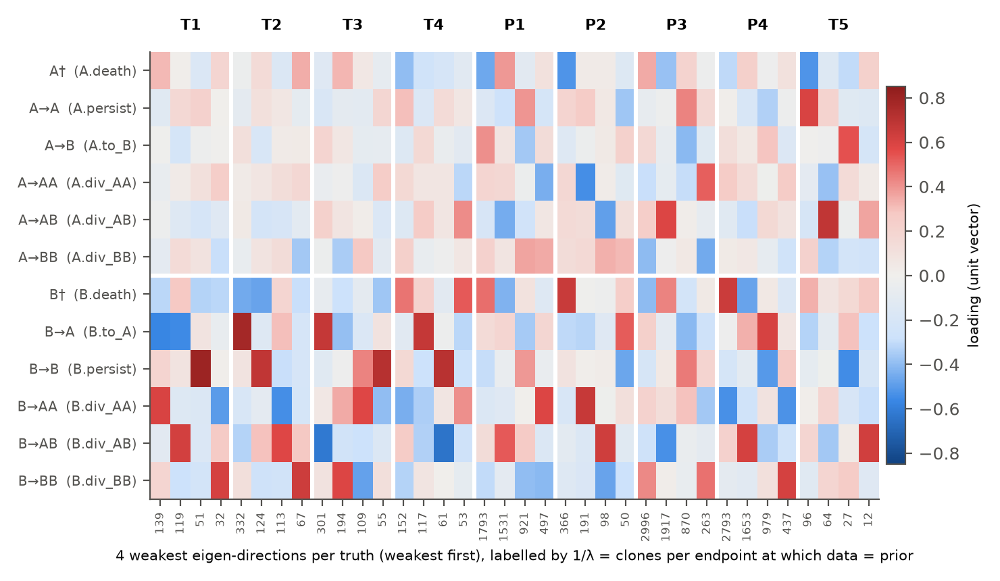
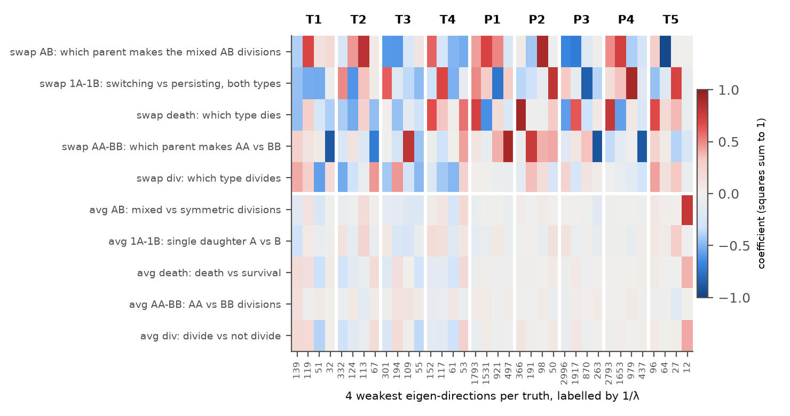
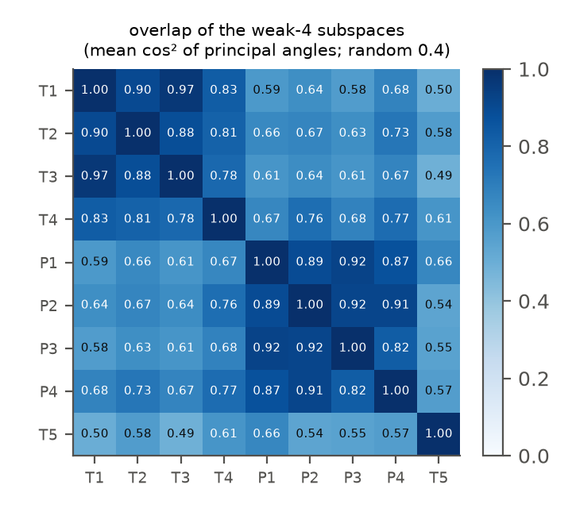
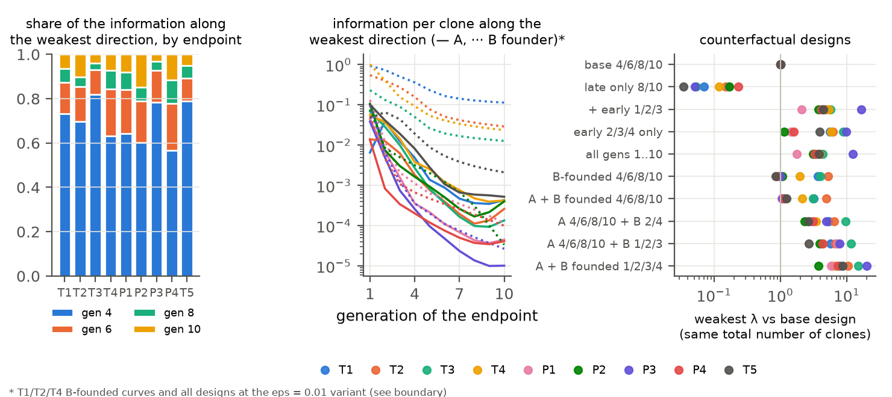
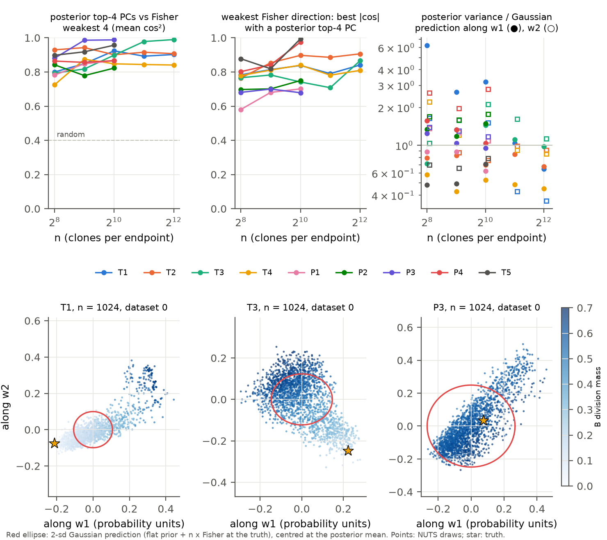

# Weak ("sloppy") parameter directions of the exact two-type GW model

Question: report Section 6 explains the bias of B→A with two weak directions found by hand:
(1) B switches back to A vs B is lost, and (2) which parent made a mixed division (P3). Are
there others? This study searches all directions systematically, using the exact expected
Fisher information, for every XG2 ground truth. It names and ranks the directions, checks
them against the XG2 NUTS posteriors, and asks which experimental design would break them.

## Short answer

* **The spectrum has three tiers in every truth.** Two stiff directions are informed with less
  than one clone per endpoint: the average cell's growth (death vs division) and the
  composition of its offspring (AA vs BB, A vs B single daughter). Two to four intermediate
  directions are informed by 2 to 35 clones per endpoint: the average cell's division
  symmetry (AB vs AA + BB) and its persistence vs death plus division. Then comes a block of
  **4 to 5 weak directions**, informed only at 1/λ = **50 to 3000 clones per endpoint**.
* **The weak block is "who does it", not "what happens".** Per truth, 74–100% of the
  weight of the 4 weakest eigenvectors lies in one 5-dimensional subspace (a random
  vector would put 50% there). In
  that subspace an outcome moves between A parents and B parents while the
  population-average outcome distribution u_A p_A + u_B p_B stays fixed (u = stable type
  composition). The clone counts show how many A and B cells are produced. They show poorly
  *which type of parent* produced them. The five named "parent swaps", ranked by the clones
  per endpoint at which the posterior variance along them halves (n½, flat prior, the other 9
  directions free):

  | rank | weak direction (parent swap) | n½, T1–T4 | n½, P1–P4 | n½, T5 |
  |---|---|---|---|---|
  | 1 | **which parent makes the mixed AB divisions** (A→AB vs B→AB; generalises Section 6.1) | 67–155 | 109–2287 | 66 |
  | 2 | **which type dies** (A† vs B†) | 34–79 | 270–2141 | 24 |
  | 3 | **switching vs persisting in both types** (B→A and A→B up, B→B and A→A down; contains the Section 6 B→A ridge) | 62–107 | 63–1023 | 22 |
  | 4 | **which parent makes AA vs BB** (B→AA and A→BB vs A→AA and B→BB) | 33–85 | 117–542 | 3 |
  | 5 | which type divides (least weak) | 30–66 | 22–120 | 8 |

  Every "average cell" direction has n½ ≤ 36 for every truth.
* **The weak eigenvectors recur.** The weak-4 subspaces of T1–T4 overlap 0.78–0.97 (mean
  cos², random 0.40). Those of P1–P4 overlap 0.82–0.92. Between the two groups the overlap
  is 0.58–0.77. The individual eigenvectors are mixtures of the five swaps, because their
  eigenvalues are close (often within a factor 1.2–2). The subspace and the swap
  decomposition are the stable objects, not the single vectors.
* **The Section 6 B→A ridge is part of the weak block for every truth.** It is the weakest
  or second-weakest direction only for T1–T4 (w1 + w2 carry 82–95% of B→A's posterior
  variance) and T5 (53% on w1). For P1–P4 B→A's uncertainty sits mostly in w2–w3. The Fisher
  ridge direction of B→A (posterior covariance × e_B→A) is 80–100% parent swap: "switching
  vs persisting" plus "B divides less, A divides more". Moving down in B→A, the lost mass
  goes to B's divisions (T1: B→AA, B→AB; T3: B→AB) or to B's death (T2). This is the profile
  result of Section 6, now derived from the information alone.
* **Most of the information on the weak directions comes from the earliest endpoint.**
  Generation 4 contributes 57–91% (median 71%) and generation 10 1–15%. Per clone, the
  information along the weakest direction falls 15–3800× from generation 1 to 10. Early
  endpoints, while the clone is still all-A so that the parent type is known, break the
  swaps. With the same total number of clones, the weakest λ improves by these factors:
  adding generations 1/2/3 ×2–17; A- and B-founded clones at 1/2/3/4 ×4–20; 4/6/8/10 plus
  B-founded clones at 1/2/3 ×3–12; B-founded clones at 4/6/8/10 ×2–5 (T1–T4 only, none for
  the P truths); late endpoints only (8/10) ×0.04–0.2.
* **The posteriors follow the Fisher picture.** The posterior's top-4 principal subspace
  overlaps the Fisher weak-4 subspace 0.67–0.99 (median 0.89 at n ≥ 512; random 0.40).
  Variances along w1–w4 are 0.6–1.4 × the Gaussian prediction 1/(1 + nλ) (interquartile
  range). The departures have known causes. At the boundary truths, directions pointing
  into B's divisions are truncated (ratio ≈ 0.4, as for a half-normal, 0.36). T1 at
  n ≤ 1024 has its "B divides" branch (ratio 3–6, 42% of draws with B division mass > 0.15
  at 1024). T3 has a two-branch ridge, P3 a banana-shaped one.
* **Boundary truths (T1, T2, T4, B divisions = 0):** the information at the face is finite
  and continuous. The one-sided values equal those at ε = 0.001 to < 2%, and at ε = 0.01
  to within 10–15%. The asymptotics are not Gaussian along the 16–70% of each weak vector
  that loads on B's divisions: the posterior there is truncated and biased by about one
  posterior sd, and that bias shrinks only like the sd (the report's z ≈ −1.2 to −2.4).
  Knowing that B never divides (the face) raises the weakest λ 1.8–2.5×. It does not
  remove the weak block: 1/λ = 60 (T1), 132 (T2), 86 (T4). Exception: B-founded clones at
  the exact boundary are non-regular. A B-founded clone with more than 2^(h−1) cells at
  generation h is impossible unless B divides, so the expected information along B's
  divisions is infinite, and the floor-truncated value is meaningless. Design numbers for
  T1/T2/T4 therefore use ε = 0.01.

## 1. Method

**Coordinates.** The 12 outcome probabilities (A: death, persist, to_B, div_AA, div_AB,
div_BB; B: death, to_A, persist, div_AA, div_AB, div_BB) move in a 10-dimensional tangent
space, where each row's changes sum to 0. All matrices are stored as 12 × 12 on that space,
so the eigenvectors read directly as loadings on the 12 named probabilities.

**Information.** I_h is the expected Fisher information of one detected clone at
generation h. It comes from the exact pgf/FFT law with forward-mode derivatives
(`src/bio_sbi/inference/gw_fisher.py::horizon_information`, the code of the Jeffreys study).
It is evaluated along our own physical directions, an orthonormal set of row contrasts,
instead of stick coordinates. A boundary truth therefore needs no singular stick Jacobian:
the derivative towards a zero outcome is the one-sided one. A check against the stick-
coordinate information through the exact Jacobian, Jᵀ I_phys J = I_θ, agrees to
relative 3e-15. The design information is n · Σ_{h∈{4,6,8,10}} I_h.

**Main scale: prior-whitened.** The flat Dirichlet(1,…,1) on a 6-outcome row has covariance
(diag(m) − m mᵀ)/7 with m = 1/6, which is P₀/42 (P₀ = projector on the row's tangent
space). It is *isotropic*. Prior whitening is therefore the Euclidean metric of the
probabilities, scaled by 42, and the generalised eigenproblem I v = λ Σ_prior⁻¹ v is just
eig(I/42) on the tangent space. This is not an arbitrary Euclidean choice: it is the flat
prior's own metric. Then **1/λ is the number of clones per endpoint at which the data carry
as much information as the prior along v**. With a Gaussian approximation, the posterior
variance along v is (1/42)/(1 + nλ). Unit vectors are in probability units (a loading of
0.5 at sd 0.05 moves that probability by 0.025).

**Second scale: one observed fate.** `per_clone_vs_one_fate` = vᵀ(I/4)v / vᵀGv, where
G = diag(1/p) per row is the multinomial information of directly observing one cell's
outcome per row. It answers: how many directly observed cell fates is one clone (at one
endpoint) worth along v? For the interior truths the answer along the 3 weakest directions
is **0.0003–0.03**, i.e. 35 to 3000 clones per observed fate. For the 4th weakest
direction it is up to 0.06. On the face of the boundary truths it is 0.013–0.17. Aggregation into clone counts loses
almost all the information on who did what. (At the boundary this ratio is 0 by
definition for any direction that loads on a zero outcome: a single observed B division
would settle it.)

**Named basis.** Let d be a 6-vector over the daughter outcomes (†, 1A, 1B, AA, AB, BB)
summing to 0. Take the orthogonal basis d ∈ {AB − ½(AA + BB), 1A − 1B, † − mean(rest),
AA − BB, divide − not divide}. A **parent swap** is (A row −u_B d, B row +u_A d): outcome
mass moves between the parent types with the population-average outcome distribution fixed.
An **average-cell change** is (A row u_A d, B row u_B d). Together these 10 vectors form an
orthonormal basis of the tangent space, and its names hold for every truth (`named_basis`
in `analyse_fisher.py`).

**Boundary truths.** T1, T2 and T4 have B.div_* = 0. They are analysed three ways:
(a) the full 10-dimensional information at the face (one-sided derivatives);
(b) restricted to the active face (7 dimensions: "B never divides" known);
(c) slightly inside, with each zero set to ε = 0.001 or 0.01 and the rest of B's row
rescaled.

## 2. Sloppiness spectra (figure a)



λ for the design 4/6/8/10 with an A founder (`tables/spectra.csv`). 1/λ for the 6 weakest
directions, in clones per endpoint:

| truth | w1 | w2 | w3 | w4 | w5 | w6 | λ9 | λ10 |
|---|---|---|---|---|---|---|---|---|
| T1 | 139 | 119 | 51 | 32 | 21 | 7 | 4.1 | 13.1 |
| T2 | 332 | 124 | 113 | 67 | 26 | 15 | 3.1 | 10.2 |
| T3 | 301 | 194 | 109 | 55 | 36 | 13 | 5.9 | 14.2 |
| T4 | 152 | 117 | 61 | 53 | 35 | 14 | 2.1 | 11.5 |
| P1 | 1793 | 1531 | 921 | 497 | 123 | 34 | 3.6 | 7.0 |
| P2 | 366 | 191 | 98 | 50 | 18 | 12 | 4.1 | 9.1 |
| P3 | 2996 | 1917 | 870 | 263 | 63 | 26 | 4.7 | 11.6 |
| P4 | 2793 | 1653 | 979 | 437 | 107 | 13 | 8.7 | 20.4 |
| T5 | 96 | 64 | 27 | 12 | 10 | 8 | 13.5 | 34.6 |

The eigenvalues span 4 to 5 decades. At the XG2 sizes (128–1024) the T truths have 1–2
directions with 1/λ > 128 (prior-dominated at n = 128) and none with 1/λ > 1024. P1, P3 and
P4 have 2 directions still prior-dominated at n = 1024 (1/λ 1500–3000), and 2 more with
1/λ 260–980. This is the "which
parent" ridge of Section 6.1 and more. It is the reason the individual division
probabilities of P3 differ between datasets at n = 1024 while every run is converged.

## 3. What the weak directions are (figure b)



Loadings of the 4 weakest eigenvectors on the 12 probabilities
(`tables/weak_directions.csv`). The same vectors arranged as parent (row) × daughter
outcome (column) are in `figures/loadings_grid.png`. In that layout a parent swap shows up
as a column with opposite signs in rows A and B. In the named basis:



35 of the 36 weakest vectors are almost pure parent swaps (`frac_parent_swap` 0.69–1.00,
mean 0.86 for T1–T4, 0.99 for P1–P4). The exception is T5's w4 (1/λ = 12), which is the
average cell's division symmetry. The weak vectors mix 2–3 of the named swaps because
their eigenvalues are close. The eigenvalues *inside* the swap subspace
(`tables/swap_subspace.csv`; 1/λ):

| truth | swap block (5) | average-cell block (5) |
|---|---|---|
| T1 | 96, 28, 20, 17, 11 | 11, 4.3, 1.8, 0.24, 0.08 |
| T2 | 128, 78, 53, 41, 9 | 22, 6.5, 3.8, 0.33, 0.10 |
| T3 | 187, 110, 43, 17, 12 | 18, 5.9, 2.9, 0.17, 0.07 |
| T4 | 117, 54, 42, 30, 14 | 19, 6.8, 3.0, 0.48, 0.09 |
| P1 | 1026, 724, 456, 279, 27 | 40, 19, 4.7, 0.28, 0.14 |
| P2 | 184, 83, 81, 32, 7 | 13, 4.6, 1.2, 0.25, 0.11 |
| P3 | 2197, 866, 210, 148, 12 | 58, 21, 9.1, 0.21, 0.09 |
| P4 | 1819, 959, 650, 283, 27 | 13, 6.8, 2.8, 0.12, 0.05 |
| T5 | 86, 62, 19, 1.3, 0.8 | 11, 7.1, 5.8, 0.08, 0.03 |

**Plain-language list** (d = what moves to the B parent; the A parent loses the same
outcome mass, scaled by u_B/u_A):

1. **Which parent makes the mixed AB divisions.** d ≈ AB − ½(AA + BB): B makes more AB
   divisions and fewer AA/BB; A the opposite. A mixed division gives one A and one B,
   whoever divided, and with a population that is half A the counts barely tell the parent.
   This is the weakest swap for P1, P3 and P4 (n½ 1300–2300) and 2nd–3rd for T1–T4. It is
   Section 6.1's P3 ridge, which generalises to every truth.
2. **Which type dies.** A dead cell leaves no trace in the next generation's counts. Only
   the composition of the survivors and the clone-size spread tell A deaths from B deaths.
   Weakest or second weakest for P1, P2, P4 and T5 (n½ 270–2141 for P). Moderate for
   T1/T3 (34–39), whose B cells mostly switch back.
3. **Switching vs persisting, in both types.** d = 1A − 1B: B switches back to A more
   (B→A ↑, B→B ↓) while A switches to B more (A→B ↑, A→A ↓). A cell that "stays one cell"
   produces one A or one B daughter. More switching both ways leaves the composition
   almost unchanged. **The Section 6 B→A ridge lives here** (§8). Weakest component for T3
   w1 and T4 w2. n½ 62–107 (T), 63–1023 (P).
4. **Which parent makes AA vs BB divisions.** d = AA − BB: B makes more AA and A more BB,
   i.e. more type-changing symmetric divisions on both sides. It is w4 for T1–T4 and
   P1/P3/P4 (n½ 33–85 T, 117–542 P).
5. **Which type divides.** d = divide − not divide. Moving divisions from A to B changes
   the growth of a clone that starts as A, so it is the least weak swap (1/λ 7–27 in the
   swap block).

For comparison, the average cell's directions: growth, n½ ≤ 3; offspring composition, ≤ 2
(AA−BB) and 2–36 (single daughter A vs B); division symmetry, 2–10. These are what XG2
recovers well (Section 5 of the report: growth rate, stable A fraction).

## 4. Recurrence across truths



Mean cos² of the principal angles between weak-4 subspaces (`tables/recurrence_overlap.csv`;
individual |cos| in `tables/recurrence_cosines.csv`). Two families:

* T1–T4 (reference A row; B mostly switches back): overlap 0.78–0.97;
* P1–P4 (prior draws, near-even composition u_A 0.49–0.68): 0.82–0.92;
* across families 0.58–0.77; T5 (B divides into BB 67%, u_A = 0.36) 0.49–0.66 to the rest.

What recurs is the *swap subspace*, everywhere. Which swap is weakest depends on the truth.
For P truths it is "which parent makes AB" and "which type dies". For T1–T4 it is a mixture
of "switching vs persisting", "which type divides" and "who dies", with "which parent makes
AB" close behind.

## 5. Boundary truths

`tables/boundary.csv`, diamonds in figure (a).

| truth | variant | 1/λ, 4 weakest | weight of w1..w4 on B's zero outcomes |
|---|---|---|---|
| T1 | full (one-sided) | 139, 119, 51, 32 | 0.41, 0.49, 0.11, 0.70 |
| T1 | ε = 0.001 | 141, 120, 51, 33 | same |
| T1 | ε = 0.01 | 153, 135, 56, 38 | 0.35, 0.57, 0.12, 0.70 |
| T1 | face (B never divides, 7-dim) | 60, 33, 8.9, 3.6 | — |
| T2 | full | 332, 124, 113, 67 | 0.16, 0.16, 0.69, 0.54 |
| T2 | face | 132, 68, 18, 5.9 | — |
| T4 | full | 152, 117, 61, 53 | 0.37, 0.23, 0.41, 0.24 |
| T4 | face | 86, 58, 16, 6.3 | — |

* **The information is continuous at the face for A-founded clones**: the full one-sided
  values equal ε = 0.001 to < 2%, and the weak subspaces coincide (overlap 1.00 and 0.999 at
  ε = 0.01). At generations ≥ 4 no B division creates otherwise impossible counts.
* **The asymptotics change, the scale does not.** 16–70% of each weak vector points into
  B's divisions, where the truth sits on the edge. Along those components the posterior is
  a truncated normal: variance ≈ 0.36 × the Gaussian one, mean pushed inwards by ≈ 0.8
  posterior sd. Both shrink like 1/√(nλ), so the bias in sd units does not vanish. This is
  the report's "z stays at −1.2 to −2.4 for T1/T2/T4". The posterior check (§7) shows the
  truncation directly: variance ratio 0.38–0.46 along T2 w3 (69% on the zero outcomes) and
  0.43–0.58 along T4 w1.
* **The face analysis** ("B never divides" known, as in the report's sub-model test) is
  1.8–2.5× better on the weakest direction, but still has a weak swap block of 2 directions
  at 1/λ 33–132.
* **B-founded clones at the exact boundary are non-regular.** At generation h a B founder
  that never divides has at most 2^(h−1) descendants. Larger clones have probability 0 at
  the truth and positive probability as soon as B divides, so the expected information
  along B's divisions is infinite. Numerically it depends on the probability floor: 400 →
  38 → 2.5 → 0.2 for floors 1e-13 → 1e-6 at generation 7, while A-founded and interior
  values change < 0.5%. In practice a single oversized B-founded clone proves that B
  divides: a one-sided, faster-than-√n test. The design numbers below use ε = 0.01 for
  T1/T2/T4. They are conservative for "does B divide at all".

## 6. Where the information comes from, and designs that break the weak directions (figure c)



* **By endpoint** (left; `share_g*` in `tables/weak_directions.csv`): along the 36 weakest
  vectors, generation 4 gives 57–91% (median 71%). On average generation 6 gives 17%,
  generation 8 6% and generation 10 5%.
* **Per clone** (middle; `tables/generation_info.csv`): the information along the weakest
  direction falls steeply with generation, by 15–3800× from generation 1 to 10. Early on
  the clone is (nearly) all A, so the parent of every event is known. Later the types mix
  and only population averages remain. At generation 4, B-founded clones (dotted) carry
  18–86× more per clone along w1 for T1–T4, whose B cells switch back immediately, so the
  first generations of a B-founded clone show B's row directly. For the P truths and T5
  they carry 1.4–3.3× more, and as a whole design they do not help: some other swap
  becomes the weakest direction.
* **Designs** (right; `tables/designs.csv`). The table gives the weakest λ relative to the
  base design at the same total number of clones, followed by 1/λ in clones per endpoint
  of the base design's budget:

| design | T1 | T2 | T3 | T4 | P1 | P2 | P3 | P4 | T5 |
|---|---|---|---|---|---|---|---|---|---|
| base 4/6/8/10 (A) | 1 (153) | 1 (384) | 1 (301) | 1 (169) | 1 (1793) | 1 (366) | 1 (2996) | 1 (2793) | 1 (96) |
| late only 8/10 | 0.07 | 0.15 | 0.05 | 0.12 | 0.17 | 0.17 | 0.05 | 0.23 | 0.03 |
| + early 1/2/3 | 4.3 | 4.8 | 5.7 | 5.4 | 2.1 | 3.8 | 16.6 | 4.1 | 4.4 |
| early 2/3/4 only | 5.6 | 6.2 | 8.8 | 5.9 | 1.4 | 1.1 | 9.9 | 1.6 | 3.9 |
| all generations 1..10 | 3.4 | 3.6 | 4.3 | 3.9 | 1.8 | 3.1 | 12.3 | 3.3 | 3.8 |
| B-founded 4/6/8/10 | 3.7 | 5.2 | 4.0 | 2.0 | 0.9 | 1.1 | 1.0 | 0.9 | 0.9 |
| A + B founded 4/6/8/10 | 3.2 | 5.0 | 3.1 | 2.1 | 1.1 | 1.1 | 1.1 | 1.1 | 1.2 |
| A 4/6/8/10 + B 2/4 | 5.4 | 6.5 | 9.6 | 3.5 | 2.8 | 2.3 | 4.9 | 3.1 | 2.6 |
| A 4/6/8/10 + B 1/2/3 | 5.7 | 6.8 | 11.7 | 4.3 | 7.2 | 3.9 | 7.8 | 4.4 | 2.7 |
| **A + B founded 1/2/3/4** | **7.9 (19)** | **10.4 (37)** | **15.0 (20)** | **6.4 (26)** | **5.8 (308)** | **3.7 (98)** | **20.0 (150)** | **7.3 (381)** | **8.7 (11)** |

(Base 1/λ for T1/T2/T4 differs slightly from §2 because the design table uses ε = 0.01.)

Plain-language design implications:

* **Early endpoints are what the weak directions need.** At equal budget, adding
  generations 1–3 improves the weakest direction 2–17×. Keeping only the late endpoints
  (8/10) makes it 4–30× worse.
* **B-founded clones help only early, or where B switches back fast.** For T1–T4, B-founded
  clones (any endpoints) give 2–5×. For the P truths, B-founded clones at 4/6/8/10 give
  nothing (0.9–1.1×): by generation 4 they have mixed like an A-founded clone. B-founded
  clones at generations 1–3 do help (×4–8).
* **The best simple design**, A- and B-founded clones at generations 1–4, improves the
  weakest λ 4–20×. The T truths would then be informed in every direction by about 20–40
  clones per endpoint. P1 and P4 would still need about 300–400.
* **The price.** Early-only designs lose on the stiff directions (λ10 × 0.07–0.3 for
  "early 2/3/4 only"; × 0.6 for "+ early 1/2/3" at equal budget). Those directions are
  informed below one clone per endpoint anyway, so the trade is cheap.
* Typing a cell's parent directly (lineage tracing / imaging of divisions) would be the
  structural fix. One directly observed fate is worth 35–3000 clones along the weak
  directions (§1, second scale).

## 7. Check against the posteriors (figure d)



All XG2 runs at n = 256, 512, 1024 (and 2048/4096 for T1–T4), 3 datasets each, 105 runs
(`tables/posterior_alignment.csv`, means in `tables/posterior_alignment_summary.md`). The
posterior covariance of the NUTS draws (prior-whitened, same tangent basis) is compared
with (I + nK)⁻¹, with the Fisher information at the truth. Using the information at each
run's posterior mean instead leaves the subspace results unchanged (`pmean_*` columns). It
moves some variance ratios, e.g. T1 at n = 256 from 6.2 to 3.5.

* **Subspaces agree.** Top-4 posterior PCs vs the Fisher weak 4: median overlap 0.82 at
  n = 256, 0.89 at 512–1024, 0.93–0.94 at 2048–4096 (range 0.67–1.00; random 0.40). Top-2:
  median 0.59 → 0.85 (random 0.20).
* **Single vectors agree less**, where eigenvalues are close. Examples: T4 (λ1/λ2 = 0.77),
  where posterior PC1 matches w1 only at |cos| 0.04–0.3 but some top-4 PC matches it at
  0.8; P4 (0.6); P1 (0.86). The best |cos| of w1 with a top-4 PC is 0.58–0.99.
* **Variances** along w1–w4: posterior/predicted median 0.92, interquartile range 0.60–1.39
  (420 comparisons). Systematic departures:
  * *truncation at the simplex*: T2 w3 (0.38–0.46) and w4 (0.46–0.66), and T4 w1
    (0.43–0.58), which load on B's zero divisions; T5 w1 (0.48–0.71), which loads on
    A.death = 0.05;
  * *T1's "B divides" branch*: variance ratio 6.2 / 2.7 / 3.2 at n = 256 / 512 / 1024,
    falling to 1.0 / 0.65 at 2048 / 4096. The fraction of draws with B division mass
    > 0.15 is 0.76 / 0.43 / 0.42 / 0.10 / 0.00. In the projection the branch is a curved
    tail along w1 + w2 (bottom left);
  * *T3: two branches along w1/w2*, with the truth on the minor (low B-division) branch at
    n = 1024 dataset 0 (bottom middle). Ratio 1.0–2.2 along w2–w4 up to n = 1024, then
    1.1–1.6;
  * *P3: banana-shaped ridge* (bottom right). The size is right (ratio 0.95–1.05) but the
    shape is curved;
  * *P2 w4*: ratio 2.5–6.5, a non-Gaussian tail near P2's tiny B.div_AB = 0.004 and
    A.to_B = 0.008.
* **B→A posterior sd vs Gaussian prediction** (`sd_BtoA_*`): wider for T1 (3× at 256,
  2× at 512–1024: the branch), T3 (1.5× at 512–1024) and T4 at 256 (1.9×). Narrower for P4
  (0.6×: B→A = 0.11 is close to the face at 0). Within 25% elsewhere, and for T1–T4 at
  2048–4096 (T1 0.03 vs 0.03, 0.02 vs 0.02).

## 8. The Section 6 story revisited

`tables/btoa_variance.csv`.

* **Is the B→A ridge the weakest Fisher direction?** For T1–T4, yes in the sense that
  w1 + w2 carry 82–95% of B→A's Gaussian posterior variance at every n (n = 512: T1 51% +
  44%; T2 90% on w1; T3 75% + 19%; T4 79% on w2). T5 has 53% on w1 and 23% on w5. For
  P1–P4, no: B→A is carried mostly by w2–w3 (P1 44% on w3, P3 51% on w3, P4 67% on w3, P2 39% on w1 and 24%
  on w4). The weakest P directions are "which parent makes AB" and "which type dies", which
  hardly involve B→A. This is why B→A converges for the P truths but not for T1–T4.
* **What moves with B→A along the ridge** (posterior-covariance direction of B→A, n = 512):
  * T1: +B→A, −B→AA, −B→AB, −A†, −B→B;
  * T2: +B→A, −B†, −B→AB, −B→AA, +A→B;
  * T3: +B→A, −B→AB, −A†, +A→B;
  * T4: +B→A, −B→AA, −B→AB, −A→A, −B→B.

  Lower B→A is compensated by B dividing (T1, T3, T4) or by B dying (T2). This is exactly
  the profile result of `docs/xg2_mle_vs_posterior/` ("replaced by divisions (T1, T3) or by
  death (T2)"). In the named basis the ridge is 80–100% parent swap: mostly "switching vs
  persisting" (+0.6 to +0.94) plus "which type divides" (−0.2 to −0.56). A single A
  daughter can come from B switching back or from A persisting, and the counts see the A
  cell, not its parent.
* n½ of B→A itself (the posterior sd halves): 82 (T1), 214 (T2), 151 (T3), 59 (T4), 37–326
  (P), 10 (T5).

## 9. Straight direction or curved ridge?

CURVATURE_PLACEHOLDER

## Reproduce

```
uv run python scripts/weak_directions/compute_info.py        # info per generation, ~10 s
uv run python scripts/weak_directions/analyse_fisher.py      # tables + figures a-c
uv run python scripts/weak_directions/posterior_alignment.py # figure d (~5 min)
uv run python scripts/weak_directions/curvature.py           # section 9 (~1 h, 2 threads)
uv run python scripts/weak_directions/mle_faces.py           # MLEs on simplex faces
```

Caches and logs go in `results/exact_gw/weak_directions/` (info_*.npz, fisher_eigen.npz,
info_postmean.npz, curvature.log). Everything runs on CPU with at most 2 threads. The
Fisher information of one truth (generations 1–10, A and B founder) takes < 4 s.

## Files

* `tables/spectra.*`: λ1..λ10 per truth and boundary variant.
* `tables/weak_directions.*`: the 4 weakest eigenvectors per truth, with loadings,
  named-basis coefficients `nb[...]`, parent-swap / mean-matrix / B-row shares, the
  one-fate scale and generation shares.
* `tables/swap_subspace.*`: eigenvalues and d-vectors inside the swap block, and the
  average-cell block's eigenvalues.
* `tables/named_directions.*`: Rayleigh λ, n½ and n¼ of the 10 named basis vectors and of
  the Section 6 contrasts.
* `tables/btoa_variance.*`: B→A's variance split by eigen-direction, and its ridge.
* `tables/boundary.*`: boundary variants.
* `tables/designs.*`: counterfactual designs.
* `tables/generation_info.*`: information per clone and generation.
* `tables/recurrence_*.csv`: cross-truth overlaps.
* `tables/posterior_alignment*`: posterior check.
* `tables/curvature*`: section 9.
* `tables/mle_faces.*`: MLEs on faces the truth is not on (at n = 128/256/512/1024:
  26/20/15/12 of 27 runs; none at 2048/4096).
