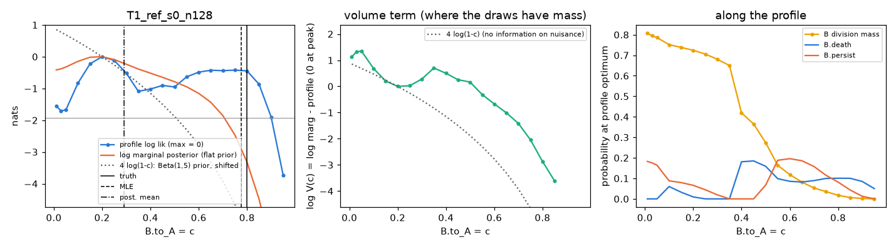
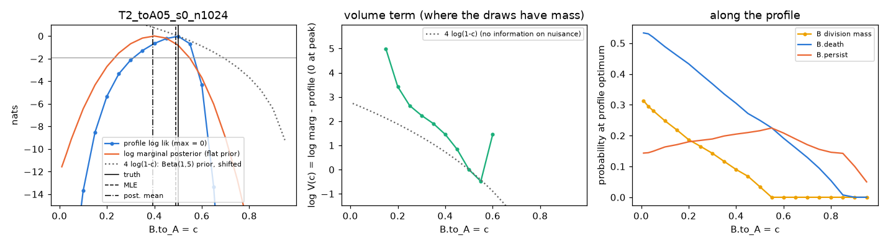
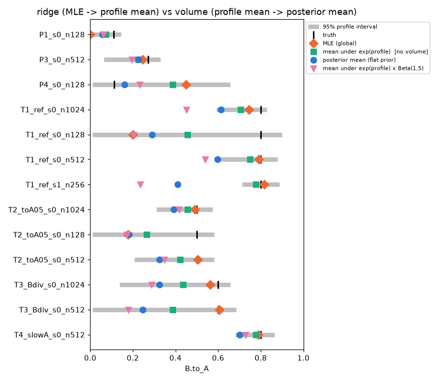
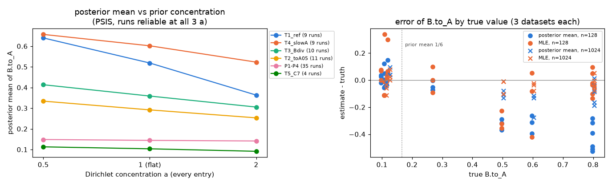

# XG2: why the MLE of B.to_A beats the posterior mean for some truths and not others

Data: `results/exact_gw/data_size` (exact GW likelihood, 10 free probabilities,
generations 4/6/8/10, n = 128...1024 clones per endpoint, flat Dirichlet prior, NUTS).
Read only. Scripts: `scripts/xg2_mle_vs_posterior/`. New likelihood work: about 55 min
on one thread (8 profiles, plus a low-B.to_A branch check and sub-model fits on 37 runs).

## Short answer

The posterior mean of B.to_A is pulled down by about the same amount for every truth
whose B.to_A is far above 1/6, **whether or not that truth sits on the simplex
boundary** (T3_Bdiv is interior and is as biased as T1/T2/T4). Two effects add up:

1. **Flat or two-branch likelihood in B.to_A** (C1, holds at small n). Moving down in
   B.to_A, the lost "switch back to A" mass is replaced by divisions (T1, T3) or by death
   (T2). At n = 128 the profile drops only 1.9 nats from 0.2 to 0.9 (T1) and less
   than 1 nat from 0.05 to 0.5 (T2).
2. **Volume** (C2, holds, but the mechanism is more general than stated). The flat
   Dirichlet prior on B's 6 outcomes makes B.to_A marginally Beta(1, 5), with density
   proportional to (1 - c)^4: about 5.5 nats more at 0.2 than at 0.8. In the likelihood
   this shows up as a volume term log V(c) = log p(c | y) - profile(c). Between 0.2 and
   0.8 it is 2.5 to 3.7 nats larger at the lower value. Over the posterior's support it is
   0.5 to 2 times 4 log(1 - c).
   It does not come from B's three division outcomes as such. It comes from to_A being one
   outcome out of six, so the other five share 1 - c. On the low branch, death absorbs the
   mass just as well as division does (T2).

For truths drawn from the prior (P1-P4, T5, B.to_A 0.10-0.27, near the prior mean 1/6)
the same pull points *toward* the truth, so the mean wins. The MLE also does worse there
for a separate reason: it lands on the B.to_A = 0 boundary in 11 runs (P1 7/12, P4 4/12).

Two more findings that change the picture:

* **The stored MLE is not always the global one, and the miss favours the truth.** For
  T1 n = 128 seed 0, the global maximum is at B.to_A = 0.207 (B divides 0.72). It is
  0.41 nats *above* the stored MLE at 0.776. The 24+6-start L-BFGS-B never reaches it: a
  free optimisation started from the best posterior draw at B.to_A < 0.35 also climbs to
  0.776. Only pinning B.to_A finds the 0.207 optimum. This happens in 2 of 37 runs
  checked (also P3 s0 n128). It is a caveat on the MLE's record at n = 128, not the main
  story.
* **MCMC mis-weights modes in at least one run** (T1 n = 256 seed 1, R-hat 3.75, chain
  means of B.to_A 0.59 / 0.13 / 0.60 / 0.33, mean deficit 8.6 against the 5 expected).
  The volume effect alone already gives the low mode comparable mass there, so the
  mean's error is not *caused* by the sampler. The size of the error in that run is not
  reliable, though.

## C1: is there a flat likelihood ridge in B.to_A?

Profile likelihood of B.to_A on a grid of 21 values (0.01...0.95). At each value c, the
other 9 free probabilities are maximised: the A row, and B's other 5 outcomes sharing
1 - c. Starts: warm starts from the neighbouring grid point in two outward passes, plus
the 2 best posterior draws near c. The gradient is exact, through our own `dP` into
`gw_exact.log_likelihood`, checked against finite differences.
(`profile_runs.py`, `analyse_profiles.py`, `profiles.csv`, `profile_curves.csv`)

| run | truth | global MLE | profile drop 0.2-0.9 (nats) | profile at truth (nats) | 95% profile interval | posterior 95% CrI | posterior mean |
|---|---|---|---|---|---|---|---|
| T1 s0 n128 | 0.80 | **0.21** (0.78 local, -0.41) | 1.9 | -0.45 | [0.01, 0.90] | [0.03, 0.68] | 0.29 |
| T1 s1 n256 | 0.80 | 0.82 | 7.6 | -0.10 | [0.71, 0.89] | [0.02, 0.82] | 0.41 |
| T1 s0 n1024 | 0.80 | 0.74 | 12.2 | -0.66 | [0.59, 0.83] | [0.19, 0.77] | 0.61 |
| T2 s0 n128 | 0.50 | 0.18 | 26.9 (flat < 1 nat on 0.05-0.5) | -0.82 | [0.01, 0.58] | [0.03, 0.39] | 0.18 |
| T2 s0 n1024 | 0.50 | 0.49 | 149 | -0.02 | [0.31, 0.57] | [0.27, 0.50] | 0.39 |
| T3 s0 n1024 | 0.60 | 0.56 | 129 (two branches: 0.25 at -0.65, 0.55) | -0.17 | [0.14, 0.66] | [0.14, 0.57] | 0.33 |
| P1 s0 n128 | 0.11 | 0.00 | 47 | -1.46 | [0.01, 0.15] | [0.00, 0.20] | 0.06 |
| P4 s0 n128 | 0.11 | 0.45 | 16 (flat < 1.6 nats on 0.01-0.6) | -1.53 | [0.01, 0.66] | [0.01, 0.41] | 0.16 |

Verdict: **supported at small n, and sometimes still at n = 1024** (T3: two branches
within 0.65 nats). The ridge has two branches (figures `profile_*.png`, right panel):
"B switches back" (divisions near 0) and "B divides" (division mass 0.6-0.8) on T1/T3,
with a jump in the profile optimum around c = 0.35-0.4. On T2 the low side is "B dies"
instead: at c = 0.05, B.death is 0.52-0.55 and division only 0.24-0.28. So the weak
direction is "switch back" against "any loss of B" (divide or die), not specifically
against division. The 95% profile intervals cover the truth in 13/13 runs (8 original + 5 at n = 512,
added 2026-11-22). The posterior 95% CrI covers it in only 5/13: it misses in T1 s0 n128
(upper 0.68), T1 s0 n512 (0.79), T1 s0 n1024 (0.77), T2 s0 n128 (0.39), T2 s0 n512 (0.48),
T2 s0 n1024 (0.496), T3 s0 n512 (0.56) and T3 s0 n1024 (0.57). (Corrected: this note
previously said 5/8 for the first 8 runs, overlooking T2 n128 and T3 n1024; it is 3/8.)

## C2: peak against average, with volume as the lever

*Premise.* Under the flat prior, the joint density in physical coordinates is
proportional to the likelihood, so the joint mode is the MLE. This holds. The posterior
also explores that peak: the best of 2000 draws is 0.4-1.4 nats below the global
maximum. The draws' deficit (max LL - LL) has mean 4.4-5.9, against 5 for Gamma(d/2 = 5),
and 2-10% of draws fall beyond the Gamma 95% quantile (`deficit_*.png`). The exception
is T1 s1 n256: mean 8.6, 42% beyond, which is the mis-mixed run.

*Decomposition.* Start from the global MLE. Moving from the MLE to the mean under
exp(profile) is the effect of averaging over the ridge with no volume. Moving from there
to the posterior mean is the volume effect. A reference curve weights exp(profile) by
Beta(1,5), the prior marginal of B.to_A, and so assumes nothing is learnt about the
nuisance.

| run | global MLE | mean, exp(profile) | posterior mean | exp(profile) x Beta(1,5) | log V(0.2) - log V(0.8) |
|---|---|---|---|---|---|
| T1 s0 n128 | 0.21 | 0.46 | 0.29 | 0.20 | 2.9 |
| T1 s1 n256 | 0.82 | 0.78 | 0.41 | 0.23 | 3.7 |
| T1 s0 n1024 | 0.74 | 0.71 | 0.61 | 0.45 | 2.5 |
| T2 s0 n128 | 0.18 | 0.27 | 0.18 | 0.17 | (0.2-0.55: 3.8) |
| T2 s0 n1024 | 0.49 | 0.46 | 0.39 | 0.42 | (0.2-0.5: 3.4) |
| T3 s0 n1024 | 0.56 | 0.44 | 0.33 | 0.29 | (0.25-0.55: 1.9) |
| P1 s0 n128 | 0.00 | 0.07 | 0.06 | 0.06 | n/a |
| P4 s0 n128 | 0.45 | 0.39 | 0.16 | 0.23 | (0.1-0.45: 4.0) |

Verdict: **supported in direction and size.** In every run with posterior mass above
0.3, the volume term moves the mean down, by 0.06-0.37. It is the larger move in 4 of 7
runs and about equal in the others: ridge against volume is 0.25 against 0.17 for T1 s0
n128, 0.09 against 0.08 for T2 n128, and 0.12 against 0.11 for T3. The ridge move goes
either way, because the MLE can sit on either branch. The volume move always goes down.
log V across the posterior's support is 2-4 nats. Between 0.2 and 0.8 that is about half
of 4 log(1 - c) (2.5-3.7 against 5.5 nats) for T1. Over the shorter spans of T2, T3 and P4
it is 1-2 times 4 log(1 - c) (`profile_*.png`, middle panel). So the data fix B's
remaining mass 1 - c only weakly in absolute terms, and the prior's "1 of 6 outcomes"
geometry largely passes through to the marginal. At high c, where the divisions are
pinned at 0, log V falls faster, so boundary truncation adds to it. Two corrections to
the claim as stated:

* It is not about B having *three division* outcomes. Any of the five other outcomes
  absorbs the volume (death on T2).
* "The peak is the MLE" holds for the joint density only. The *marginal* posterior mode
  of B.to_A is not the MLE: the KDE mode is a worse summary than the mean. Mean |error|
  over all runs: 0.289 against 0.259 for T1, 0.081 against 0.045 for P1.

*Prior concentration* (PSIS-reweighted, reliable rows only; `prior_alpha.csv`). Under a
symmetric Dir(a), B.to_A is marginally Beta(a, 5a). Its log density at 0.2 against 0.8
differs by 2.8 / 5.5 / 11.1 nats for a = 0.5 / 1 / 2, so the volume argument predicts
that the mean rises as a falls. Observed change of the posterior mean against flat:

| truth | a = 0.5 | a = 2 | runs ordered mean(0.5) >= mean(1) >= mean(2) |
|---|---|---|---|
| T1_ref | +0.121 | -0.157 | 9/9 |
| T4_slowA | +0.054 | -0.079 | 9/9 |
| T3_Bdiv | +0.055 | -0.049 | 10/10 |
| T2_toA05 | +0.042 | -0.041 | 11/11 |
| P1-P4 | -0.008...+0.019 | -0.024...+0.006 | 16/33 |

The direction is consistent with the volume argument for every high-B.to_A truth and is
null for prior-typical ones. The sparse (0.2) and central (5) priors are mostly
unreliable under PSIS (Pareto k > 0.7; 11% and 26% reliable) and are not used.

## C3: boundary truths make it worse; for interior truths, averaging beats a jumpy MLE

Point summaries of B.to_A against the truth, mean |error| over 3 datasets x 4 n
(`summaries.py`, `summaries.csv`; stored MLE):

| truth (B.to_A) | posterior mean | median | KDE mode | stored MLE | bias of mean |
|---|---|---|---|---|---|
| T1_ref (0.8, B div = 0) | 0.259 | 0.264 | 0.289 | 0.045 | -0.257 |
| T4_slowA (0.8, B div = 0) | 0.197 | 0.190 | 0.200 | 0.047 | -0.197 |
| T2_toA05 (0.5, B div = 0) | 0.205 | 0.207 | 0.210 | 0.129 | -0.205 |
| **T3_Bdiv (0.6, interior)** | **0.264** | 0.268 | 0.279 | 0.156 | **-0.264** |
| P1 (0.11) | 0.045 | 0.047 | 0.081 | 0.092 | +0.003 |
| P2 (0.12) | 0.080 | 0.077 | 0.076 | 0.067 | +0.080 |
| P3 (0.27) | 0.055 | 0.054 | 0.056 | 0.054 | -0.055 |
| P4 (0.11) | 0.040 | 0.041 | 0.077 | 0.073 | -0.015 |
| T5_C7 (0.10, 6 runs) | 0.025 | 0.026 | 0.042 | 0.032 | 0.000 |

Verdict: **not supported as stated.**

* T3_Bdiv has every B entry interior, and its mean is as biased as T1's (-0.264 against
  -0.257). The variable that orders the bias is the true B.to_A relative to the prior
  mass, not the boundary (figure above, right panel). The boundary does play a smaller
  role. Along the profile, the high-B.to_A side has its divisions pinned at 0 (3 active
  bounds on T2 n1024 from c >= 0.55), and log V falls faster there than 4 log(1 - c)
  (T2 n1024: 3.4 nats from 0.2 to 0.5, where the prior marginal gives 1.9).
* For P truths the boundary that matters is B.to_A = 0, and it hurts the *MLE*: 10 runs
  have MLE B.to_A < 1e-3 (P1 7/12, P4 4/12). The MLE also jumps across n on nested data
  (P4 s0: 0.45, 0.00, 0.00, 0.12; T3 s0: 0.18, 0.00, 0.59, 0.56). The posterior mean
  moves smoothly. This part of C3 survives. In 77% of runs, the stored multistart's
  second-best end point is within 0.1 nats of the best. Most of these are starts that
  stalled at different places on the same flat ridge rather than separate optima. The
  P4 s0 n128 profile stays within 1.6 nats over 0.01-0.6.
* The posterior mean being good for P truths is also expected by design. These truths
  are draws from the same flat prior, and the posterior mean minimises the
  prior-averaged squared error.

## Is the stored MLE global? (`low_branch.py`, `mle_global.py`, `mle_global.csv`)

For each run (T1-T4 at n = 128 and 256, one T1 run at n = 512, P1-P4 at n = 128; 37 runs),
150 posterior draws are evaluated. Then (a) a free L-BFGS-B, with tight tolerances, starts
from the best draw with B.to_A < 0.35, and (b) B.to_A is pinned at 0.1 / 0.2 / 0.3 and the
rest maximised from the 2 best nearby draws, after which the pin is released.

* A better optimum on the low branch exists in **2 of 37 runs**: T1 s0 n128 (+0.41 nats,
  B.to_A 0.207 instead of 0.776) and P3 s0 n128 (+0.27 nats, 0.097 instead of 0.371). In
  both, the free start from a low draw climbs back to the stored optimum. Only the pinned
  route finds the better one. So a multistart in stick coordinates is biased toward the
  "switch back" basin.
* Elsewhere the stored MLE is global, to within 1e-4 nats. The MLE's small error on T1/T4
  is real in the other 6/7 and 6/6 runs checked. With the corrected MLE, the T1 n = 128
  error rises from 0.056 to 0.245 (3 seeds), so at n = 128 even the MLE is not reliable
  for T1.

## Other explanations checked

* **MCMC failure**: not the cause. The bias is present in all 12 T1 runs, including
  those with R-hat < 1.02. 9 runs have R-hat > 1.05 or chain-mean spread > 0.1 (T1 s1
  n256 R-hat 3.75, T1 s0 n1024 1.31, P2 s1 n512 1.85, ...). There the mode weights are
  unreliable and the mean's error is inflated or deflated by chance.
* **Coordinates**: NUTS runs in logit-stick space with the Jacobian included, so the
  target is the flat-Dirichlet posterior. The stick order (B: death, to_A, persist,
  div_AA, div_AB, div_BB) has no effect on the posterior. It does affect the optimiser's
  basins, which is how the T1 s0 n128 global optimum was missed.
* **Detection conditioning** (`selection: detected`) is part of the exact likelihood and
  is the same for every summary. I found no sign that it drives the difference; not
  tested separately.
* **Multistart MLE luck**: see the previous section. In 2 of 37 runs the optimiser's
  preference for the switch-back basin makes the stored MLE look better than the true
  MLE. Otherwise the MLE's record is real.

## What to report, and what fixes the bias

* **Summary**: for B.to_A under the flat prior, neither the mean nor the MLE is safe
  alone. Report the **profile-likelihood interval** next to the posterior interval:
  the profile interval covered the truth in 13/13 profiled runs, the CrI in 5/13. When the two disagree, the result depends on the prior.
  The median behaves like the mean. The marginal KDE mode is worse than both. If a point
  estimate is needed for prior-typical truths, the posterior mean is better. For a
  high-B.to_A truth, a global MLE is better, provided it really is global (profile or
  pinned starts, not plain multistart). Better still is the MLE of the model chosen by
  the "B never divides" test (below).
* **More data** fixes the bias slowly. The mean's |error| for n = 128 / 256 / 512 / 1024
  is 0.44 / 0.35 / 0.12 / 0.12 for T1, 0.40 / 0.24 / 0.08 / 0.07 for T4 and
  0.32 / 0.30 / 0.26 / 0.17 for T3. At n = 1024 the volume
  still moves the mean by 0.06-0.1 (T1, T2, T3 s0).
* **A different prior** moves the mean as the volume argument predicts (table above).
  But any symmetric Dirichlet puts B.to_A's prior mean at 1/6. Choosing a < 1 to help
  T1 is tuning to the truth. A prior that is flat on B.to_A, e.g. Beta(1,1) on to_A with
  a Dirichlet for the rest, would remove the 4 log(1 - c) term. That is a modelling
  decision, not a fix.
* **Model comparison with B divisions fixed to 0** works well where it applies. The likelihood-ratio test of "B never divides" (B.div_* = 0)
  against the full model uses a chi-bar-squared(3) reference with weights 1/8, 3/8, 3/8,
  1/8. At 5% it gives the right answer in **37/37 runs**: kept in all 19 runs of T1/T2/T4
  (n = 128, 256, plus T1 at 512), rejected in all 18 runs of T3 (n = 128, 256) and P1-P4
  (n = 128). Reporting the sub-model's B.to_A when it is kept, and the global MLE
  otherwise, gives mean |error| 0.050 (T1), 0.060 (T2), 0.023 (T4). The posterior mean
  gives 0.369 / 0.283 / 0.320 on the same runs. For T3 and P this is the full MLE: 0.246
  for T3 (mean 0.309), 0.09-0.15 for P (mean 0.04-0.09). So model comparison removes the
  bias for truths without B divisions. For truths with divisions, the problem is the
  ridge plus volume itself, and only more data (or an informative prior on B.to_A) helps.
  At n = 1024 the T3 s0 likelihood still has two branches 0.65 nats apart.

## Files

* `README.md` (this note); `summaries.csv`; `profiles.csv`; `profile_curves.csv`;
  `prior_alpha.csv`; `low_branch.csv`; `mle_global.csv`; `profiles/*.npz` (per-run
  draws' log likelihood, profile, sub-model fit).
* Figures: `figures/decomposition.png`, `figures/prior_alpha_and_bias.png`,
  `figures/profile_<run>.png` (8), `figures/deficit_<run>.png` (8).
* Scripts (`scripts/xg2_mle_vs_posterior/`): `common.py` (SubModel: exact likelihood
  with pinned entries and exact gradient), `check_submodel.py`, `profile_runs.py`,
  `analyse_profiles.py`, `summaries.py`, `prior_and_bias.py`, `low_branch.py`,
  `mle_global.py`.
